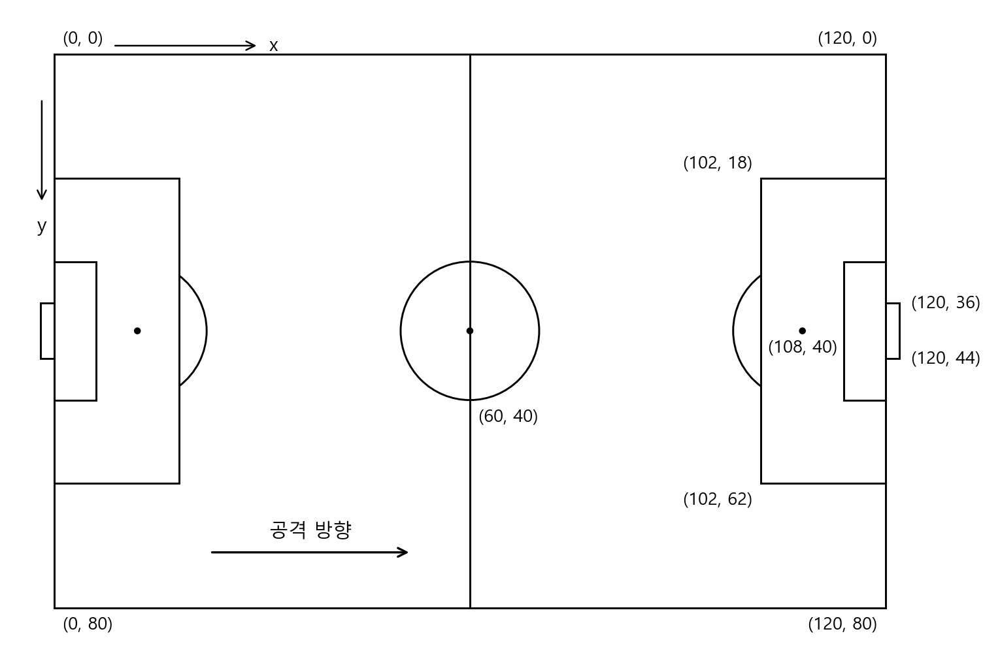
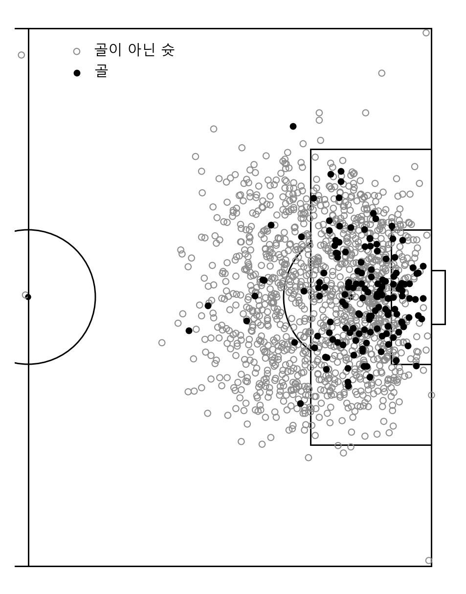
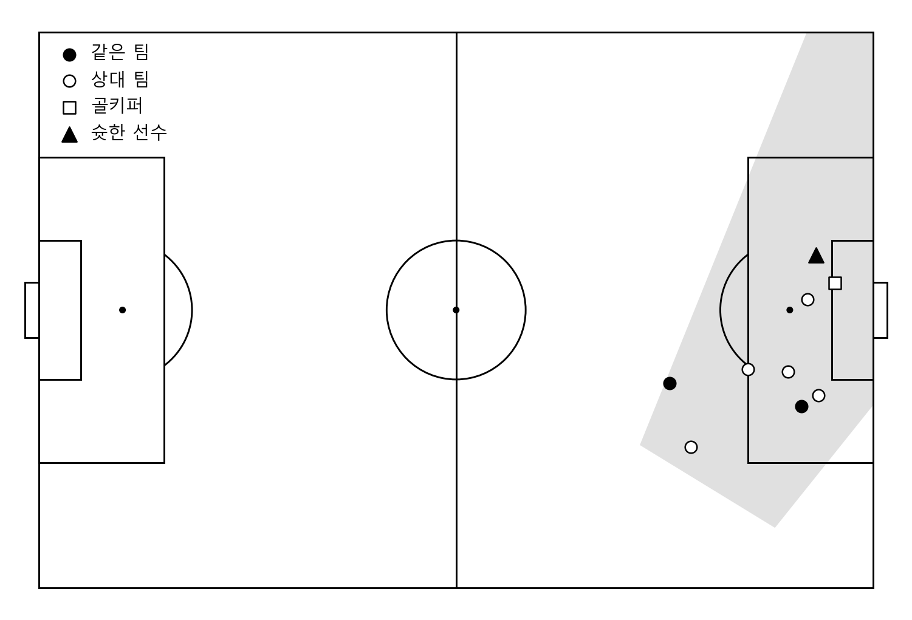

# 데이터 1장. 데이터와 좌표 — 영상은 어떻게 표가 되는가


- [I. 영상에서 표까지](#i-영상에서-표까지)
- [II. 사건 표](#ii-사건-표)
- [III. 좌표](#iii-좌표)
- [IV. 프리즈 프레임](#iv-프리즈-프레임)
- [V. 기록의 일관성과 신뢰도](#v-기록의-일관성과-신뢰도)
- [VI. 정리: 뒤 장을 위한 결론](#vi-정리-뒤-장을-위한-결론)
- [참고문헌](#참고문헌)

> 데이터: StatsBomb 공개 데이터(<https://github.com/statsbomb/open-data>). 이용 약관에 따라 데이터는 이 저장소에 싣지 않는다.

이 장은 뒤의 모든 장이 쓰는 데이터를 다룬다. 2022년 카타르 월드컵의 경기 영상에서 무엇을 어떻게 기록했는지, 그 기록이 어떤 표가 되는지, 좌표를 어떻게 해석하는지를 본다. 데이터를 설명하는 장이지만 방법이 넷 들어 있다. 첫째는 여러 겹으로 겹친 기록을 분석용 표로 펴는 법(정돈된 표, 열쇠, 분석 단위), 둘째는 좌표를 다루는 법(반전, 단위의 환산, 거리와 각도), 셋째는 화면에 잡히지 않은 선수를 결측으로 다루는 법(보인 영역, 결측의 기제), 넷째는 사람이 기록한 값의 오차를 점검하는 법(해상도, 끝자리 선호, 내적 일관성, 관측자 간 일치도)이다. 넷 모두 뒤 장의 모형이 무엇을 관측값으로 삼는지를 정한다.

데이터는 StatsBomb 공개 데이터 가운데 2022년 남자 월드컵의 경기 파일(`matches`), 사건 파일(`events`), 프리즈 프레임 파일(`three-sixty`)이다. 받는 스크립트는 `scripts/fetch_statsbomb.py`이고, 읽는 함수는 `sportsdata/statsbomb.py`에 있다. 파일의 형식은 StatsBomb의 명세서 두 편(StatsBomb, 2019; StatsBomb, 2021)을 따랐다.

## I. 영상에서 표까지

### 1. 경기를 기록하는 세 가지 방식

축구 경기의 데이터는 기록하는 대상에 따라 셋으로 나뉜다. 사건 데이터(event data)는 공에 일어난 일을 기록한다. 패스, 슛, 태클 같은 사건마다 언제, 어디서, 누가 했고 결과가 무엇이었는지를 한 행으로 적는다. 훈련된 기록원이 경기 영상을 보면서 입력하는 것이 일반적이며, 공개된 사건 데이터의 수집 절차는 Pappalardo et al. (2019)에 자세히 적혀 있다. 추적 데이터(tracking data)는 선수 22명과 공의 위치를 초당 수십 번 기록한다. 경기장에 설치한 전용 카메라나 중계 영상에서 컴퓨터 비전으로 위치를 추출한다. 자세 데이터는 선수의 관절 위치까지 기록한다. 사건 데이터는 공을 가진 선수만 알려 주고 나머지 21명이 어디 있었는지는 알려 주지 않는다. 추적 데이터는 모든 선수의 위치를 알려 주지만 그 순간에 무슨 일이 일어났는지는 따로 적혀 있지 않다.

이 장의 데이터는 사건 데이터와 그 중간 형식 하나다. StatsBomb은 사건마다 그 순간의 중계 화면에 잡힌 선수들의 위치를 함께 기록해 360 데이터라는 이름으로 낸다. 화면 한 장면을 멈춰 선수의 위치를 찍은 것이어서 프리즈 프레임(freeze frame)이라 부른다. 사건 데이터에 없는 다른 선수의 위치가 들어 있지만, 연속된 궤적이 아니라 사건 순간의 한 장면이고 화면에 잡힌 선수만 들어 있다. 추적 데이터는 운동학 1장에서 다룬다.

### 2. 대회와 파일

2022년 월드컵은 2022-11-20부터 2022-12-18까지 32개 나라가 64경기를 치렀다. 조별 리그는 4개 나라씩 8개 조가 조 안에서 한 번씩 만나 48경기이고, 조 1위와 2위가 올라가는 16강부터는 지면 탈락한다. 16강부터는 90분에 승부가 나지 않으면 연장전 30분을 하고, 그래도 같으면 승부차기를 한다.

표 1은 대회의 단계별로 경기와 사건의 수를 센 것이다. 사건은 사건 파일의 한 항목이고, 프리즈 프레임이 있는 사건은 그 사건의 ID가 프리즈 프레임 파일에도 있는 것이다. 마지막 열은 경기 하나의 평균 사건 수다.

**표 1. 대회 단계별 경기와 사건**

| 단계       | 경기 |    사건 | 프리즈 프레임이 있는 사건 | 경기당 사건 |
|:-----------|-----:|--------:|--------------------------:|------------:|
| 조별 리그  |   48 | 171,208 |                   149,386 |       3,567 |
| 16강       |    8 |  31,632 |                    27,649 |       3,954 |
| 8강        |    4 |  16,473 |                    14,028 |       4,118 |
| 4강        |    2 |   7,357 |                     6,053 |       3,678 |
| 3위 결정전 |    1 |   3,560 |                     3,083 |       3,560 |
| 결승       |    1 |   4,407 |                     3,683 |       4,407 |
| 전체       |   64 | 234,637 |                   203,882 |       3,666 |

표 1에서 경기 하나는 평균 3,666개의 사건으로 기록되어 있고, 가장 적은 경기가 2,827개, 가장 많은 경기가 5,145개다. 16강 이후의 경기는 평균 3,964개로 조별 리그의 3,567개보다 많은데, 연장전까지 간 경기가 들어 있기 때문이다. 사건 234,637개 가운데 87%에 프리즈 프레임이 있다. 경기가 64개뿐이라는 점은 이 책 전체의 조건이다. 사건을 단위로 하는 분석은 표본이 수만에서 수십만이지만, 경기나 팀을 단위로 하는 분석은 표본이 64개와 32개다.

## II. 사건 표

### 1. 겹친 기록을 표로 편다

사건 파일은 JSON 형식이고 경기 하나에 파일 하나다. 파일은 사건의 목록이고, 사건 하나는 항목 이름과 값의 묶음이다. 값이 다시 묶음이거나 목록일 수 있어 기록이 여러 겹으로 겹친다. 다음은 결승전의 사건 하나를 파일에 적힌 그대로 옮긴 것이다.

``` json
{
 "id": "109a67e0-3ade-46b0-bcb0-1f6920a52dde",
 "index": 709,
 "period": 1,
 "timestamp": "00:20:01.713",
 "minute": 20,
 "second": 1,
 "type": {
  "id": 30,
  "name": "Pass"
 },
 "possession": 31,
 "possession_team": {
  "id": 779,
  "name": "Argentina"
 },
 "play_pattern": {
  "id": 3,
  "name": "From Free Kick"
 },
 "team": {
  "id": 779,
  "name": "Argentina"
 },
 "player": {
  "id": 3090,
  "name": "Nicolás Hernán Otamendi"
 },
 "position": {
  "id": 5,
  "name": "Left Center Back"
 },
 "location": [
  48.4,
  14.7
 ],
 "duration": 1.49362,
 "related_events": [
  "6799e533-c3e6-4afc-8da0-a8b28587cd84"
 ],
 "pass": {
  "recipient": {
   "id": 20572,
   "name": "Cristian Gabriel Romero"
  },
  "length": 27.01481,
  "angle": 1.9183023,
  "height": {
   "id": 1,
   "name": "Ground Pass"
  },
  "end_location": [
   39.2,
   40.1
  ],
  "body_part": {
   "id": 40,
   "name": "Right Foot"
  }
 }
}
```

이 기록에서 `type`, `team`, `player`, `position`은 ID와 이름의 묶음이고, `location`은 좌표 두 개의 목록이며, `pass`는 패스에만 있는 항목들의 묶음이다. `pass` 안의 `recipient`는 다시 묶음이다. 통계 분석은 행이 관측이고 열이 변수인 표를 요구하므로, 이 기록을 표로 바꾸어야 한다. Wickham (2014)은 그 기준을 정돈된 표(tidy data)라는 이름으로 정리했다. 변수 하나가 열 하나, 관측 하나가 행 하나, 관측 단위의 종류 하나가 표 하나라는 세 조건이다.

세 조건을 사건 파일에 적용하면 다음과 같다. 묶음은 안쪽 이름을 바깥 이름에 밑줄로 이어 열로 편다. `pass` 안의 `recipient` 안의 `name`은 `pass_recipient_name` 열이 된다. 길이가 정해진 목록인 `location`은 `x`와 `y` 두 열로 나눈다. 길이가 정해지지 않은 목록은 열로 펼 수 없으므로 다른 표로 내보낸다. 슛에 딸린 선수 위치의 목록이나 프리즈 프레임이 여기 해당하며, 그 표는 선수 한 명이 한 행이고 사건의 ID를 열쇠(key)로 사건 표와 이어진다. 관측 단위가 사건에서 선수 위치로 바뀌었으므로 표를 따로 두는 것이 셋째 조건에 맞는다.

이렇게 편 사건 표는 234,637행, 143열이다. 열의 대부분은 특정한 유형의 사건에만 값이 있다. `pass_`로 시작하는 열은 패스에만, `shot_`으로 시작하는 열은 슛에만 값이 있고 나머지 행에서는 비어 있다. 표 전체에서 비어 있는 값의 비율은 81%다. 이 빈 값은 측정하지 못한 결측이 아니라 해당 사항이 없다는 뜻이다. 두 가지를 구분하지 않고 결측 처리 함수에 넘기면 안 된다. 분석할 때는 사건의 유형으로 행을 먼저 고르고, 그 유형에 해당하는 열만 쓴다.

### 2. 사건의 유형

표 2는 사건을 유형별로 센 것이다. 수가 많은 10개 유형과 슛을 따로 적고 나머지를 한 행으로 모았다. 위치 열은 그 유형의 사건에 좌표가 있는지를, 프레임 열은 프리즈 프레임이 있는 사건의 비율을 나타낸다.

**표 2. 사건의 유형**

| 유형 | 내용 | 사건 | 비율(%) | 위치 | 프레임(%) |
|:---|:---|---:|---:|:---|---:|
| Pass | 패스 | 68,515 | 29.2 | 있음 | 84 |
| Ball Receipt\* | 패스를 받음(받지 못한 것도 포함) | 63,699 | 27.1 | 있음 | 90 |
| Carry | 공을 가지고 이동 | 53,764 | 22.9 | 있음 | 92 |
| Pressure | 공을 가진 상대를 압박 | 16,554 | 7.1 | 있음 | 88 |
| Ball Recovery | 주인 없는 공을 차지 | 5,821 | 2.5 | 있음 | 89 |
| Duel | 상대와의 경합 | 4,389 | 1.9 | 있음 | 86 |
| Clearance | 공을 걷어 냄 | 2,684 | 1.1 | 있음 | 92 |
| Block | 공의 진로를 막음 | 2,386 | 1.0 | 있음 | 88 |
| Dribble | 상대를 제치려는 시도 | 1,793 | 0.8 | 있음 | 82 |
| Goal Keeper | 골키퍼의 동작 | 1,790 | 0.8 | 있음 | 43 |
| Shot | 슛 | 1,494 | 0.6 | 있음 | 97 |
| 그 밖의 22개 유형 |  | 11,748 | 5.0 | 섞여 있음 | 69 |

표 2에서 사건의 유형은 모두 33개이고, 패스와 패스를 받는 사건, 공을 가지고 이동하는 사건의 세 유형이 전체의 79%다. 사건 데이터의 대부분은 공이 선수에서 선수로 옮겨 가는 과정의 기록이다. 슛은 1,494개로 전체의 0.6%에 지나지 않는다. 득점을 직접 다루는 분석(회귀 1장과 2장)은 표본이 작고, 패스와 이동을 다루는 분석(연쇄 1장과 2장)은 표본이 크다. 좌표가 없는 유형은 9개로, 전반 시작과 종료, 교체, 전술 변경, 부상으로 인한 중단처럼 경기장의 한 지점에서 일어났다고 할 수 없는 사건이다.

수가 둘째와 셋째로 많은 `Ball Receipt*`와 `Carry`는 기록원이 따로 관측해 입력한 사건이 아니라 앞뒤의 사건에서 만들어 낸 사건으로 보인다. 이 점은 V.1절에서 데이터로 점검한다. `Pressure`는 공을 가진 상대에게 다가가 압박한 것을 기록한 사건으로, 공에 닿지 않아도 기록되는 드문 유형이다.

### 3. 시간

사건의 시각은 세 열로 적혀 있다. `period`는 경기의 구간으로 1이 전반, 2가 후반, 3과 4가 연장 전반과 후반, 5가 승부차기다. `timestamp`는 그 구간이 시작된 뒤 흐른 시간을 1,000분의 1초까지 적은 것이고 구간마다 0에서 다시 시작한다. `minute`와 `second`는 중계 화면의 시계에 해당하며, 후반은 45분, 연장 전반은 90분에서 시작한다.

표 3은 구간별로 그 구간이 있었던 경기의 수, 사건의 수, 구간의 평균 길이와 가장 긴 길이를 적은 것이다. 구간의 길이는 그 구간의 마지막 사건의 `timestamp`다.

**표 3. 구간별 경기, 사건, 구간의 길이**

| 구간        | 경기 |    사건 | 평균 길이(분) | 가장 긴 길이(분) |
|:------------|-----:|--------:|--------------:|-----------------:|
| 1 전반      |   64 | 116,337 |          49.0 |             59.1 |
| 2 후반      |   64 | 112,708 |          52.4 |             58.8 |
| 3 연장 전반 |    5 |   2,885 |          16.6 |             18.1 |
| 4 연장 후반 |    5 |   2,601 |          17.3 |             19.1 |
| 5 승부차기  |    5 |     106 |           5.9 |              7.8 |

표 3에서 전반은 평균 49.0분, 후반은 평균 52.4분으로 규정의 45분보다 길다. 추가 시간이 붙기 때문이다. 연장전까지 간 경기는 5개이고 모두 승부차기까지 갔다. 전반이 45분을 넘기 때문에 `minute`만으로는 시각을 정할 수 없다. 전반의 추가 시간에 일어난 사건 8,728개는 `minute`가 45 이상이어서 후반 초반의 사건과 값이 겹친다. 사건의 순서와 시각은 `period`와 `timestamp`의 쌍으로 정하고, 경기 안의 순서만 필요하면 사건의 일련번호인 `index`를 쓴다. 승부차기의 슛은 경기 중의 슛과 성격이 다르므로 이 책의 분석은 `period`가 4 이하인 사건만 쓴다.

### 4. 분석 단위

사건 표의 한 행은 사건이지만, 사건은 여러 단위에 겹쳐 속해 있다. 사건은 한 선수가 한 것이고, 그 선수는 한 팀에 속하며, 그 팀은 한 경기를 치른다. 이 사이에 점유(possession)라는 단위가 하나 더 있다. 점유는 한 팀이 공을 계속 가지고 있는 동안의 사건의 묶음으로, 사건 표의 `possession` 열이 경기 안에서 몇 번째 점유인지를 나타낸다. 상대가 공을 빼앗으면 번호가 바뀌고, 공이 경기장 밖으로 나갔다가 같은 팀의 스로인으로 경기가 다시 시작되어도 번호가 바뀐다(StatsBomb, 2019).

표 4는 단위별 개수다. 팀·경기는 한 팀의 한 경기이고, 선수·경기는 한 선수의 한 경기 출전이다. 선수·경기는 사건을 하나라도 기록한 선수만 세었다. 마지막 열은 그 단위 하나에 속한 사건의 평균 수다.

**표 4. 분석 단위별 개수 (승부차기 제외)**

| 단위      |    개수 | 단위 하나의 평균 사건 수 |
|:----------|--------:|-------------------------:|
| 경기      |      64 |                  3,664.5 |
| 팀        |      32 |                  7,329.1 |
| 선수      |     680 |                    344.9 |
| 팀·경기   |     128 |                  1,832.3 |
| 선수·경기 |   1,996 |                    117.5 |
| 점유      |  11,080 |                     21.2 |
| 사건      | 234,531 |                      1.0 |

표 4에서 점유는 11,080개이고 하나가 평균 21.2개의 사건으로 되어 있다. 선수는 680명이며 선수마다 기록된 사건의 수는 크게 다르다. 중위값이 265개이고 가장 많은 선수가 1,906개다. 탈락한 팀의 선수는 3경기만 뛰었고 결승에 오른 팀의 선수는 7경기를 뛰었기 때문이다.

분석 단위는 질문이 정한다. 슛 하나가 골이 될 확률을 물으면 슛이 단위이고(회귀 1장), 한 팀이 한 경기에서 넣는 골의 수를 물으면 팀·경기가 단위다(회귀 2장). 점유가 골로 끝날 확률을 물으면 점유가 단위다(연쇄 1장). 어느 단위를 택하든 그 아래의 관측은 서로 독립이 아니다. 같은 선수의 패스는 그 선수의 기량을 공유하고, 같은 경기의 사건은 그 경기의 상대와 점수 상황을 공유한다. 사건 23만여 개를 독립인 관측 23만여 개로 다루면 표준오차가 지나치게 작게 나온다. 다층 모형 1장이 이 의존을 다룬다.

## III. 좌표

### 1. 좌표계

사건의 위치는 가로 120, 세로 80의 좌표로 적혀 있다. 그림 1은 명세서의 좌표계를 그린 것이다. 원점 $(0, 0)$은 왼쪽 위 모서리이고 $x$는 오른쪽으로, $y$는 아래쪽으로 커진다. 골대는 $x = 0$과 $x = 120$의 골라인에서 $y$가 36과 44 사이이고, 페널티 구역은 골라인에서 18까지, $y$가 18과 62 사이다. 페널티 마크는 $(12, 40)$과 $(108, 40)$, 경기장의 중심은 $(60, 40)$이다.



그림 1에서 주의할 점은 $y$축의 방향이다. 수학의 좌표평면과 반대로 $y$가 아래로 커진다. 화면의 화소를 세는 방식을 따랐기 때문이며, 영상에서 온 좌표는 대개 이렇다. 그림을 그릴 때 $y$축의 방향을 반대로 두지 않으면 경기장의 좌우가 바뀐 그림이 나온다. 이 책의 경기장 그림은 모두 `sportsdata/pitch.py`의 `draw_pitch`가 $y$축을 아래로 커지게 두고 그린다.

### 2. 공격 방향과 반전

실제 경기에서 두 팀은 서로 반대 방향으로 공격하고 전반과 후반에 방향을 바꾼다. 사건 데이터는 이것을 그대로 적지 않는다. 사건을 한 팀이 언제나 $x$가 커지는 쪽으로 공격하도록 좌표를 정규화해 둔다. 어느 팀의 어느 구간의 사건이든 자기 골대는 $x = 0$에, 상대 골대는 $x = 120$에 있다. 이 방식에서는 슛의 위치를 팀과 구간에 관계없이 바로 비교할 수 있다.

표 5는 이 규칙을 데이터로 확인한 것이다. 규칙이 맞다면 골키퍼의 동작은 $x$가 0에 가깝고, 슛은 $x$가 120에 가까워야 한다. 또 $y$가 아래로 커지므로 공격 방향을 바라볼 때 왼쪽이 $y$가 작은 쪽이어서, 왼쪽 수비수의 사건은 $y$가 작고 오른쪽 수비수의 사건은 $y$가 커야 한다. 평균과 함께 팀·경기별 평균의 최솟값과 최댓값을 적었다. 규칙이 한 경기에서라도 어긋나면 그 범위가 경기장의 반대쪽에 걸친다.

**표 5. 공격 방향과 좌우의 확인**

| 사건 | 좌표 | 사건 수 | 평균 | 팀·경기 평균의 최소 | 팀·경기 평균의 최대 |
|:---|:---|---:|---:|---:|---:|
| 골키퍼의 동작 | x | 1,749 | 3.5 | 1.4 | 15.2 |
| 슛 | x | 1,453 | 104.5 | 95.2 | 111.0 |
| 왼쪽 수비수의 모든 사건 | y | 17,531 | 11.4 | 7.1 | 21.6 |
| 오른쪽 수비수의 모든 사건 | y | 17,548 | 68.3 | 55.1 | 73.6 |

표 5에서 네 행 모두 팀·경기별 평균의 범위가 경기장의 한쪽에만 있다. 골키퍼의 동작은 어느 팀의 어느 경기에서나 평균 $x$가 15.2 이하이고, 왼쪽 수비수는 평균 $y$가 40보다 작으며 오른쪽 수비수는 40보다 크다. 좌표는 팀마다 자기 공격 방향을 기준으로 적혀 있다.

이 정규화의 대가는 두 팀의 좌표가 서로 다른 기준을 쓴다는 것이다. 같은 지점이 두 팀의 좌표로는 다르게 적힌다. 두 팀의 사건을 한 경기장에 함께 놓으려면 한 팀의 좌표를 경기장의 중심에 대해 반전한다.

$$x' = 120 - x, \qquad y' = 80 - y$$

$x$만 반전하면 안 된다. 방향을 돌려 바라보면 좌우도 바뀌기 때문이다. 반칙으로 확인할 수 있다. 반칙은 반칙한 선수의 사건(`Foul Committed`)과 반칙당한 선수의 사건(`Foul Won`)으로 두 번 기록되고, 두 사건은 서로를 `related_events`로 가리킨다. 두 사건은 같은 자리에서 일어났으므로 같은 지점이어야 한다. 짝이 맞는 반칙 1,693쌍에서 두 좌표 사이의 거리는 그대로 계산하면 중위값이 66.2이고, 한쪽을 반전한 뒤 계산하면 중위값이 0.14이다. 반전한 뒤의 거리가 1 이하인 쌍은 100.0%다.

### 3. 단위와 실제 길이

명세서는 좌표의 단위를 따로 정의하지 않는다. 다만 역습을 정의하는 대목에서 거리를 야드로 적고 있고(StatsBomb, 2019), 그림 1의 선의 위치도 같은 것을 말한다. 경기 규칙은 경기장의 선을 야드에서 온 길이로 정한다(IFAB, 2022). 페널티 구역은 골대 기둥에서 양옆으로 16.5m, 골라인에서 16.5m이고 이것은 18야드다. 페널티 마크는 골라인에서 11m로 12야드, 골대의 너비는 7.32m로 8야드, 중앙 원의 반지름은 9.15m로 10야드다. 좌표계에서 이 값들은 18, 12, 8, 10이다. 좌표의 1단위는 선을 기준으로 1야드(0.9144m)다. 데이터도 이 해석과 맞는다. 경기 중의 페널티킥 23개의 위치는 평균 $x$가 108.0, 평균 $y$가 40.0이고, 킥오프 307개의 $x$는 60.0에서 61.0 사이다. 기록원은 사건의 위치를 경기장의 선에 맞추어 입력한다.

그런데 경기장 전체의 크기는 야드로 맞지 않는다. 좌표계의 경기장은 120야드와 80야드, 즉 109.7m와 73.2m다. 경기 규칙은 국제 경기의 경기장을 길이 100\~110m, 너비 64\~75m로 정하고(IFAB, 2022), 이 대회의 경기장은 모두 105m와 68m였다. 야드로는 114.8과 74.4다. 좌표계의 경기장이 실제보다 길이로 4.5%, 너비로 7.6% 크다. 선의 위치와 경기장의 크기를 모두 실제와 맞추는 1차식은 없으므로, 기록된 좌표는 경기장의 어느 부분에서는 실제 길이와 어긋난다. 어느 부분에서 얼마나 어긋나는지는 명세서로 확인하지 못했다.

두 가지 해석을 비교하면 어긋남의 크기를 알 수 있다. 하나는 좌표를 어디서나 야드로 보는 것이고, 다른 하나는 좌표가 경기장 전체를 비례로 줄인 것이라고 보는 것이다. 뒤의 방식에서 $x$의 1단위는 $105 / 120 = 0.875$m, $y$의 1단위는 $68 / 80 = 0.85$m다. 좌표로 $(d_x, d_y)$만큼 떨어진 두 지점의 거리는 다음과 같다.

$$D_{\text{야드}} = 0.9144 \sqrt{d_x^2 + d_y^2}, \qquad D_{\text{비례}} = \sqrt{(0.875\ d_x)^2 + (0.85\ d_y)^2}$$

페널티 마크에서 골라인까지는 $d_x = 12$이므로 야드로 보면 10.97m, 비례로 보면 10.50m다. 실제는 11m이므로 골대 근처에서는 야드로 보는 것이 맞다. 경기장의 중심에서 골라인까지는 $d_x = 60$이므로 야드로 보면 54.9m, 비례로 보면 52.5m다. 실제는 52.5m이므로 경기장 전체로는 비례로 보는 것이 맞다. 이 책은 좌표의 1단위를 1야드로 본다. 슛처럼 골대 근처의 거리가 중요한 분석에서 이 해석이 정확하기 때문이다. 경기장을 가로지르는 긴 거리는 이 해석에서 최대 4.5\~7.6% 크게 나올 수 있다. 본문에서 길이를 미터로 적을 때는 이 환산을 쓴 것이다.

### 4. 거리와 각도

좌표에서 가장 자주 계산하는 두 값은 골대까지의 거리와 골대가 보이는 각도다. 위치 $(x, y)$에서 골대의 중심 $(120, 40)$까지의 거리는 다음과 같다.

$$d = \sqrt{(120 - x)^2 + (y - 40)^2}$$

골대가 보이는 각도 $\theta$는 그 위치에서 두 골대 기둥 $(120, 36)$과 $(120, 44)$를 바라보는 두 방향 사이의 각이다. 골라인까지의 거리를 $a = 120 - x$, 골대 중심선에서 옆으로 벗어난 거리를 $b = y - 40$, 골대 너비의 절반을 $w = 4$라 하면, 두 기둥을 향한 벡터 $(a, -w - b)$와 $(a, w - b)$의 내적과 외적에서 다음을 얻는다.

$$\theta = \arctan \frac{2 w a}{a^2 + b^2 - w^2}$$

분모가 음수이면 $\theta$에 $\pi$를 더한다. 두 기둥 사이를 지름으로 하는 원의 안쪽에서는 각이 직각보다 크기 때문이다. 코드에서는 분자와 분모를 따로 받아 사분면을 가리는 함수 `arctan2`를 쓰면 이 경우가 함께 처리된다. $\theta$는 골대 정면에서 가까울수록 크고, 골라인에 가까운 옆쪽에서는 거리가 가까워도 작다. 거리가 같은 두 위치의 득점 가능성이 다른 것을 이 각도가 설명한다.

그림 2는 페널티킥과 승부차기를 뺀 슛 1,430개의 위치다. 공격하는 쪽의 절반만 그렸다. 골이 된 슛은 검은 점, 나머지는 빈 원이다.



그림 2에서 슛은 페널티 구역 안과 그 바로 앞에 몰려 있고, 골은 골대 정면의 좁은 범위에 몰려 있다. 슛 1,430개 가운데 152개(10.6%)가 골이 되었다. 골대까지의 거리는 중위값이 16.3m이고, 골이 된 슛은 10.4m, 골이 되지 않은 슛은 17.2m다. 골대가 보이는 각도의 중위값은 골이 된 슛이 34도, 되지 않은 슛이 19도다. 페널티 구역 안에서 찬 슛은 62%이고 그 가운데 15.8%가 골이 되었으며, 구역 밖에서 찬 슛은 2.2%가 골이 되었다. 회귀 1장은 거리와 각도를 설명변수로 삼아 슛이 골이 될 확률을 로지스틱 회귀로 추정한다.

### 5. 해상도와 끝자리

기록된 좌표는 소수 첫째 자리까지 있다. 좌표의 해상도는 0.1단위, 즉 9cm쯤이다. 연속인 값을 간격 $\Delta$로 반올림하면 반올림 오차는 $-\Delta/2$와 $\Delta/2$ 사이에 고르게 분포한다고 볼 수 있고, 그 표준편차는 다음과 같다.

$$\sigma_{\text{반올림}} = \frac{\Delta}{\sqrt{12}}$$

$\Delta = 0.1$이면 0.029단위, 즉 2.6cm다. 이 오차는 무시할 수 있다. 그러나 해상도가 9cm라는 것이 위치가 9cm까지 정확하다는 뜻은 아니다. 기록원이 화면을 보고 지점을 찍을 때의 오차가 훨씬 클 것이고, 그 크기는 이 데이터만으로 알 수 없다. 해상도는 정확도의 상한일 뿐이다.

사람이 입력한 수치인지를 점검하는 고전적인 방법이 끝자리의 분포다. 측정이 충분히 세밀하고 사람이 끝자리를 고르지 않았다면 끝자리 0\~9는 각각 10%씩 나와야 한다. 사람이 값을 어림해 적으면 0이나 5 같은 끝자리가 많아진다. 이것을 끝자리 선호(digit preference)라 한다. 표 6은 좌표가 있는 사건 전체에서 $x$와 $y$의 소수 첫째 자리의 분포다.

**표 6. 좌표의 소수 첫째 자리의 분포**

| 끝자리 | x(%) | y(%) |
|:-------|-----:|-----:|
| 0      | 10.9 | 10.7 |
| 1      |  9.9 | 10.7 |
| 2      | 10.0 |  9.9 |
| 3      |  9.9 |  9.9 |
| 4      |  9.8 |  9.8 |
| 5      |  9.9 |  9.8 |
| 6      |  9.9 |  9.8 |
| 7      |  9.7 |  9.8 |
| 8      | 10.0 |  9.7 |
| 9      | 10.0 |  9.9 |

표 6에서 끝자리는 거의 고르게 분포한다. 10%에서 가장 멀리 벗어난 끝자리가 $x$에서 0.9%포인트, $y$에서 0.7%포인트다. 끝자리가 고르다는 가설의 카이제곱 통계량은 $x$가 205, $y$가 300이고(자유도 9), 두 경우 모두 가설은 기각된다. 여기서 검정의 결론과 차이의 크기를 구분해야 한다. 관측이 232,430개이면 아주 작은 차이도 유의하게 나온다. 표본이 클 때는 검정의 $p$값이 아니라 차이의 크기를 본다. 조금 많은 끝자리는 0과 1이고, 이것은 위치가 정해진 사건에서 온다. 스로인과 코너킥처럼 경기장의 가장자리에서 일어난 사건은 좌표가 0.1, 80.0, 120.0으로 적혀 있고, 킥오프와 페널티킥은 정수 좌표에 놓인다. 이런 사건 3,624개를 빼면 10%에서 가장 멀리 벗어난 끝자리가 $x$에서 0.5%포인트, $y$에서 0.1%포인트다. 좌표를 어림해 적은 흔적은 없다.

## IV. 프리즈 프레임

### 1. 구조

프리즈 프레임 파일은 사건 하나에 기록 하나이고, 기록마다 세 항목이 있다. `event_uuid`는 사건 표의 `id`와 맞는 열쇠다. `visible_area`는 그 순간 카메라에 보인 경기장의 영역을 다각형으로 적은 것이다. `freeze_frame`은 화면에 보인 선수의 목록이고, 선수마다 위치와 세 가지 표시가 있다. `teammate`는 사건을 한 선수와 같은 팀인지, `actor`는 사건을 한 선수 본인인지, `keeper`는 골키퍼인지를 나타낸다. 선수가 누구인지는 적혀 있지 않다. 좌표는 그 사건의 좌표와 동일한 방향, 즉 사건을 한 선수의 팀이 오른쪽으로 공격하는 방향으로 적혀 있다(StatsBomb, 2021).

II.1절의 기준에 따라 이 파일은 표 둘이 된다. 하나는 프레임 하나가 한 행인 표로 보인 영역을 담고, 다른 하나는 프레임 안의 선수 한 명이 한 행인 표로 위치와 표시를 담는다. 선수 위치의 표는 3,084,800행이고 프레임 203,882개에 속한다.

### 2. 보인 영역

중계 카메라는 경기장의 일부만 비춘다. 보인 영역의 다각형은 꼭짓점의 좌표를 $x_1, y_1, x_2, y_2, \ldots$의 순서로 늘어놓은 목록이다. 꼭짓점이 $n$개인 다각형의 넓이는 꼭짓점의 좌표만으로 계산할 수 있다. $(x_{n+1}, y_{n+1}) = (x_1, y_1)$로 두면 넓이는 다음과 같고, 이것을 신발끈 공식이라 한다.

$$A = \frac{1}{2} \left| \sum_{i=1}^{n} (x_i\ y_{i+1} - x_{i+1}\ y_i) \right|$$

그림 3은 결승전에서 경기 중에 나온 첫 골의 프리즈 프레임이다. 회색으로 칠한 부분이 보인 영역이다. 검은 점은 슛한 선수의 팀, 빈 원은 상대 팀이고, 네모는 골키퍼, 세모는 슛한 선수다.



그림 3의 장면에서 보인 영역은 경기장의 15%이고 선수는 9명이 보인다. 나머지 선수는 화면 밖에 있었다. 대회 전체에서 보인 영역은 평균적으로 경기장의 29%이고, 프레임의 절반은 22%에서 35% 사이다. 프레임 하나에 보이는 선수는 평균 15.1명이고 22명이 모두 보이는 프레임은 9개뿐이다.

### 3. 화면 밖의 선수는 결측이다

프리즈 프레임에 없는 선수는 경기장에 없었던 것이 아니라 기록되지 않은 것이다. 이것은 결측이고, 결측이 분석에 미치는 영향은 결측이 왜 생겼는지에 달려 있다. Rubin (1976)의 분류에서 결측이 데이터의 어떤 값과도 무관하면 완전 무작위 결측, 관측된 값에만 의존하면 무작위 결측, 관측되지 않은 값 자체에 의존하면 비무작위 결측이다. 프리즈 프레임의 결측은 셋째다. 선수가 기록되지 않는 이유가 그 선수의 위치, 즉 기록되지 않은 값 자체에 있다. 카메라는 공을 따라가므로 공에서 먼 선수일수록 화면 밖에 있다.

표 7은 이 의존을 보여 준다. 사건의 위치를 $x$에 따라 자기 진영(0\~40), 중앙(40\~80), 상대 진영(80\~120)으로 나누고, 구역별로 프레임에 보이는 선수의 평균 수, 보인 영역의 평균 비율, 자기 팀 골키퍼와 상대 팀 골키퍼가 보이는 프레임의 비율을 적었다. 골키퍼는 위치가 거의 정해져 있어 결측이 위치에 의존하는지를 보기에 알맞다.

**표 7. 사건의 위치별 프리즈 프레임에 보이는 것**

| 사건의 위치 | 프레임 | 보이는 선수(명) | 보인 영역(%) | 자기 골키퍼가 보임(%) | 상대 골키퍼가 보임(%) |
|:---|---:|---:|---:|---:|---:|
| 자기 진영 (0\~40) | 58,387 | 13.4 | 28.5 | 53.3 | 0.6 |
| 중앙 (40\~80) | 95,828 | 16.0 | 31.6 | 1.0 | 2.9 |
| 상대 진영 (80\~120) | 49,633 | 15.5 | 25.3 | 4.8 | 55.2 |

표 7에서 골키퍼가 보이는지는 사건이 어디서 일어났는지에 거의 전적으로 달려 있다. 상대 골키퍼는 사건이 상대 진영에서 일어난 프레임의 55%에서 보이지만, 중앙에서 일어난 프레임에서는 3%, 자기 진영에서 일어난 프레임에서는 1%에서만 보인다. 자기 팀 골키퍼는 그 반대다. 보이는 선수의 수도 구역에 따라 13.4명에서 16.0명까지 다르다.

이 결과에서 프리즈 프레임을 쓰는 규칙이 나온다. 프레임에 보이는 선수의 수를 그대로 세어 비교하면 안 된다. 수비수가 몇 명 있었는지를 세면 실제 수비수의 수가 아니라 화면에 잡힌 수비수의 수가 나오고, 그 수는 카메라가 어디를 비추었는지에 따라 달라진다. 타당한 것은 보인 영역 안에서의 진술이다. 공 주변 몇 야드 안에 상대가 몇 명 있는지, 패스가 지나간 길에 상대가 있는지는 그 범위가 보인 영역 안에 들어 있으면 관측된 것으로 볼 수 있다. 공간 2장은 분석의 범위를 보인 영역으로 제한하는 방식으로 프리즈 프레임을 쓴다. 슛은 사정이 낫다. 슛의 프레임은 골대를 비추므로 슛과 골대 사이의 선수는 대부분 화면 안에 있다.

### 4. 사건을 한 선수의 위치

프리즈 프레임에는 사건을 한 선수의 위치가 들어 있고, 사건 표에도 그 사건의 위치가 있다. 두 좌표는 같은 것을 두 번 적은 것이므로 일치해야 한다. 이런 중복은 데이터의 일관성을 점검할 기회다. 표 8은 프레임에서 `actor`로 표시된 선수의 위치와 사건의 위치 사이의 거리가 1을 넘는 프레임의 비율을 사건의 유형별로 적은 것이다. 비율이 높은 유형부터 6개와 전체를 적었다.

**표 8. 사건을 한 선수의 위치가 사건의 위치와 어긋난 프레임**

| 유형          |  프레임 | 위치가 어긋난 프레임(%) |
|:--------------|--------:|------------------------:|
| Dribbled Past |     871 |                    99.8 |
| Foul Won      |   1,443 |                    98.9 |
| Dispossessed  |   1,200 |                    98.8 |
| Duel          |   3,777 |                    52.2 |
| 50/50         |     198 |                    48.5 |
| Dribble       |   1,477 |                    40.3 |
| 전체          | 203,848 |                     5.9 |

표 8에서 전체 프레임의 94%는 두 위치가 일치한다. 어긋남은 몇 유형에 몰려 있다. 제침을 당함(`Dribbled Past`), 반칙을 당함(`Foul Won`), 공을 빼앗김(`Dispossessed`)의 세 유형은 거의 모든 프레임에서 어긋난다. 경합(`Duel`)과 드리블(`Dribble`)도 절반 가까이 어긋난다. 이 유형들은 모두 상대 선수의 사건과 짝을 이루어 기록되는 사건이다. 프레임이 짝이 되는 상대 사건을 기준으로 기록된 것으로 보이지만 명세서로 확인하지는 못했다. 명세서는 일부 사건에 `actor` 표시가 없을 수 있다고만 적고 있다(StatsBomb, 2021). 이 책에서 프리즈 프레임을 쓸 때는 사건을 한 선수의 위치가 사건의 위치와 일치하는 프레임만 쓴다.

## V. 기록의 일관성과 신뢰도

### 1. 만들어 낸 사건

II.2절에서 `Ball Receipt*`와 `Carry`가 앞뒤의 사건에서 만들어 낸 사건으로 보인다고 했다. 명세서는 `Carry`를 선수가 공을 발밑에 두고 움직이거나 서 있는 것이라고만 정의하고(StatsBomb, 2019), 어떻게 기록하는지는 적지 않는다. 데이터로 확인할 수 있다. 패스에는 패스가 끝난 위치(`pass_end_location`)가 있고, 그 패스를 받은 사건에는 받은 위치가 있다. 두 위치를 따로 관측해 입력했다면 입력할 때의 오차만큼 어긋나야 한다. `Carry`에는 시작한 위치와 끝난 위치(`carry_end_location`)가 있다. 이것도 따로 입력했다면 바로 앞 사건과 바로 뒤 사건의 위치와 조금씩 어긋나야 한다.

패스와 그것을 받은 사건의 짝은 63,699개다. 받는 데 성공한 56,320개 가운데 100.0%에서 두 위치는 소수 첫째 자리까지 같다. 받지 못한 것으로 기록된 7,379개에서는 6.6%가 같다. `Carry` 53,764개 가운데 시작한 위치가 같은 구간의 바로 앞 사건의 위치와 동일한 것이 100.0%, 끝난 위치가 바로 뒤 사건의 위치와 동일한 것이 80.4%다. 사람이 화면을 보고 두 번 찍은 좌표가 9cm 단위까지 이 비율로 일치할 수는 없다. 성공한 패스를 받은 위치는 패스가 끝난 위치를, `Carry`가 시작한 위치는 앞 사건의 위치를 옮겨 적은 값이고, `Carry`가 끝난 위치도 대부분 뒤 사건의 위치를 옮겨 적은 값이다. `Carry`의 이동 거리는 중위값이 3.1m다.

이 사실에서 두 가지 결론이 나온다. 첫째, 사건의 수를 활동량의 척도로 쓸 때 만들어 낸 사건을 함께 세면 안 된다. 패스 하나가 패스, 받음, 이동의 세 사건으로 기록되므로 사건 수는 실제 동작의 수보다 크다. 둘째, 만들어 낸 사건의 위치는 원래 사건의 위치와 독립인 측정이 아니므로, 두 위치가 일치한다는 것을 측정이 정확하다는 증거로 삼을 수 없다.

### 2. 시각의 점검

시각의 기록은 물리적으로 가능한 범위와 대조해 점검할 수 있다. 패스에는 지속 시간(`duration`)과 길이(`pass_length`)가 있으므로, 길이를 시간으로 나누면 공의 평균 속도가 나온다. 성공한 패스 56,345개에서 계산한 공의 평균 속도는 중위값이 초속 12.0m(시속 43km)이고 99번째 백분위수가 초속 25.9m다. 이 범위는 그럴듯하다. 그러나 초속 40m(시속 144km)를 넘는 패스가 102개 있고 가장 큰 값은 초속 674m다. 패스에서 나올 수 없는 값이므로 이 패스들은 지속 시간이 지나치게 짧게 기록된 것이다. 전체의 0.18%로 드물지만, 속도를 분석에 쓸 때는 이런 값을 먼저 걸러 내야 한다. 값의 범위를 물리적 한계와 대조하는 점검은 운동학 1장에서 추적 데이터의 속도와 가속도에 다시 쓴다.

### 3. 관측자 간 신뢰도

사건 데이터는 사람이 판단해 기록한 것이다. 같은 장면을 두 기록원이 따로 기록하면 결과가 다를 수 있다. 이 차이를 측정하는 것이 관측자 간 신뢰도(inter-rater reliability)다. 범주로 기록한 값의 일치는 흔히 Cohen (1960)의 카파로 측정한다. 두 기록원이 같은 범주를 고른 비율을 $p_o$, 두 사람이 각자의 범주별 비율대로 무작위로 골랐을 때 우연히 같을 비율을 $p_e$라 하면 카파는 다음과 같다.

$$\kappa = \frac{p_o - p_e}{1 - p_e}$$

$\kappa$는 우연을 넘어선 일치가 가능한 최대치의 얼마인지를 나타낸다. 두 사람이 언제나 일치하면 1이고 우연 수준이면 0이다. 단순 일치율 $p_o$를 쓰지 않는 까닭은 범주의 빈도가 한쪽으로 치우쳐 있으면 아무렇게나 골라도 일치율이 높게 나오기 때문이다. 사건의 대부분이 패스이면 두 기록원이 모든 사건을 패스라고만 적어도 일치율은 높다.

축구의 사건 데이터에 대해서는 Liu et al. (2013)이 다른 회사(OPTA)의 기록원들이 같은 경기를 따로 기록한 결과를 비교해 일치도가 높다고 보고했다. 그러나 이 장의 데이터에는 그런 점검을 할 재료가 없다. 공개된 것은 최종 기록 하나뿐이어서 두 기록원의 결과를 비교할 수 없다. 데이터에서 할 수 있는 것은 이 장에서 한 점검들이다. 중복된 기록이 서로 일치하는지(III.2절의 반칙, IV.4절의 선수 위치), 값이 가능한 범위 안에 있는지(V.2절), 끝자리가 고른지(III.5절)를 본다. 이 점검들은 기록이 스스로 모순되지 않는다는 것을 보일 뿐이고 기록이 실제와 일치한다는 것을 보이지는 못한다. 판단이 많이 들어가는 유형일수록 이 한계가 크다. 슛이나 골은 누가 보아도 같지만, 압박이나 경합은 어디서부터 그 사건으로 볼지가 기록원의 기준에 달려 있다. 기록원이 장면을 보지 못한 경우도 있다. 중계가 다른 화면을 내보내는 동안 일어난 사건은 `off_camera`로 표시되어 있고, 명세서는 이런 사건의 정확도를 보장하지 않으며 기록원이 앞뒤 상황에서 추론한 것이라고 적고 있다(StatsBomb, 2019). 이 대회에서는 3,217개(1.4%)다.

## VI. 정리: 뒤 장을 위한 결론

이 장의 결과에서 뒤 장이 따를 규칙 다섯 가지가 나온다.

첫째, 사건 표의 빈 값은 대부분 해당 사항이 없다는 뜻이다. 분석은 사건의 유형으로 행을 먼저 고른다. 시각은 `period`와 `timestamp`로 정하고, 승부차기는 뺀다.

둘째, 사건은 선수, 팀, 경기에 겹쳐 속해 있다. 사건의 수는 많지만 경기는 64개, 팀은 32개다. 분석 단위는 질문이 정하고, 그 아래의 관측은 독립이 아니다.

셋째, 좌표는 팀마다 자기 공격 방향을 기준으로 적혀 있다. 두 팀의 위치를 함께 다룰 때는 한쪽을 $x' = 120 - x$, $y' = 80 - y$로 반전한다. 좌표의 1단위는 1야드로 보고, 경기장을 가로지르는 긴 거리는 실제보다 몇 % 크게 나올 수 있다.

넷째, 프리즈 프레임에 없는 선수는 화면 밖에 있었던 선수이고, 이 결측은 선수의 위치에 의존한다. 보이는 선수의 수를 그대로 세지 않고, 보인 영역 안에서만 진술한다. 사건을 한 선수의 위치가 사건의 위치와 어긋나는 프레임은 쓰지 않는다.

다섯째, 사건 데이터는 사람이 기록한 것이다. `Ball Receipt*`와 `Carry`는 다른 사건에서 만들어 낸 것이어서 독립인 측정으로 세지 않는다. 시간에서 계산한 속도는 가능한 범위와 대조한 뒤에 쓴다. 판단이 들어가는 유형의 기록이 얼마나 재현되는지는 이 데이터로 알 수 없다.

## 참고문헌

Cohen, J. (1960). “A coefficient of agreement for nominal scales.” *Educational and Psychological Measurement* 20(1), 37–46.

IFAB (2022). *Laws of the Game 2022/23*. The International Football Association Board.

Liu, H., Hopkins, W., Gómez, M. A., and Molinuevo, J. S. (2013). “Inter-operator reliability of live football match statistics from OPTA Sportsdata.” *International Journal of Performance Analysis in Sport* 13(3), 803–821.

Pappalardo, L., Cintia, P., Rossi, A., Massucco, E., Ferragina, P., Pedreschi, D., and Giannotti, F. (2019). “A public data set of spatio-temporal match events in soccer competitions.” *Scientific Data* 6, 236.

Rubin, D. B. (1976). “Inference and missing data.” *Biometrika* 63(3), 581–592.

StatsBomb (2019). *StatsBomb Open Events Structure and Data Specification* (v4.0.0). StatsBomb.

StatsBomb (2021). *Open Data 360 Frames Specification* (v1.0.0). StatsBomb.

Wickham, H. (2014). “Tidy data.” *Journal of Statistical Software* 59(10), 1–23.
