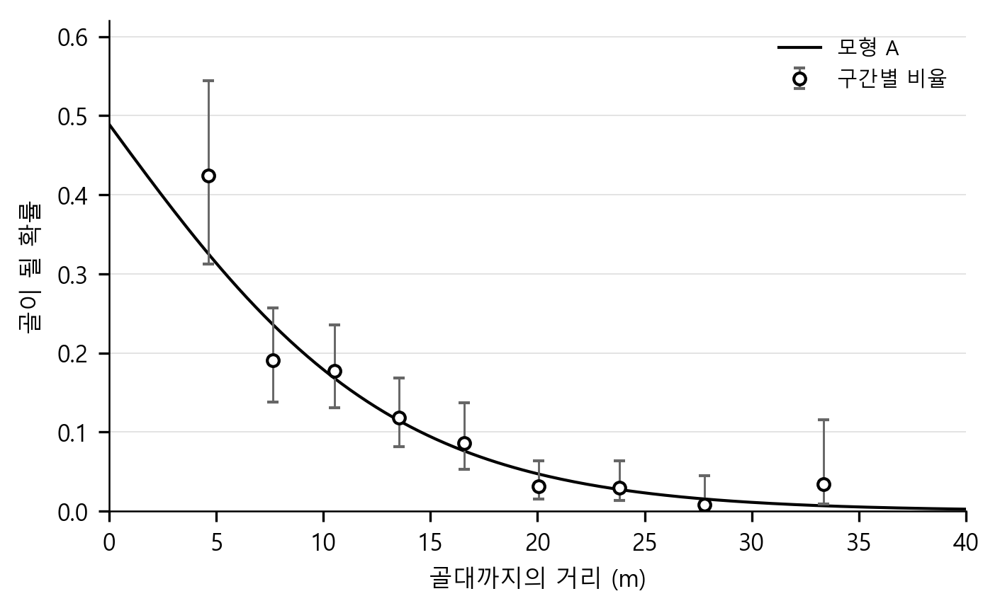
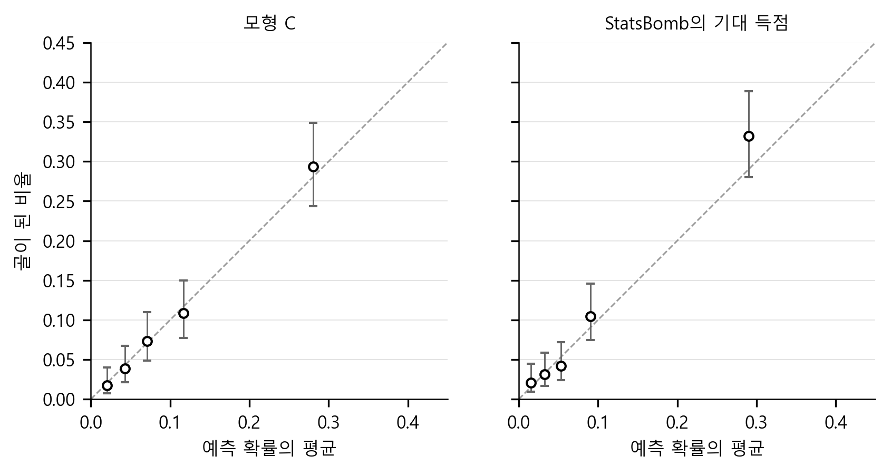

# 회귀 1장. 로지스틱 회귀 — 어디서 찬 슛이 골이 되는가

- [I. 질문과 데이터](#i-질문과-데이터)
- [II. 로지스틱 회귀 모형](#ii-로지스틱-회귀-모형)
- [III. 거리 하나로](#iii-거리-하나로)
- [IV. 설명변수의 형태와 선택](#iv-설명변수의-형태와-선택)
- [V. 예측 확률과 기대 득점](#v-예측-확률과-기대-득점)
- [VI. 모형의 점검](#vi-모형의-점검)
- [VII. 해석](#vii-해석)
- [VIII. 이 방법을 쓴 연구](#viii-이-방법을-쓴-연구)
- [참고문헌](#참고문헌)

> 데이터: StatsBomb 공개 데이터(<https://github.com/statsbomb/open-data>). 이용 약관에 따라 데이터는 이 저장소에 싣지 않는다.

이 장은 결과가 둘 가운데 하나인 데이터를 다루는 로지스틱 회귀를 설명한다. 예는 슛이다. 슛은 골이 되거나 되지 않고, 골이 될 확률은 어디서 찼는지에 따라 다르다. 그 확률을 슛의 위치로 설명하는 모형을 세우고, 계수를 해석하고, 모형이 낸 확률이 믿을 만한지 점검한다. 슛마다 추정한 득점 확률을 축구 분석에서는 기대 득점(expected goals, xG)이라 부른다. 이 장의 모형은 그 가장 단순한 형태다.

장의 순서는 다음과 같다. I장은 데이터를 본다. II장은 모형과 추정 방법을 설명한다. III장은 거리 하나만 넣은 모형을 적합해 계수를 해석한다. IV장은 설명변수를 어떤 형태로 넣을지, 변수를 더할지를 어떻게 정하는지 다룬다. V장은 계수를 확률로 되돌려 슛 하나와 팀 하나의 기대 득점을 계산한다. VI장은 예측 확률을 평가하는 세 가지 척도와 교차검증을 설명한다. VII장은 결과의 해석과 한계를, VIII장은 이 방법을 쓴 연구를 적는다.

## I. 질문과 데이터

데이터는 2022년 월드컵 64경기의 슛이다. 페널티킥과 승부차기는 뺀다. 페널티킥은 위치가 정해져 있어 위치로 설명할 것이 없고 득점 확률도 다른 슛과 크게 다르다. 남는 슛은 1,430개이고 그 가운데 152개(10.6%)가 골이 되었다. 결과 변수는 슛이 골이 되었으면 1, 아니면 0이다. 설명변수는 데이터 1장 III.4절에서 정의한 두 가지, 골대의 중심까지의 거리(m)와 골대가 보이는 각도(도)다. 여기에 슛을 머리로 했는지를 더한다.

표 1은 슛을 골대까지의 거리로 나누어 구간마다 슛의 수, 골의 수, 골이 된 비율을 적은 것이다. 구간의 경계는 슛의 수가 지나치게 적은 구간이 없도록 정했다.

**표 1. 골대까지의 거리별 슛과 골**

| 거리(m) |  슛 |  골 | 골이 된 비율(%) |
|:--------|----:|----:|----------------:|
| 0\~6     |  66 |  28 |            42.4 |
| 6\~9     | 168 |  32 |            19.0 |
| 9\~12    | 203 |  36 |            17.7 |
| 12\~15   | 212 |  25 |            11.8 |
| 15\~18   | 175 |  15 |             8.6 |
| 18\~22   | 223 |   7 |             3.1 |
| 22\~26   | 201 |   6 |             3.0 |
| 26\~30   | 123 |   1 |             0.8 |
| 30 이상 |  59 |   2 |             3.4 |

표 1에서 골이 된 비율은 거리가 멀수록 낮아진다. 6m 안에서 찬 슛은 42%가 골이 되었고, 18m 밖에서 찬 슛 606개 가운데 골은 16개(2.6%)다. 이 관계를 식 하나로 요약하고 거리가 1m 멀어질 때 득점 가능성이 얼마나 줄어드는지를 수로 나타내는 것이 이 장의 과제다. 구간으로 나눈 표는 구간을 어떻게 나누는지에 따라 달라지고, 구간 안에서의 차이를 무시하며, 변수가 둘 이상이면 구간의 조합마다 관측이 지나치게 적어진다. 회귀 모형은 이 세 문제를 피한다.

## II. 로지스틱 회귀 모형

### 1. 로짓

슛 $i$가 골이 될 확률을 $p_i$라 하자. 확률을 설명변수의 1차식으로 두는 선형 회귀는 쓸 수 없다. 확률은 0과 1 사이에 있어야 하는데 직선은 그 범위를 벗어난다. 거리가 충분히 멀면 예측 확률이 음수가 된다. 로지스틱 회귀는 확률 대신 승산의 로그를 1차식으로 둔다. 승산(odds)은 일어날 확률을 일어나지 않을 확률로 나눈 값 $p / (1 - p)$이다. 확률이 0.2이면 승산은 0.25이고, 4번 실패할 때 1번 성공한다는 뜻이다.

$$\log \frac{p_i}{1 - p_i} = \beta_0 + \beta_1 x_{i1} + \cdots + \beta_k x_{ik}$$

왼쪽을 로짓(logit)이라 한다. 확률이 0에서 1까지 움직일 때 로짓은 음의 무한대에서 양의 무한대까지 움직이므로, 오른쪽이 어떤 값이 되어도 확률로 되돌릴 수 있다. 오른쪽을 $\eta_i$로 적으면 되돌리는 식은 다음과 같다.

$$p_i = \frac{1}{1 + \exp(-\eta_i)}$$

이 함수는 S자 모양이다. $\eta_i = 0$이면 확률이 0.5이고, 그 근처에서 가장 가파르며, 양 끝에서는 0과 1에 가까워질 뿐 넘지 않는다. 슛은 대부분 득점 확률이 낮으므로 이 곡선의 왼쪽 아래 부분에 놓인다.

### 2. 계수와 승산비

계수 $\beta_j$는 다른 설명변수가 같을 때 $x_j$가 한 단위 크면 로그 승산이 얼마나 달라지는지를 나타낸다. 로그 승산의 차이는 승산의 비의 로그이므로 $\exp(\beta_j)$는 승산비(odds ratio)다.

$$\exp(\beta_j) = \frac{\mathrm{odds}(x_j + 1)}{\mathrm{odds}(x_j)}$$

이 모형에서 승산비는 다른 설명변수의 값과 $x_j$ 자신의 값에 관계없이 일정하다. 이것이 로지스틱 회귀의 가정이다. 확률의 차이는 일정하지 않다. 승산비가 0.5로 같아도 확률이 0.4에서 출발하면 0.25가 되어 0.15 줄어들고, 0.04에서 출발하면 0.02가 되어 0.02 줄어든다. 계수 하나의 효과를 확률로 말하려면 어느 지점에서의 효과인지를 정해야 한다. 확률이 작을 때는 승산과 확률이 거의 같으므로 승산비를 확률의 비로 해석해도 크게 틀리지 않는다. 확률이 0.04이면 승산은 0.042다. 슛의 득점 확률은 대부분 이 범위에 있다.

### 3. 최대가능도 추정

계수는 최대가능도법으로 추정한다. 가능도(likelihood)는 관측된 데이터가 나올 확률을 파라미터의 함수로 본 것이다. 우도라고도 한다. 파라미터가 어떤 값일 확률이 아니라, 그 값이라면 지금의 데이터가 나올 확률이다. 결과 $y_i$가 확률 $p_i$로 1이 되는 베르누이 변수이고 슛들이 서로 독립이라고 보면, 관측된 결과 전체가 나올 확률의 로그인 로그가능도는 다음과 같다.

$$\ell(\beta) = \sum_{i=1}^{n} \left\lbrace y_i \log p_i + (1 - y_i) \log(1 - p_i) \right\rbrace$$

골이 된 슛에서는 $p_i$가 클수록, 골이 되지 않은 슛에서는 $p_i$가 작을수록 로그가능도가 커진다. 최대가능도 추정치는 이 값을 가장 크게 하는 $\beta$다. 로그가능도를 $\beta_j$로 미분해 0으로 두면 다음 방정식이 나온다.

$$\sum_{i=1}^{n} x_{ij} (y_i - p_i) = 0, \qquad j = 0, 1, \ldots, k$$

$x_{i0} = 1$로 둔 절편의 방정식은 $\sum_i (y_i - p_i) = 0$이다. 예측 확률을 모두 더하면 관측된 골의 수와 같다는 뜻이며, 절편이 있는 로지스틱 회귀에서는 적합에 쓴 데이터에서 이 등식이 언제나 성립한다. $p_i$가 $\beta$의 비선형 함수이므로 방정식의 해는 식 하나로 나오지 않고, 초기값에서 출발해 계수를 되풀이해 고치는 뉴턴 방법으로 구한다. 이 장의 적합은 `statsmodels`의 `logit` 함수가 한다. 계수의 표준오차는 로그가능도의 2차 미분으로 만든 정보 행렬의 역행렬에서 나온다. 로그가능도가 추정치 근처에서 뾰족할수록 표준오차가 작다.

## III. 거리 하나로

### 1. 추정

가장 단순한 모형은 거리 $d_i$ 하나만 넣는다. 이것을 모형 A라 부른다.

$$\log \frac{p_i}{1 - p_i} = \beta_0 + \beta_1 d_i$$

표 2가 추정 결과다. 승산비는 계수의 지수이고, 하한과 상한은 승산비의 95% 신뢰구간이다. 신뢰구간은 계수에 표준오차의 1.96배를 더하고 뺀 뒤 지수를 취해 구한다. 계수의 추정량이 근사적으로 정규분포를 따르므로 구간은 계수의 척도에서 대칭이고 승산비의 척도에서는 대칭이 아니다.

**표 2. 모형 A: 거리만 넣은 로지스틱 회귀**

| 항        |   계수 | 표준오차 | 승산비 |  하한 |  상한 |
|:----------|-------:|---------:|-------:|------:|------:|
| 절편      | -0.044 |    0.211 |        |       |       |
| 거리 (1m) | -0.148 |    0.016 |  0.862 | 0.836 | 0.890 |

표 2에서 거리의 계수는 -0.148이고 승산비는 0.86이다. 골대에서 1m 멀어질 때마다 득점의 승산이 14% 줄어든다. 승산비는 곱으로 쌓인다. 5m 멀어지면 승산비는 0.86의 5제곱인 0.48이고 95% 신뢰구간은 0.41\~0.56이다. 절편은 거리가 0일 때의 로그 승산이므로 그 자체로는 뜻이 없다. 골대의 중심에서 찬 슛은 없다. 절편과 기울기를 함께 쓰면 뜻이 생긴다. 예측 확률은 6m에서 28%, 11m에서 16%, 16.5m에서 8%, 25m에서 2%다.

### 2. 적합을 눈으로 본다

그림 1은 모형 A의 예측 확률 곡선을 표 1의 구간별 비율과 함께 그린 것이다. 점은 구간 안의 슛의 평균 거리에 찍었고, 세로 막대는 비율의 95% 신뢰구간(윌슨 구간)이다. 곡선이 점들의 신뢰구간을 지나가면 거리와 로짓의 관계를 직선으로 둔 가정이 데이터와 어긋나지 않는다고 볼 수 있다.

그림 1에서 곡선은 9개 구간 가운데 8개의 신뢰구간 안을 지난다. 어긋남이 가장 큰 곳은 골대에 가까운 쪽이다. 6m 안의 구간은 비율이 42%로 곡선의 33%보다 높고, 그다음 6\~9m 구간은 19%로 곡선의 24%보다 낮다. 골대 바로 앞에서는 확률이 곡선보다 가파르게 올라가는 것일 수 있다. 그러나 가장 가까운 구간은 슛이 66개뿐이어서 신뢰구간이 넓고, 이것이 실제 구조인지 우연인지는 이 그림만으로 판단할 수 없다. IV장에서 거리의 형태를 바꾼 모형과 비교한다.

## IV. 설명변수의 형태와 선택

### 1. 이탈도, 가능도비 검정, AIC

모형을 비교하는 기준이 필요하다. 로지스틱 회귀에서는 잔차 제곱합 대신 이탈도(deviance)를 쓴다. 이탈도는 로그가능도에 $-2$를 곱한 값이다.

$$D = -2\ \ell(\hat\beta)$$

이탈도가 작을수록 모형이 데이터에 가깝다. 한 모형이 다른 모형에 변수를 더한 것일 때 두 모형을 포함 관계에 있다고 한다. 변수를 더하면 이탈도는 반드시 줄어든다. 줄어든 크기가 우연히 줄어들 만큼인지를 묻는 것이 가능도비 검정이다. 더한 변수의 계수가 실제로는 0이라는 가설 아래에서 두 이탈도의 차이는 근사적으로 자유도가 더한 계수의 수인 카이제곱 분포를 따른다.

$$D_{\text{작은 모형}} - D_{\text{큰 모형}} \sim \chi^2_q$$

포함 관계가 아닌 모형끼리는 가능도비 검정을 쓸 수 없다. 거리를 넣은 모형과 거리의 로그를 넣은 모형이 그런 경우다. 이때는 AIC(Akaike, 1974)를 쓴다. AIC는 이탈도에 계수의 수 $k$의 두 배를 더한 값이다.

$$\mathrm{AIC} = D + 2k$$

$2k$는 계수가 많은 모형에 주는 벌점이다. 계수를 더하면 적합에 쓴 데이터의 이탈도는 줄어들지만 새 데이터에 대한 예측은 나빠질 수 있고, AIC는 새 데이터에서의 이탈도를 근사한다. AIC가 작은 모형을 고른다. AIC의 차이가 2보다 작으면 두 모형을 구분할 근거가 약하다고 본다.

### 2. 거리의 형태

모형 A는 거리가 1m 멀어질 때의 승산비가 6m에서나 25m에서나 같다고 가정한다. 다른 형태를 생각할 수 있다. 거리의 로그를 넣으면 거리가 일정한 비율로 늘어날 때의 승산비가 같다는 가정이 된다. 5m에서 10m로 멀어지는 것과 15m에서 30m로 멀어지는 것을 같게 보는 것이다. 거리의 제곱항을 더하면 로짓이 거리의 곡선이 될 수 있다. 거리 대신 각도 하나만 넣을 수도 있다. 표 3은 이 네 모형의 계수의 수, 이탈도, AIC다. 첫 행은 설명변수 없이 절편만 있는 모형이다.

**표 3. 설명변수의 형태에 따른 이탈도와 AIC**

| 모형               | 계수의 수 | 이탈도 |   AIC |
|:-------------------|----------:|-------:|------:|
| 절편만             |         1 |  968.7 | 970.7 |
| 거리 (모형 A)      |         2 |  857.0 | 861.0 |
| 거리의 로그        |         2 |  856.4 | 860.4 |
| 거리와 거리의 제곱 |         3 |  855.3 | 861.3 |
| 각도               |         2 |  865.0 | 869.0 |

표 3에서 절편만 있는 모형의 이탈도는 968.7이고 거리를 넣으면 857.0으로 111.7 줄어든다. 자유도 1의 카이제곱 분포에서 이 값은 우연히 나올 수 없는 크기다. 거리의 제곱항을 더했을 때 줄어드는 이탈도는 1.6이고 가능도비 검정의 $p$값은 0.20이다. 로짓이 거리의 직선에서 벗어난다는 증거는 없다. 거리와 거리의 로그는 AIC가 861.0과 860.4로 거의 같아, 이 데이터로는 두 형태를 구분할 수 없다. 각도 하나만 넣은 모형은 AIC가 869.0으로 거리 하나만 넣은 모형보다 크다. 이 장은 해석이 가장 쉬운 거리 그대로의 형태를 쓴다. 그림 1에서 본 가까운 거리의 어긋남은 제곱항을 더해도 이탈도를 뚜렷하게 줄이지 못했다. 그 정도의 어긋남은 우연의 범위 안에 있다.

### 3. 각도를 더한다

거리가 같아도 골대 정면과 옆쪽은 다르다. 골대가 보이는 각도 $\theta_i$를 더한 것이 모형 B다. 머리로 한 슛인지를 나타내는 지시변수 $h_i$까지 더한 것이 모형 C다.

$$\text{모형 B:}\quad \log \frac{p_i}{1 - p_i} = \beta_0 + \beta_1 d_i + \beta_2 \theta_i$$

$$\text{모형 C:}\quad \log \frac{p_i}{1 - p_i} = \beta_0 + \beta_1 d_i + \beta_2 \theta_i + \beta_3 h_i$$

표 4는 두 모형의 추정 결과다. 열은 표 2와 같아서, 항마다 계수와 표준오차, 계수의 지수인 승산비와 그 95% 신뢰구간을 적었다. 거리는 1m, 각도는 1도가 한 단위이고, 머리는 머리로 한 슛이면 1, 아니면 0이다. 같은 항의 계수가 두 모형에서 어떻게 달라지는지를 함께 본다.

**표 4. 모형 B와 모형 C**

| 모형 | 항         |   계수 | 표준오차 | 승산비 |  하한 |  상한 |
|:-----|:-----------|-------:|---------:|-------:|------:|------:|
| B    | 절편       | -1.426 |    0.531 |        |       |       |
| B    | 거리 (1m)  | -0.093 |    0.024 |  0.911 | 0.869 | 0.955 |
| B    | 각도 (1도) |  0.020 |    0.007 |  1.020 | 1.006 | 1.035 |
| C    | 절편       | -0.884 |    0.551 |        |       |       |
| C    | 거리 (1m)  | -0.121 |    0.025 |  0.886 | 0.843 | 0.931 |
| C    | 각도 (1도) |  0.024 |    0.008 |  1.024 | 1.009 | 1.039 |
| C    | 머리       | -1.275 |    0.254 |  0.280 | 0.170 | 0.460 |

모형 B에서 각도의 승산비는 1.020이다. 거리가 같을 때 골대가 1도 더 넓게 보이면 득점의 승산이 2.0% 크다. 10도이면 1.22배다. 모형 A에서 모형 B로 가면 이탈도가 8.3 줄어들고 가능도비 검정의 $p$값은 0.004다. 각도는 거리가 설명하지 못한 부분을 설명한다.

각도를 넣자 거리의 계수가 달라졌다. 모형 A의 -0.148에서 모형 B의 -0.093으로 0에 가까워졌고, 표준오차는 0.016에서 0.024로 커졌다. 두 변수가 강하게 상관되어 있기 때문이다. 거리와 각도의 상관계수는 -0.75다. 골대에서 멀어지면 골대가 좁게 보인다. 모형 A의 거리 계수에는 멀어서 불리한 것과 각도가 좁아서 불리한 것이 함께 들어 있었고, 모형 B는 그것을 둘로 나눈다. 설명변수들이 상관되어 있으면 각 계수를 따로 추정하는 데 쓸 수 있는 정보가 줄어들어 표준오차가 커진다. 이것을 다중공선성이라 한다. 예측 확률은 다중공선성의 영향을 거의 받지 않는다. 영향을 받는 것은 계수 하나하나의 해석이다.

### 4. 머리로 한 슛

머리로 한 슛은 설명변수를 고르는 문제에서 중요한 점 하나를 보여 준다. 표 5는 머리로 한 슛과 그 밖의 슛을 비교한 것이다. 골이 된 비율과 함께 거리와 각도의 중위값을 적었다.

**표 5. 슛을 한 부위별 비교**

| 부위              |    슛 | 골이 된 비율(%) | 거리의 중위값(m) | 각도의 중위값(도) |
|:------------------|------:|----------------:|-----------------:|------------------:|
| 발과 그 밖의 부위 | 1,178 |            10.5 |             18.3 |              18.3 |
| 머리              |   252 |            11.1 |              9.0 |              40.0 |

표 5에서 골이 된 비율은 머리가 11.1%, 그 밖이 10.5%로 거의 같다. 이 비교만 보면 머리로 한 슛은 발로 한 슛만큼 들어간다. 그러나 두 집단은 찬 위치가 다르다. 머리로 한 슛은 거리의 중위값이 9.0m로 그 밖의 슛의 18.3m보다 훨씬 가깝다. 헤딩은 골대 앞으로 올라온 공에 하기 때문이다. 가까이서 했는데도 비율이 같다면, 같은 위치에서는 머리가 불리하다는 뜻이다.

모형 C가 그것을 수로 나타낸다. 표 4에서 머리의 승산비는 0.28이고 95% 신뢰구간은 0.17\~0.46이다. 거리와 각도가 같을 때 머리로 한 슛의 득점 승산은 발로 한 슛의 0.28배다. 모형 B에서 모형 C로 가면 이탈도가 29.0 줄어든다. 표 5의 단순 비교에서 차이가 보이지 않은 것은 거리가 부위와 결과 양쪽에 관련되어 있어 머리의 불리함을 가렸기 때문이다. 이렇게 제3의 변수가 두 변수의 관계를 가리거나 만들어 내는 것을 교란(confounding)이라 한다. 회귀 모형에 그 변수를 함께 넣는 것이 교란을 다루는 가장 기본적인 방법이다. 모형 C에서 거리의 계수가 -0.121로 모형 B보다 0에서 멀어진 것도 같은 이유다. 모형 B에서는 가까운 슛에 불리한 헤딩이 섞여 있어 가까운 거리의 이점이 작게 추정되었다.

## V. 예측 확률과 기대 득점

### 1. 슛 하나의 확률

계수를 II.1절의 식에 넣으면 어느 위치의 슛이든 득점 확률을 계산할 수 있다. 표 6은 경기장의 다섯 위치에 대해 모형 C의 예측 확률을 발로 한 슛과 머리로 한 슛으로 나누어 적은 것이다. 발로 한 슛에는 95% 신뢰구간을 함께 적었다. 예측 확률의 신뢰구간은 로짓 $\hat\eta$의 표준오차를 계수의 공분산 행렬에서 구해 $\hat\eta \pm 1.96\ \mathrm{SE}$를 만든 뒤 양 끝을 확률로 되돌린 것이다.

**표 6. 위치별 모형 C의 예측 확률**

| 위치 | 거리(m) | 각도(도) | 발(%) | 발의 하한(%) | 발의 상한(%) | 머리(%) |
|:---|---:|---:|---:|---:|---:|---:|
| 골 구역의 선 위, 정면 | 5.5 | 67.4 | 51.3 | 41.1 | 61.4 | 22.8 |
| 페널티 마크 | 11.0 | 36.9 | 20.8 | 17.4 | 24.6 | 6.8 |
| 페널티 구역의 선 위, 정면 | 16.5 | 25.1 | 9.2 | 7.5 | 11.3 | 2.8 |
| 골 구역 옆, 골라인에서 5.5m | 13.9 | 12.5 | 9.3 | 6.9 | 12.5 | 2.8 |
| 정면 25m | 25.0 | 16.6 | 2.9 | 1.8 | 4.6 | 0.8 |

표 6에서 페널티 마크에서 발로 찬 슛의 예측 확률은 21%(95% 신뢰구간 17\~25%)이고 같은 자리에서 머리로 한 슛은 7%다. 승산비는 하나지만 확률의 차이는 위치마다 다르다. 머리와 발의 차이는 골 구역의 선 위에서 29%포인트이고 25m에서는 2.1%포인트다. 넷째 행은 각도의 역할을 보여 준다. 골 구역 옆의 위치는 페널티 구역의 선 위 정면보다 골대에 2.5m 가깝지만 골대가 13도로만 보인다. 두 위치의 예측 확률은 9.3%와 9.2%로 거의 같다. 가까운 거리의 이점을 좁은 각도가 상쇄한다. 페널티 마크에서 찬 경기 중의 슛의 확률은 페널티킥의 성공률보다 훨씬 낮다. 페널티킥은 수비수가 없고 공이 멈춰 있기 때문이며, 이 모형의 설명변수에는 그런 조건이 없다.

### 2. 더하면 기대 득점이 된다

슛마다의 예측 확률을 더하면 그 슛들에서 기대되는 골의 수가 된다. 슛 $i$의 결과가 확률 $p_i$의 베르누이 변수이고 서로 독립이면, 골의 수 $G = \sum_i y_i$의 기댓값과 분산은 다음과 같다.

$$E(G) = \sum_i p_i, \qquad \mathrm{Var}(G) = \sum_i p_i (1 - p_i)$$

한 팀의 슛을 모아 $E(G)$를 구한 것이 그 팀의 기대 득점이다. 실제 골의 수가 기대 득점보다 많으면 슛의 위치에 비해 골을 많이 넣은 것이다. 그 차이가 우연의 범위 안인지는 표준편차로 나눈 값으로 가늠한다.

$$z = \frac{G - \sum_i p_i}{\sqrt{\sum_i p_i (1 - p_i)}}$$

표 7은 기대 득점이 큰 8개 팀이다. 골과 기대 득점은 페널티킥과 자책골을 뺀 것이다. 팀 이름은 데이터의 표기를 따랐다.

**표 7. 기대 득점이 큰 8개 팀 (모형 C)**

| 팀          |  슛 |  골 | 기대 득점 | 표준편차 |     z |
|:------------|----:|----:|----------:|---------:|------:|
| France      | 100 |  14 |      11.7 |      3.1 |  0.74 |
| Brazil      |  94 |   7 |      10.5 |      2.9 | -1.20 |
| Argentina   |  96 |  11 |       9.9 |      2.8 |  0.39 |
| England     |  61 |  12 |       8.1 |      2.5 |  1.61 |
| Germany     |  67 |   5 |       7.8 |      2.5 | -1.13 |
| Croatia     |  79 |   8 |       7.5 |      2.5 |  0.19 |
| Morocco     |  62 |   6 |       6.5 |      2.2 | -0.23 |
| Switzerland |  37 |   5 |       5.6 |      2.0 | -0.31 |

표 7에서 기대 득점과 실제 골은 팀마다 몇 골씩 다르다. 그러나 표준편차도 2\~3골이어서 대부분의 차이는 $z$의 절댓값이 2보다 작다. 32개 팀 전체에서 $z$가 가장 큰 팀은 Netherlands(골 10개, 기대 득점 5.4, $z$ = 2.34)이고 가장 작은 팀은 Belgium(골 1개, 기대 득점 4.7, $z$ = -2.00)이다. $z$의 절댓값이 1.96을 넘는 팀은 3개다.

이 수를 해석할 때 두 가지를 고려한다. 첫째, 팀이 32개이면 모든 팀이 모형대로 넣었더라도 1.96을 넘는 팀이 평균 1.6개 나온다. 여러 개를 한꺼번에 검정하면 우연히 넘는 것이 생긴다. 넘은 팀이 3개라는 것은 우연만으로도 설명되는 범위에 가깝다. 둘째, 한 팀의 슛은 많아야 100개 안팎이고 골은 10개 안팎이다. 한 대회의 데이터로는 어느 팀의 마무리가 실제로 뛰어난지와 운이 좋았는지를 구분하기 어렵다. 기대 득점은 골보다 표본이 큰 슛을 이용하므로 팀이 만든 기회의 양을 골보다 안정되게 나타낸다. 이것이 축구 분석에서 기대 득점을 쓰는 이유다. 선수마다의 차이를 표본의 크기를 고려해 추정하는 문제는 다층 모형 1장에서 다룬다.

## VI. 모형의 점검

### 1. 세 가지 척도

예측 확률이 쓸 만한지는 여러 측면에서 따진다(Steyerberg et al., 2010). 판별력(discrimination)은 골이 된 슛과 되지 않은 슛을 예측 확률로 구분할 수 있는지를 묻는다. 척도는 AUC다. 골이 된 슛 하나와 되지 않은 슛 하나를 무작위로 뽑았을 때 골이 된 슛의 예측 확률이 더 클 확률이며(Hanley and McNeil, 1982), 0.5는 구분하지 못한다는 뜻이고 1은 완전히 구분한다는 뜻이다. AUC는 예측 확률의 순서만 본다. 모든 확률을 절반으로 줄여도 AUC는 같다.

보정(calibration)은 예측 확률의 크기가 맞는지를 묻는다. 예측 확률이 20%인 슛을 모으면 그 가운데 20%가 골이 되어야 한다. 기대 득점은 확률을 더해 쓰므로 순서보다 크기가 중요하고, 보정이 판별력보다 중요하다. 보정은 예측 확률로 슛을 몇 집단으로 나누어 집단마다 예측 확률의 평균과 관측된 비율을 비교해 본다. 수 하나로 요약할 때는 보정 기울기를 쓴다(Cox, 1958). 결과를 예측 확률의 로짓에 다시 로지스틱 회귀한다.

$$\log \frac{P(y_i = 1)}{1 - P(y_i = 1)} = a + b \log \frac{\hat p_i}{1 - \hat p_i}$$

예측이 맞으면 $a = 0$, $b = 1$이다. $b$가 1보다 작으면 예측 확률이 지나치게 벌어져 있다는 뜻이다. 높은 확률은 실제보다 높고 낮은 확률은 실제보다 낮다. 모형이 적합에 쓴 데이터의 우연한 특징까지 따라간 과적합에서 이렇게 된다.

브라이어 점수(Brier, 1950)는 둘을 함께 본다. 예측 확률과 결과의 차이의 제곱을 평균한 값이다.

$$\mathrm{BS} = \frac{1}{n} \sum_{i=1}^{n} (\hat p_i - y_i)^2$$

작을수록 좋다. 0은 완전한 예측이다. 기준은 모든 슛에 전체 비율 $\bar y$를 예측했을 때의 값 $\bar y (1 - \bar y)$다. 결과가 드물면 기준 자체가 작으므로 브라이어 점수는 절댓값이 아니라 기준과의 비교로 판단한다.

### 2. 적합에 쓰지 않은 데이터로 평가한다

모형을 적합한 데이터로 그 모형을 평가하면 실제보다 좋게 나온다. 계수가 그 데이터에 맞춰졌기 때문이다. II.3절에서 본 대로 적합에 쓴 데이터에서는 예측 확률의 합이 골의 수와 반드시 같으므로 보정은 평가할 것이 없다. 필요한 것은 모형이 보지 못한 슛에 대한 성능이다.

교차검증(cross-validation)은 데이터를 $K$개 묶음으로 나누어, 한 묶음을 빼고 나머지로 모형을 적합한 뒤 뺀 묶음의 슛을 예측하는 일을 묶음마다 되풀이한다. 모든 슛이 자기를 빼고 적합한 모형의 예측을 하나씩 얻는다. 묶음을 어떻게 나누는지가 중요하다. 슛을 무작위로 나누면 같은 경기의 슛이 적합하는 쪽과 예측하는 쪽에 함께 들어간다. 같은 경기의 슛은 같은 두 팀, 같은 골키퍼의 슛이어서 서로 닮았을 수 있고, 그러면 예측이 실제보다 쉬워진다. 이 장은 경기를 단위로 나눈다. 64경기를 무작위로 8묶음으로 나누어, 한 묶음의 8경기를 나머지 56경기로 적합한 모형으로 예측한다. 예측할 대상이 새 경기의 슛이므로 평가도 새 경기에 대해 한다.

표 8은 세 모형의 AUC와 브라이어 점수를 적합에 쓴 데이터와 교차검증에서 구한 것이다. 보정 기울기는 교차검증의 예측으로 구했다. 마지막 두 행은 비교 대상이다. 하나는 모든 슛에 전체 비율을 예측한 것이고, 다른 하나는 데이터에 들어 있는 StatsBomb의 기대 득점(`shot_statsbomb_xg`)이다. StatsBomb의 값은 그 회사가 가진 훨씬 큰 데이터로 만든 모형에서 나온 것이다. 그 데이터에 이 대회가 들어 있는지는 알 수 없으나, 이 대회의 데이터에 맞춘 값은 아니므로 교차검증의 열에 적었다.

**표 8. 모형의 판별력, 브라이어 점수, 보정 기울기**

| 모형 | AUC(적합) | AUC(교차검증) | 브라이어(적합) | 브라이어(교차검증) | 보정 기울기 |
|:---|---:|---:|---:|---:|---:|
| 모형 A | 0.749 | 0.747 | 0.0868 | 0.0871 | 0.98 |
| 모형 B | 0.756 | 0.753 | 0.0858 | 0.0861 | 0.98 |
| 모형 C | 0.779 | 0.775 | 0.0826 | 0.0831 | 0.97 |
| 전체 비율 |  | 0.500 |  | 0.0950 |  |
| StatsBomb의 기대 득점 |  | 0.815 |  | 0.0762 | 1.06 |

표 8에서 세 가지를 알 수 있다. 첫째, 교차검증의 값은 적합에 쓴 데이터의 값보다 조금씩 나쁘다. 모형 C의 AUC는 0.779에서 0.775로 내려간다. 차이가 작은 것은 계수가 4개뿐이어서 과적합의 여지가 적기 때문이다. 보정 기울기는 0.97로 1에 가깝다. 둘째, 변수를 더할수록 새 경기에 대한 예측이 나아진다. 교차검증의 AUC는 모형 A가 0.747, 모형 B가 0.753, 모형 C가 0.775다. IV장에서 이탈도와 AIC로 내린 판단과 같다. 셋째, 브라이어 점수의 개선은 크지 않다. 전체 비율만 예측한 기준이 0.0950이고 모형 C가 0.0831로, 기준에서 13% 줄어든 데 그친다. 슛 하나의 결과는 위치를 알아도 대부분 예측할 수 없다.

StatsBomb의 기대 득점은 AUC가 0.815, 브라이어 점수가 0.0762로 모형 C보다 좋다. 그 모형이 어떤 변수를 쓰는지는 공개 데이터의 명세서에 없으나, 사건 파일에는 슛마다 골키퍼와 수비수의 위치가 기록되어 있고(데이터 1장 II.1절) 이 장의 모형은 그것을 쓰지 않았다. 슛한 선수와 골대 사이에 수비수가 몇 명 있었는지, 골키퍼가 어디 있었는지는 위치가 같은 두 슛을 구분하는 정보다. 다만 StatsBomb의 기대 득점을 모두 더하면 137.9로 실제 골 152개보다 14.1 작다. 이 대회에서는 그 모형의 예측보다 골이 많이 나왔다.

### 3. 보정을 그림으로 본다

그림 2는 보정 그림이다. 교차검증의 예측 확률이 낮은 순서로 슛을 5개 집단으로 나누고, 집단마다 예측 확률의 평균을 가로축에, 골이 된 비율을 세로축에 찍었다. 세로 막대는 비율의 95% 신뢰구간이다. 점이 대각선 위에 있으면 예측 확률이 관측된 비율과 같다. 집단을 5개로 한 것은 골이 152개뿐이어서 더 잘게 나누면 집단마다의 비율이 불안정하기 때문이다.

그림 2에서 모형 C의 점들은 대각선에 가깝고 신뢰구간이 모두 대각선에 걸친다. 예측 확률이 낮은 네 집단은 원점 가까이에 몰려 있고 가장 높은 집단만 떨어져 있다. 슛의 대부분은 득점 확률이 10%에 못 미치고, 확률이 높은 슛은 소수다. StatsBomb의 기대 득점은 가장 높은 집단에서 관측된 비율이 예측보다 높지만 신뢰구간은 대각선에 걸친다. 앞에서 본 합계의 차이는 대부분 이 집단에서 나온다.

## VII. 해석

### 1. 이 모형이 말하는 것

모형 C의 내용은 세 문장이다. 골대에서 1m 멀어지면 득점의 승산이 11% 줄어든다. 골대가 10도 더 넓게 보이면 승산이 1.27배가 된다. 같은 위치에서 머리로 한 슛의 승산은 발로 한 슛의 0.28배다. 계수 3개와 절편으로 새 경기의 슛을 AUC 0.77로 구분하고, 예측 확률의 크기도 관측된 비율과 맞는다.

표준오차는 슛들이 서로 독립이라는 가정에서 나온 것이다. 슛 1,430개는 선수 428명이 찬 것이고, 같은 선수의 슛은 그 선수의 기량을 공유하므로 독립이 아닐 수 있다. 선수를 군집으로 하는 군집 강건 표준오차를 구해 비교하면, 세 계수의 표준오차는 독립을 가정한 값의 0.94\~0.97배다. 이 데이터에서는 독립의 가정이 결론을 바꾸지 않는다. 선수 한 명의 슛이 평균 3.3개로 적어 군집의 영향이 작다.

### 2. 이 모형이 말하지 않는 것

첫째, 계수는 실제로 찬 슛에 대한 것이다. 선수는 들어갈 것 같을 때 슛을 한다. 25m에서 찬 슛은 25m에서 공을 가진 모든 상황이 아니라 선수가 차기로 한 상황이고, 대개 앞이 비어 있거나 공이 잘 놓인 경우다. 그러므로 모형의 예측 확률을 그 위치에서 누구든 언제든 슛을 하면 얻는 확률로 해석하면 안 된다. 먼 거리의 슛을 더 많이 차라는 식의 처방은 이 모형에서 나오지 않는다.

둘째, 위치가 같은 슛은 같은 확률을 받는다. 수비수가 앞을 막았는지, 골키퍼가 자리를 벗어났는지, 공이 굴러왔는지 떠 있었는지는 모형에 없다. 표 8에서 StatsBomb의 기대 득점이 더 나은 것은 이런 정보의 차이로 보인다. 프리즈 프레임을 써서 슛과 골대 사이의 상대 선수를 설명변수로 만드는 일은 공간 2장에서 한다.

셋째, 데이터가 작다. 골은 152개다. 로지스틱 회귀에서 추정할 수 있는 계수의 수는 전체 관측 수가 아니라 드문 쪽 결과의 수가 정한다. 계수 하나에 드문 쪽의 사건이 10개는 있어야 한다는 것이 흔히 쓰는 기준이다(Peduzzi et al., 1996). 이 기준으로 이 데이터는 계수 15개 안팎까지 감당한다. 상호작용이나 선수별 효과를 넣기 시작하면 금방 넘는다. 실무의 기대 득점 모형은 수만에서 수십만 개의 슛으로 적합한다.

넷째, 한 대회의 결과다. 64경기는 32개 팀이 한 달 동안 치른 것이고, 국가대표팀의 토너먼트는 리그 경기와 조건이 다르다. 계수를 다른 대회나 다른 수준의 경기로 옮겨 쓸 수 있는지는 이 데이터로 알 수 없다.

## VIII. 이 방법을 쓴 연구

슛의 득점 확률을 로지스틱 회귀로 추정한 초기의 연구는 Pollard and Reep (1997)이다. 이들은 슛의 위치와 상황을 설명변수로 삼아 득점 확률을 추정하고, 그 확률을 팀의 공격 방식을 평가하는 척도로 썼다. 슛을 골이 되었는지가 아니라 골이 될 확률로 평가한다는 생각이 여기서 나왔고, 이 장의 V.2절은 그 생각을 그대로 따른 것이다.

최근의 연구는 설명변수와 데이터의 크기에서 다르다. Anzer and Bauer (2021)는 독일 분데스리가의 슛 105,627개에 대해 사건 데이터와 추적 데이터를 시각으로 맞추어, 슛 순간의 선수들의 위치에서 설명변수를 만들었다. 모형은 로지스틱 회귀가 아니라 여러 결정 나무를 더하는 그래디언트 부스팅을 썼다. 이 장의 분석과 다른 점은 셋이다. 슛이 70배 이상 많고, 위치가 같은 슛을 구분하는 변수가 있으며, 변수들의 상호작용을 모형이 데이터에서 찾는다. 평가 방법은 같다. 적합에 쓰지 않은 데이터에서 보정과 판별력을 본다. 모형이 복잡해져도 이 장의 VI장은 그대로 쓰인다.

## 참고문헌

Akaike, H. (1974). “A new look at the statistical model identification.” *IEEE Transactions on Automatic Control* 19(6), 716–723.

Anzer, G., and Bauer, P. (2021). “A goal scoring probability model for shots based on synchronized positional and event data in football (soccer).” *Frontiers in Sports and Active Living* 3, 624475.

Brier, G. W. (1950). “Verification of forecasts expressed in terms of probability.” *Monthly Weather Review* 78(1), 1–3.

Cox, D. R. (1958). “Two further applications of a model for binary regression.” *Biometrika* 45(3/4), 562–565.

Hanley, J. A., and McNeil, B. J. (1982). “The meaning and use of the area under a receiver operating characteristic (ROC) curve.” *Radiology* 143(1), 29–36.

Peduzzi, P., Concato, J., Kemper, E., Holford, T. R., and Feinstein, A. R. (1996). “A simulation study of the number of events per variable in logistic regression analysis.” *Journal of Clinical Epidemiology* 49(12), 1373–1379.

Pollard, R., and Reep, C. (1997). “Measuring the effectiveness of playing strategies at soccer.” *Journal of the Royal Statistical Society: Series D (The Statistician)* 46(4), 541–550.

Steyerberg, E. W., Vickers, A. J., Cook, N. R., Gerds, T., Gonen, M., Obuchowski, N., Pencina, M. J., and Kattan, M. W. (2010). “Assessing the performance of prediction models: A framework for traditional and novel measures.” *Epidemiology* 21(1), 128–138.
