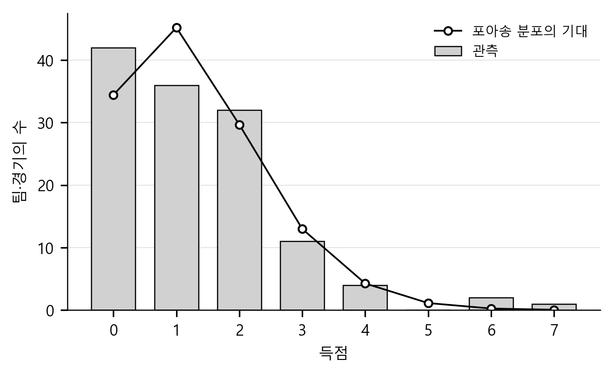
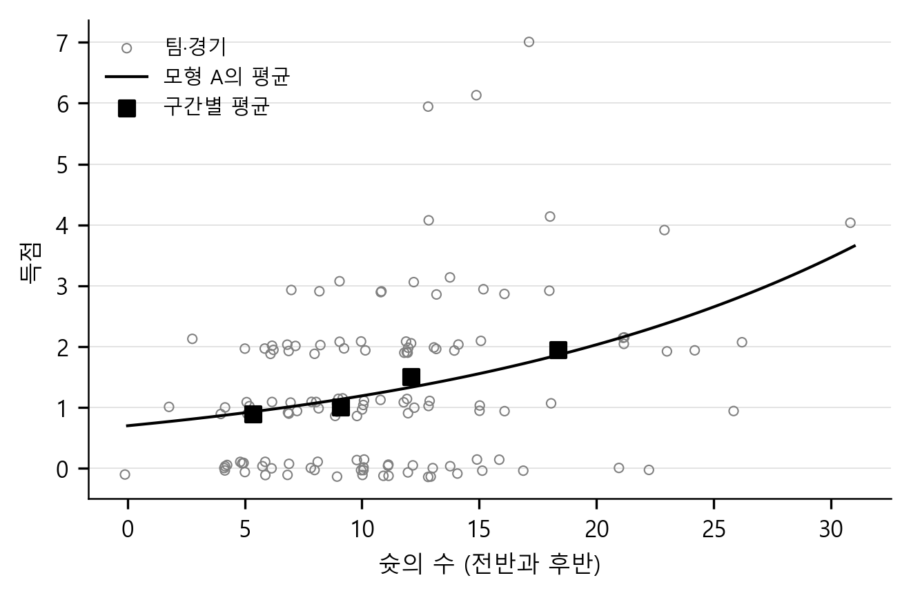

# 회귀 2장. 포아송 회귀 — 득점은 포아송 분포를 따르는가

- [I. 질문과 데이터](#i-질문과-데이터)
- [II. 포아송 분포](#ii-포아송-분포)
- [III. 포아송 회귀 모형](#iii-포아송-회귀-모형)
- [IV. 슛의 수로 설명한다](#iv-슛의-수로-설명한다)
- [V. 과대산포](#v-과대산포)
- [VI. 팀의 공격과 수비](#vi-팀의-공격과-수비)
- [VII. 두 팀의 득점은 독립인가](#vii-두-팀의-득점은-독립인가)
- [VIII. 해석](#viii-해석)
- [IX. 이 방법을 쓴 연구](#ix-이-방법을-쓴-연구)
- [참고문헌](#참고문헌)

> 데이터: StatsBomb 공개 데이터(<https://github.com/statsbomb/open-data>). 이용 약관에 따라 데이터는 이 저장소에 싣지 않는다.

이 장은 결과가 0, 1, 2, …로 세는 수인 데이터를 다루는 포아송 회귀를 설명한다. 예는 한 팀이 한 경기에서 넣은 골의 수다. 회귀 1장의 결과는 슛 하나가 골이 되었는지였고 관측은 슛이었다. 이 장의 결과는 경기가 끝났을 때의 득점이고 관측은 한 팀의 한 경기다. 관측이 128개뿐이라는 점이 이 장의 조건이다.

장의 순서는 다음과 같다. I장은 데이터를 본다. II장은 포아송 분포가 어디서 나오는지와 데이터가 그 분포를 따르는지 점검하는 법을 설명한다. III장은 포아송 회귀 모형과 추정, 노출 시간을 다루는 오프셋을 설명한다. IV장은 슛의 수로 득점을 설명하는 모형을 적합한다. V장은 분산이 평균보다 큰 과대산포를 진단하고 다루는 두 방법을 설명한다. VI장은 팀마다 공격과 수비의 파라미터를 두는 모형을 적합해 이 데이터로 어디까지 추정할 수 있는지를 본다. VII장은 한 경기의 두 팀의 득점이 독립인지 점검한다. VIII장은 해석을, IX장은 이 방법을 쓴 연구를 적는다.

## I. 질문과 데이터

분석 단위는 한 팀의 한 경기다. 64경기에 두 팀씩 128개의 관측이 있다. 결과 변수는 그 팀이 전반과 후반에 넣은 골의 수다. 페널티킥으로 넣은 골과 상대의 자책골로 얻은 골을 포함한다. 연장전의 골은 뺀다. 연장전까지 간 경기는 30분을 더 했으므로 득점할 시간이 다른 경기와 다르기 때문이다. 연장전을 포함하는 방법은 III.3절에서 다룬다. 승부차기는 득점으로 세지 않는다.

이렇게 센 골은 168개이고 한 팀의 한 경기 평균은 1.31골이다. 연장전의 골 4개를 더하면 대회의 172골이 된다. 표 1은 득점별 관측 수다. 셋째 열은 평균이 같은 포아송 분포에서 기대되는 수이며 II장에서 설명한다.

**표 1. 한 팀의 한 경기 득점의 분포 (전반과 후반)**

| 득점   | 관측 | 비율(%) | 포아송 분포의 기대 |
|:-------|-----:|--------:|-------------------:|
| 0      |   42 |    32.8 |               34.5 |
| 1      |   36 |    28.1 |               45.2 |
| 2      |   32 |    25.0 |               29.7 |
| 3      |   11 |     8.6 |               13.0 |
| 4      |    4 |     3.1 |                4.3 |
| 5 이상 |    3 |     2.3 |                1.4 |

표 1에서 가장 흔한 결과는 무득점으로 42번(33%)이다. 3골 이상은 18번뿐이다. 그런데 5골 이상이 3번 있다. Spain의 7골(상대 Costa Rica), England의 6골(상대 Iran), Portugal의 6골(상대 Switzerland)이다. 득점은 음수가 될 수 없고 정수이며 0에 몰려 있고 오른쪽으로 길게 늘어진다. 이런 데이터에 선형 회귀를 쓰면 예측값이 음수가 될 수 있고, 오차의 분산이 일정하다는 가정도 맞지 않는다. 평균이 큰 관측일수록 흩어짐이 크기 때문이다.

## II. 포아송 분포

### 1. 드문 사건을 세면 포아송 분포가 된다

포아송 분포는 일어날 기회는 많고 기회마다의 확률은 작은 사건이 일어난 횟수의 분포다. 기회가 $m$번이고 기회마다 확률 $p$로 서로 독립으로 사건이 일어나면 횟수는 이항분포를 따른다. 평균 $\mu = mp$를 고정한 채 $m$을 키우고 $p$를 줄이면 이항분포는 다음 분포에 가까워진다.

$$P(Y = k) = \frac{\mu^k e^{-\mu}}{k!}, \qquad k = 0, 1, 2, \ldots$$

축구의 득점이 이 조건에 가깝다. 한 경기에는 득점으로 이어질 수 있는 공격이 수십 번 있고 그 하나하나가 골이 될 확률은 작다. 회귀 1장에서 슛 하나가 골이 될 확률은 평균 10%쯤이었고, 한 팀의 골의 수는 확률이 제각각인 베르누이 변수의 합이었다. 확률이 모두 작으면 그런 합도 근사적으로 포아송 분포를 따른다. 포아송 분포는 득점에 대해 임의로 고른 분포가 아니라 득점이 만들어지는 과정에서 나오는 분포다.

### 2. 평균과 분산이 같다

포아송 분포의 파라미터는 $\mu$ 하나이고, 평균과 분산이 모두 $\mu$다.

$$E(Y) = \mu, \qquad \mathrm{Var}(Y) = \mu$$

정규분포는 평균과 분산을 따로 정하지만 포아송 분포는 평균이 분산을 정한다. 이 성질이 포아송 분포를 점검하는 기준이 된다. 데이터의 분산이 평균보다 크면 과대산포(overdispersion)라 한다. 과대산포는 앞 절의 조건 가운데 하나가 깨졌다는 신호다. 흔한 원인은 $\mu$가 관측마다 다른 것이다. 강한 팀과 약한 팀의 평균 득점이 다른데 모두에게 같은 $\mu$를 주면, 팀 사이의 차이가 분산에 더해진다.

### 3. 데이터가 포아송 분포를 따르는지 점검한다

표 1의 셋째 열은 $\mu$를 표본 평균 1.31로 둔 포아송 분포의 확률에 128을 곱한 것이다. 관측과 비교하면 무득점은 기대보다 많고(42번과 34.5번) 1골은 기대보다 적으며(36번과 45.2번), 5골 이상은 기대가 1.4번인데 3번 나왔다. 가운데가 낮고 양 끝이 높으므로 분산이 포아송 분포보다 크다. 표본 분산은 1.79로 평균의 1.36배다.

이 차이가 우연인지를 두 가지 검정으로 본다. 첫째는 분산과 평균의 비를 쓰는 산포 검정이다. 데이터가 평균이 같은 포아송 분포에서 나왔다면 다음 통계량은 근사적으로 자유도 $n - 1$의 카이제곱 분포를 따른다.

$$D = \frac{(n - 1)\ s^2}{\bar y} = \frac{\sum_i (y_i - \bar y)^2}{\bar y}$$

여기서 $D$는 173.3이고 자유도 127에서 $p$값은 0.004다. 둘째는 표 1의 관측 수와 기대 수를 칸마다 비교하는 적합도 검정이다. 기대 수가 5보다 작은 칸이 없도록 4골 이상을 한 칸으로 묶어 5칸으로 만들면, 통계량 $\sum (O - E)^2 / E$는 4.33이고 자유도 3에서 $p$값은 0.228이다. 자유도는 칸의 수 5에서 1을 빼고, 데이터에서 추정한 파라미터 1개를 더 뺀 것이다.

두 검정의 결론이 다르다. 산포 검정은 포아송 분포를 기각하고 적합도 검정은 기각하지 않는다. 이유는 두 검정이 보는 곳이 다르기 때문이다. 적합도 검정은 4골 이상을 한 칸으로 묶으므로 4골과 7골을 구분하지 못한다. 이 데이터가 포아송 분포에서 벗어나는 곳은 바로 그 꼬리다. 산포 검정은 분산을 쓰므로 큰 값에 민감하다. 검정마다 민감한 방향이 다르고, 한 검정이 기각하지 않았다는 것이 가설이 맞다는 뜻은 아니다. 그림 1은 표 1을 그린 것이다.

그림 1에서 관측은 0에서 기대보다 높고 1에서 낮으며, 6과 7에 기대가 거의 0인 관측이 있다. 이 장의 나머지는 이 어긋남이 어디서 오는지를 따진다. 한 가지 설명은 II.2절에서 말한 대로 $\mu$가 팀·경기마다 다르다는 것이다. 포아송 회귀는 $\mu$를 설명변수의 함수로 두어 그 차이를 모형에 넣는다.

## III. 포아송 회귀 모형

### 1. 로그 연결과 비율비

포아송 회귀는 관측 $i$의 결과가 평균 $\mu_i$의 포아송 분포를 따른다고 보고, 평균의 로그를 설명변수의 1차식으로 둔다.

$$\log \mu_i = \beta_0 + \beta_1 x_{i1} + \cdots + \beta_k x_{ik}$$

로그를 쓰는 이유는 로지스틱 회귀가 로짓을 쓰는 이유와 같다. 평균은 양수여야 하는데 1차식은 음수가 될 수 있다. 로그를 취하면 오른쪽이 어떤 값이든 $\mu_i = \exp(\cdot)$는 양수다. 평균과 1차식을 잇는 함수를 연결 함수라 하고, 분포와 연결 함수를 정해 회귀를 세우는 틀을 일반화 선형 모형이라 한다(McCullagh and Nelder, 1989). 로지스틱 회귀는 베르누이 분포와 로짓 연결, 포아송 회귀는 포아송 분포와 로그 연결, 선형 회귀는 정규분포와 항등 연결의 경우다.

계수의 해석은 로그에서 나온다. $x_j$가 한 단위 크면 $\log \mu$가 $\beta_j$ 커지므로 $\mu$는 $\exp(\beta_j)$배가 된다.

$$\exp(\beta_j) = \frac{\mu(x_j + 1)}{\mu(x_j)}$$

이것을 비율비(rate ratio)라 한다. 로지스틱 회귀의 승산비와 달리 평균 자체의 비이므로 그대로 해석하면 된다. 비율비가 1.1이면 평균 득점이 10% 많다. 효과는 더해지지 않고 곱해진다. 평균이 1골인 팀과 2골인 팀에 같은 비율비 1.1이 걸리면 늘어나는 골은 0.1과 0.2로 다르다.

### 2. 추정

계수는 최대우도법으로 추정한다. 관측들이 서로 독립이면 로그우도는 II.1절의 확률에 로그를 취해 더한 것이다.

$$\ell(\beta) = \sum_{i=1}^{n} \left\lbrace y_i \log \mu_i - \mu_i - \log(y_i!) \right\rbrace$$

$\beta_j$로 미분해 0으로 두면 다음 방정식이 나온다.

$$\sum_{i=1}^{n} x_{ij} (y_i - \mu_i) = 0, \qquad j = 0, 1, \ldots, k$$

회귀 1장 II.3절의 방정식에서 $p_i$가 $\mu_i$로 바뀐 것이다. 일반화 선형 모형은 모두 이 형태의 방정식을 갖는다. 절편의 방정식은 $\sum_i (y_i - \mu_i) = 0$이므로 적합한 평균의 합은 관측된 골의 합과 같다. 모형의 적합은 이탈도로 요약한다. 포아송 회귀의 이탈도는 관측마다 평균을 관측값 그대로 둔 모형과의 로그우도 차이의 두 배다.

$$D = 2 \sum_{i=1}^{n} \left\lbrace y_i \log \frac{y_i}{\hat\mu_i} - (y_i - \hat\mu_i) \right\rbrace$$

$y_i = 0$인 관측에서는 $y_i \log(y_i / \hat\mu_i)$를 0으로 둔다. 포함 관계에 있는 두 모형의 이탈도 차이로 우도비 검정을 하고 AIC로 모형을 비교하는 것은 회귀 1장 IV.1절과 같다. 이 장의 적합은 `statsmodels`의 `glm` 함수가 한다.

### 3. 노출과 오프셋

세는 데이터에서는 사건이 일어날 수 있었던 시간이나 크기가 관측마다 다를 수 있다. 이것을 노출(exposure)이라 한다. 120분 동안 넣은 골과 90분 동안 넣은 골을 그대로 비교할 수 없다. 관심은 단위 시간당 비율 $\lambda_i$에 있고 평균은 $\mu_i = t_i \lambda_i$다. 비율에 로그 선형 모형을 두면 다음과 같다.

$$\log \mu_i = \log t_i + \beta_0 + \beta_1 x_{i1} + \cdots + \beta_k x_{ik}$$

$\log t_i$는 계수가 1로 고정된 항이다. 추정하지 않고 더하기만 하는 이런 항을 오프셋(offset)이라 한다. 노출을 설명변수로 넣어 계수를 추정하는 것과 다르다. 오프셋은 노출이 두 배이면 평균도 두 배라는 것을 가정으로 둔다.

이 데이터에서 연장전까지 간 팀·경기는 10개다. 연장전의 골을 포함한 득점을 결과로 두고 경기 시간을 90분을 1로 하여 나타낸 값의 로그를 오프셋으로 넣어 절편만 있는 모형을 적합하면, 90분당 득점 비율은 1.310골이다. 연장전의 골을 포함한 득점을 그대로 평균하면 1.344골이고, 전반과 후반의 골만 평균하면 1.312골이다. 오프셋을 넣은 추정치는 골 172개를 총 경기 시간으로 나눈 값과 같다. 연장전이 5경기뿐이어서 세 값의 차이는 작다. 노출의 차이가 큰 데이터에서는 오프셋을 빠뜨리면 노출이 긴 관측의 평균이 크게 나오는 것을 설명변수의 효과로 잘못 해석하게 된다. 이 장의 나머지는 노출이 같은 전반과 후반의 득점만 쓴다.

## IV. 슛의 수로 설명한다

### 1. 추정

팀·경기마다 평균 득점이 다르다면 무엇으로 설명할 수 있는가. 가장 가까운 변수는 그 팀이 그 경기에서 한 슛의 수다. 회귀 1장에서 골은 슛의 득점 확률을 더한 것이었으므로 슛이 많으면 득점의 평균이 크다. 전반과 후반의 슛의 수를 $s_i$라 하고 다음 모형을 모형 A라 부른다.

$$\log \mu_i = \beta_0 + \beta_1 s_i$$

표 2가 추정 결과다. 비율비는 계수의 지수이고 하한과 상한은 그 95% 신뢰구간이다. 둘째 모형은 16강 이후의 경기인지를 나타내는 지시변수를 더한 것으로 모형 B라 부른다. 토너먼트 경기에서 득점이 달라지는지를 본다.

**표 2. 득점의 포아송 회귀**

| 모형 | 항        |   계수 | 표준오차 | 비율비 |  하한 |  상한 |
|:-----|:----------|-------:|---------:|-------:|------:|------:|
| A    | 절편      | -0.362 |    0.177 |        |       |       |
| A    | 슛 (1개)  |  0.053 |    0.012 |  1.055 | 1.030 | 1.081 |
| B    | 절편      | -0.453 |    0.192 |        |       |       |
| B    | 슛 (1개)  |  0.056 |    0.013 |  1.057 | 1.031 | 1.084 |
| B    | 16강 이후 |  0.242 |    0.172 |  1.274 | 0.908 | 1.785 |

모형 A에서 슛의 비율비는 1.055다. 슛이 1개 많은 팀·경기는 평균 득점이 5.5% 많다. 슛 5개의 비율비는 1.31이고 95% 신뢰구간은 1.16\~1.48이다. 절편만 있는 모형에서 모형 A로 가면 이탈도가 184.5에서 167.6으로 줄어들고 우도비 검정의 $p$값은 0.001보다 작다. 적합한 평균은 슛이 7개이면 1.01골, 10개이면 1.19골, 13개이면 1.40골이다. 슛의 수의 사분위수에 해당하는 값들이다.

모형 B에서 16강 이후의 비율비는 1.27이고 95% 신뢰구간은 0.91\~1.79다. 구간이 1을 포함하고 우도비 검정의 $p$값은 0.168이다. 이 결과를 토너먼트 경기와 조별 리그의 득점이 같다고 해석하면 안 된다. 구간의 폭을 보아야 한다. 이 데이터는 토너먼트 경기의 득점이 9% 적은 것부터 79% 많은 것까지를 모두 배제하지 못한다. 16강 이후의 팀·경기가 32개뿐이어서 그 정도의 차이를 가려낼 정보가 없다. 이 장은 모형 A를 쓴다.

### 2. 적합을 눈으로 본다

그림 2는 슛의 수와 득점의 산점도에 모형 A의 평균 곡선을 겹친 것이다. 득점이 정수여서 점이 겹치므로 점을 위아래로 조금 흩어 그렸다. 네모는 슛의 수를 네 구간으로 나누어 구한 득점의 평균이다.

그림 2에서 곡선은 구간별 평균을 따라간다. 그러나 점들은 곡선 주위에 넓게 흩어져 있다. 슛의 수와 득점의 상관계수는 0.33에 그친다. 슛을 22개 하고도 무득점인 팀·경기가 있고, 슛 13개로 6골을 넣은 경우도 있다. 포아송 분포에서는 흩어짐이 큰 것이 당연하다. 평균이 1.5골이어도 무득점일 확률이 22%이고 3골 이상일 확률이 19%다. 평균을 정확히 알아도 한 경기의 득점은 넓은 범위에 걸친다. 문제는 흩어짐이 포아송 분포가 허용하는 것보다 더 큰가다.

## V. 과대산포

### 1. 진단

회귀 모형을 적합한 뒤의 과대산포는 피어슨 잔차로 진단한다. 피어슨 잔차는 관측과 적합한 평균의 차이를 포아송 분포의 표준편차 $\sqrt{\hat\mu_i}$로 나눈 것이다.

$$r_i = \frac{y_i - \hat\mu_i}{\sqrt{\hat\mu_i}}$$

모형이 맞으면 $r_i$의 분산은 1에 가깝다. 잔차의 제곱합을 잔차 자유도로 나눈 값이 산포 파라미터의 추정치다.

$$\hat\phi = \frac{1}{n - k - 1} \sum_{i=1}^{n} r_i^2$$

$\hat\phi$가 1이면 분산이 평균과 같고, 1보다 크면 과대산포다. 절편만 있는 모형의 $\hat\phi$는 1.36이고 모형 A는 1.18이다. 슛의 수를 넣자 과대산포가 줄어들었다. II.2절에서 말한 대로 평균이 관측마다 다른 것이 과대산포의 한 원인이었고, 슛의 수가 그 차이의 일부를 설명했다. 남은 1.18이 1과 다른지는 피어슨 카이제곱 통계량 148.7을 자유도 126의 카이제곱 분포와 비교해 본다. $p$값은 0.082다.

표 3은 피어슨 잔차가 가장 큰 세 관측이다. 잔차 제곱합에서 이 세 관측이 차지하는 몫이 얼마인지를 본다.

**표 3. 모형 A에서 피어슨 잔차가 가장 큰 세 팀·경기**

| 팀       | 상대        |  슛 | 득점 | 적합한 평균 | 피어슨 잔차 |
|:---------|:------------|----:|-----:|------------:|------------:|
| Spain    | Costa Rica  |  17 |    7 |        1.73 |        4.01 |
| England  | Iran        |  13 |    6 |        1.40 |        3.90 |
| Portugal | Switzerland |  15 |    6 |        1.55 |        3.57 |

표 3의 세 관측은 표 1에서 본 5골 이상의 세 경기다. 128개 관측 가운데 3개가 잔차 제곱합의 30%를 차지한다. 이 셋을 빼고 모형 A를 다시 적합하면 $\hat\phi$는 0.91이다. 이 데이터의 과대산포는 데이터 전체에 퍼져 있는 것이 아니라 대승 세 경기에서 나온다. 그렇다고 세 경기를 빼고 분석하는 것이 옳다는 뜻은 아니다. 세 경기는 기록의 오류가 아니라 실제로 일어난 결과다. 한 팀이 크게 앞서면 상대가 무너져 골이 더 쉽게 나는 일은 축구에서 드물지 않고, 그것은 골들이 서로 독립이라는 포아송 분포의 조건이 깨지는 경우다. 과대산포를 모형에 넣는 두 가지 방법을 다음 절에서 본다.

### 2. 준포아송과 음이항 모형

과대산포가 있어도 평균의 모형이 맞으면 계수의 추정치는 치우치지 않는다. 틀리는 것은 표준오차다. 포아송 모형은 분산이 평균과 같다고 보고 표준오차를 계산하므로, 실제 분산이 더 크면 표준오차가 작게 나오고 신뢰구간이 지나치게 좁아진다.

첫째 방법은 준포아송(quasi-Poisson) 모형이다. 분산을 $\mathrm{Var}(Y_i) = \phi \mu_i$로 두고 $\phi$를 앞 절의 $\hat\phi$로 추정한다. 계수는 포아송 회귀와 같고 표준오차에만 $\sqrt{\hat\phi}$를 곱한다. 분포를 정하지 않고 평균과 분산의 관계만 정하는 방법이어서 우도가 없고, 우도비 검정과 AIC를 쓸 수 없다.

둘째 방법은 음이항(negative binomial) 모형이다. 평균 $\mu_i$가 같은 관측들 안에서도 실제 평균이 관측마다 다르다고 보고, 그 차이가 감마 분포를 따른다고 가정하면 결과는 음이항 분포를 따른다. 분산은 다음과 같다(Cameron and Trivedi, 2013).

$$\mathrm{Var}(Y_i) = \mu_i + \alpha \mu_i^2$$

$\alpha$가 0이면 포아송 분포다. $\alpha$가 클수록 과대산포가 크고, 준포아송과 달리 평균이 큰 관측에서 분산이 더 빨리 커진다. 분포가 정해져 있으므로 $\alpha$를 계수와 함께 최대우도로 추정하고, $\alpha = 0$을 우도비 검정으로 검정할 수 있다. 이 검정에는 주의할 점이 있다. $\alpha$는 음수가 될 수 없으므로 귀무가설의 값 0이 파라미터 공간의 경계에 있다. 이때 우도비 통계량은 자유도 1의 카이제곱 분포가 아니라, 절반은 0이고 절반은 자유도 1의 카이제곱인 혼합 분포를 따른다(Self and Liang, 1987). 보통의 $p$값을 절반으로 나누면 된다.

표 4는 세 방법으로 추정한 슛의 계수와 표준오차, 비율비의 95% 신뢰구간이다.

**표 4. 세 방법으로 추정한 슛의 계수**

| 모형     |   계수 | 표준오차 | 비율비 |  하한 |  상한 |
|:---------|-------:|---------:|-------:|------:|------:|
| 포아송   | 0.0534 |   0.0124 |  1.055 | 1.030 | 1.081 |
| 준포아송 | 0.0534 |   0.0135 |  1.055 | 1.027 | 1.083 |
| 음이항   | 0.0547 |   0.0143 |  1.056 | 1.027 | 1.086 |

표 4에서 세 방법의 계수는 거의 같고 표준오차만 다르다. 준포아송의 표준오차는 포아송의 1.09배이며 이 값은 $\sqrt{\hat\phi}$다. 음이항 모형에서 $\alpha$의 추정치는 0.144(표준오차 0.115)이고, $\alpha = 0$의 우도비 통계량은 2.21, 경계를 고려한 $p$값은 0.069다. 어느 방법으로도 슛의 비율비의 신뢰구간은 1을 포함하지 않는다. 과대산포를 고려해도 결론은 같고, 구간이 조금 넓어질 뿐이다.

세 방법 가운데 무엇을 쓸지는 목적에 달려 있다. 계수의 추론만 필요하면 준포아송이 가장 간단하다. 득점의 분포 전체가 필요하면, 예를 들어 4골 이상 넣을 확률을 계산하려면 분포를 정한 음이항 모형이 필요하다. 이 데이터처럼 과대산포가 몇 관측에서 나오고 그 크기가 작으면 포아송 모형을 쓰되 표준오차를 조금 넓게 잡는 것으로 충분하다.

## VI. 팀의 공격과 수비

### 1. 모형

슛의 수는 경기가 끝나야 알 수 있다. 경기 전에 득점을 예측하려면 팀의 실력을 모형에 넣어야 한다. 축구 득점의 고전적인 모형은 팀마다 공격의 파라미터와 수비의 파라미터를 하나씩 둔다(Maher, 1982). 팀 $a$가 팀 $b$를 상대로 넣는 골의 평균을 다음과 같이 둔다.

$$\log \mu_{ab} = \beta_0 + \gamma_a + \delta_b$$

$\gamma_a$는 팀 $a$의 공격이고 $\delta_b$는 팀 $b$의 수비다. $\exp(\gamma_a)$는 평균적인 상대를 만났을 때 팀 $a$가 평균적인 팀의 몇 배를 넣는지를, $\exp(\delta_b)$는 팀 $b$가 평균적인 팀의 몇 배를 허용하는지를 나타낸다. 파라미터를 식별하려면 제약이 필요하다. 모든 $\gamma_a$에 같은 수를 더하고 $\beta_0$에서 빼도 평균이 같기 때문이다. 여기서는 $\sum_a \gamma_a = 0$, $\sum_b \delta_b = 0$으로 둔다. 팀이 32개이므로 추정하는 계수는 절편 1개, 공격 31개, 수비 31개로 63개다.

### 2. 이 데이터로는 추정할 수 없다

표 5는 절편만 있는 모형, 공격만 있는 모형, 공격과 수비가 모두 있는 모형의 계수의 수, 이탈도, AIC다. 마지막 열은 절편만 있는 모형과 비교한 우도비 검정의 $p$값이다.

**표 5. 팀의 공격과 수비를 넣은 모형의 비교**

| 모형        | 계수의 수 | 이탈도 |   AIC | p     |
|:------------|----------:|-------:|------:|:------|
| 절편만      |         1 |  184.5 | 399.2 |       |
| 공격        |        32 |  141.3 | 418.1 | 0.072 |
| 공격과 수비 |        63 |   91.2 | 430.0 | 0.006 |

표 5에서 두 기준의 결론이 다르다. 공격과 수비를 모두 넣은 모형은 절편만 있는 모형보다 이탈도가 93.2 작고 우도비 검정의 $p$값은 0.006이다. 검정으로는 팀 사이에 차이가 있다. 그런데 AIC는 430.0으로 절편만 있는 모형의 399.2보다 크다. AIC로는 계수 62개를 더한 대가가 얻은 것보다 크다. 두 기준은 다른 것을 묻는다. 우도비 검정은 팀들의 파라미터가 모두 같다는 가설을 기각할 수 있는지를 묻고, AIC는 그 파라미터들을 추정해 쓰는 것이 새 데이터의 예측에 도움이 되는지를 묻는다. 팀 사이에 차이가 있다는 것과 그 차이를 이 데이터로 쓸 만하게 추정할 수 있다는 것은 다른 문제다.

추정치를 보면 사정이 분명하다. 표 6은 4강에 오른 네 팀의 공격 파라미터다. 4강에 오른 팀은 7경기를 치러 데이터가 가장 많다.

**표 6. 4강에 오른 팀의 공격 파라미터 (공격과 수비 모형)**

| 팀        | 경기 | 득점 | 공격의 비율비 | 하한 |  상한 |
|:----------|-----:|-----:|--------------:|-----:|------:|
| France    |    7 |   15 |          5.94 | 2.55 | 13.86 |
| Argentina |    7 |   14 |          3.47 | 1.52 |  7.94 |
| Croatia   |    7 |    7 |          0.88 | 0.30 |  2.57 |
| Morocco   |    7 |    6 |          0.57 | 0.20 |  1.60 |

표 6에서 신뢰구간은 가장 좁은 팀도 상한이 하한의 5.2배다. 7경기를 치른 팀이 이 정도이고, 32개 팀 가운데 16개는 조별 리그의 3경기만 치렀다. 3경기의 득점으로 공격을, 3경기의 실점으로 수비를 추정하는 것이다. 3경기에서 1골을 넣은 팀과 4골을 넣은 팀의 실력 차이를 그 수만으로 말하기는 어렵다. 관측 128개에 계수 63개이면 계수 하나에 관측이 둘이다.

이 결과에서 배울 것은 모형의 복잡도와 데이터의 크기의 관계다. Maher (1982)의 모형은 한 시즌에 팀마다 수십 경기를 치르는 리그의 데이터를 위한 것이다. 한 달짜리 대회에는 맞지 않는다. 그렇다고 팀의 차이를 무시하고 모두에게 같은 평균을 주는 것도 답이 아니다. 두 극단 사이의 방법이 있다. 팀마다의 파라미터를 따로 추정하지 않고 파라미터들이 한 분포에서 나왔다고 가정하면, 경기가 적은 팀의 추정치는 전체 평균 쪽으로 당겨지고 필요한 파라미터의 수는 크게 줄어든다. 다층 모형 1장이 이 방법을 다룬다.

## VII. 두 팀의 득점은 독립인가

지금까지 팀·경기 128개를 서로 독립인 관측으로 다루었다. 그런데 관측은 둘씩 같은 경기에 속한다. 한 경기의 두 팀의 득점이 관련되어 있으면 독립의 가정이 깨진다. 두 방향의 관련을 생각할 수 있다. 경기가 열려 양쪽 모두 골이 많이 나는 경기가 있으면 양의 상관이 생기고, 한 팀이 경기를 지배해 상대가 득점하지 못하면 음의 상관이 생긴다.

이 데이터에서 한 경기의 두 팀의 득점의 상관계수는 0.01이다. 두 방향의 관련이 있더라도 서로 상쇄되어 선형 상관은 보이지 않는다. 상관계수가 0이라는 것이 독립이라는 뜻은 아니므로 분포를 더 본다. 두 팀이 같은 평균 1.31의 포아송 분포에서 독립으로 득점한다면, 90분이 끝났을 때 두 팀의 득점이 같을 확률은 $\sum_k P(Y = k)^2$로 26.2%다. 관측된 비율은 64경기 가운데 15경기로 23.4%다. 0대 0은 독립이면 4.6경기가 기대되는데 8경기가 나왔다. 이항분포로 계산하면 8경기 이상이 나올 확률은 0.09다. 방향은 독립에서 벗어나는 쪽이지만 이 차이만으로 독립을 기각하기는 어렵다.

0대 0이 기대보다 많은 것은 II.3절에서 본 무득점의 초과와 같은 현상이다. 낮은 점수에서 두 팀의 득점이 독립에서 벗어난다는 것은 축구 득점의 연구에서 오래 알려진 사실이고, Dixon and Coles (1997)는 0대 0, 1대 0, 0대 1, 1대 1의 네 결과의 확률을 조정하는 파라미터를 포아송 모형에 더했다. 이 데이터는 64경기뿐이어서 그런 조정을 추정하기에는 작다. 이 장의 결론에는 한 가지 단서가 붙는다. 표 2와 표 4의 표준오차는 128개 관측이 독립이라는 가정에서 나왔고, 같은 경기의 두 관측 사이의 의존은 고려하지 않았다.

경기를 군집으로 하는 군집 강건 표준오차를 쓰면 그 의존을 고려할 수 있다. 군집 강건 표준오차는 분산이 평균과 같다는 가정도 쓰지 않으므로 과대산포도 함께 고려한다. 모형 A에서 슛의 계수의 군집 강건 표준오차는 0.0109로 포아송 모형의 0.88배다. 같은 경기 안의 의존이 이 계수의 불확실성을 키운다는 증거는 없다. 다만 군집 강건 표준오차는 잔차에서 추정한 값이어서 군집이 64개일 때는 그 자체의 변동이 작지 않다. 표 4와 이 값을 함께 놓고 보면 슛의 계수의 표준오차는 0.011에서 0.014 사이이고, 어느 값을 쓰든 결론은 같다. 이 장은 가장 넓은 구간을 주는 음이항 모형의 구간을 보수적인 값으로 본다.

## VIII. 해석

이 장의 질문은 득점이 포아송 분포를 따르는가였다. 답은 대체로 따르지만 그대로는 아니라는 것이다. 분산은 평균의 1.36배이고, 슛의 수로 평균의 차이를 설명하면 1.18배로 줄어든다. 남은 초과는 대승 세 경기에서 나온다. 무득점과 0대 0도 기대보다 많지만 우연의 범위를 벗어난다고 하기는 어렵다. 포아송 분포는 출발점으로 쓸 만하고, 어긋나는 곳이 어디인지를 알고 쓰면 된다.

슛의 계수는 인과 효과가 아니다. 슛을 1개 더 하면 득점이 5.5% 늘어난다고 해석하면 안 된다. 슛의 수는 경기의 결과이지 팀이 정하는 값이 아니다. 강한 팀이 약한 팀을 만나면 슛도 많고 골도 많다. 지고 있는 팀은 슛을 많이 하지만 무리한 슛이 많다. 모형 A는 슛이 많았던 경기에서 골도 많았다는 연관을 요약한 것이다. 또 슛의 수는 슛의 질을 구분하지 않는다. 회귀 1장의 기대 득점은 슛마다 확률을 달리 주므로 슛의 수보다 득점을 더 잘 설명할 것이다. 다만 그 확률은 같은 골로 추정한 것이어서 이 장에서 설명변수로 쓰지 않았다.

데이터의 크기가 결론을 제한한다. 관측 128개, 골 168개로는 설명변수 하나의 효과를 추정할 수 있었고, 16강 이후의 효과는 넓은 구간으로만 말할 수 있었으며, 팀마다의 파라미터는 추정할 수 없었다. 사건을 단위로 한 회귀 1장의 표본이 1,430개였던 것과 대조된다. 같은 대회의 데이터라도 분석 단위에 따라 표본의 크기가 열 배 넘게 달라지고, 세울 수 있는 모형의 복잡도도 그만큼 달라진다.

## IX. 이 방법을 쓴 연구

Maher (1982)는 잉글랜드 리그의 경기 결과에 팀마다 공격과 수비의 파라미터를 둔 독립 포아송 모형을 적합했다. 그 전의 연구들은 득점에 음이항 분포가 더 맞는다고 보았는데, 이 논문은 팀의 차이를 파라미터로 넣으면 포아송 모형이 득점을 상당히 정확하게 기술한다는 것을 보였다. 작은 체계적인 어긋남이 남았고, 두 팀의 득점 사이에 상관을 둔 이변량 포아송 모형으로 적합이 나아진다고 보고했다. 이 장의 V장과 VI장이 같은 논리를 따른다. 과대산포의 일부는 평균이 관측마다 다른 데서 오고, 그 차이를 모형에 넣으면 줄어든다.

Dixon and Coles (1997)는 이 모형을 두 방향으로 확장했다. 낮은 점수에서의 의존을 조정하는 파라미터를 더했고, 팀의 실력이 시간에 따라 변하는 것을 반영해 최근 경기에 더 큰 가중을 주었다. Karlis and Ntzoufras (2003)는 두 팀의 득점에 공통 성분을 둔 이변량 포아송 모형을 써서 무승부의 확률을 더 잘 맞추었다. 이 연구들의 모형은 팀마다 수십 경기가 있는 리그의 데이터를 전제로 한다. 이 장의 분석과 다른 점은 데이터의 크기와 그에 따른 모형의 복잡도다. 이 장은 64경기로 같은 모형을 적합해 추정이 불안정하다는 것을 보이는 데서 멈추었다.

## 참고문헌

Cameron, A. C., and Trivedi, P. K. (2013). *Regression Analysis of Count Data* (2nd ed.). Cambridge University Press.

Dixon, M. J., and Coles, S. G. (1997). “Modelling association football scores and inefficiencies in the football betting market.” *Journal of the Royal Statistical Society: Series C (Applied Statistics)* 46(2), 265–280.

Karlis, D., and Ntzoufras, I. (2003). “Analysis of sports data by using bivariate Poisson models.” *Journal of the Royal Statistical Society: Series D (The Statistician)* 52(3), 381–393.

Maher, M. J. (1982). “Modelling association football scores.” *Statistica Neerlandica* 36(3), 109–118.

McCullagh, P., and Nelder, J. A. (1989). *Generalized Linear Models* (2nd ed.). Chapman and Hall.

Self, S. G., and Liang, K.-Y. (1987). “Asymptotic properties of maximum likelihood estimators and likelihood ratio tests under nonstandard conditions.” *Journal of the American Statistical Association* 82(398), 605–610.
