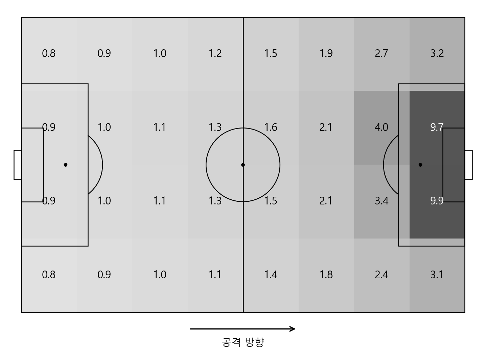

# 연쇄 1장. 마르코프 연쇄 — 공이 이 구역에 있으면 골이 날 확률은 얼마인가

- [I. 질문과 데이터](#i-질문과-데이터)
- [II. 마르코프 연쇄](#ii-마르코프-연쇄)
- [III. 흡수 연쇄의 계산](#iii-흡수-연쇄의-계산)
- [IV. 결과](#iv-결과)
- [V. 불확실성](#v-불확실성)
- [VI. 마르코프 성질의 점검](#vi-마르코프-성질의-점검)
- [VII. 동작의 가치](#vii-동작의-가치)
- [VIII. 해석](#viii-해석)
- [IX. 이 방법을 쓴 연구](#ix-이-방법을-쓴-연구)
- [참고문헌](#참고문헌)

> 데이터: StatsBomb 공개 데이터(<https://github.com/statsbomb/open-data>). 이용 약관에 따라 데이터는 이 저장소에 싣지 않는다.

이 장은 상태가 차례로 바뀌어 가는 과정을 다루는 마르코프 연쇄를 설명한다. 예는 점유다. 한 팀이 공을 잡으면 공은 패스와 드리블로 경기장의 이곳저곳을 거치고, 점유는 골로 끝나거나 공을 잃으며 끝난다. 공이 있는 구역을 상태로 보면 점유는 상태의 열이다. 이 장은 그 열에서 구역 사이를 옮겨 가는 확률을 추정하고, 그 확률만으로 공이 어느 구역에 있을 때 그 점유가 골로 끝날 확률을 계산한다.

회귀 1장은 슛 하나가 골이 될 확률을 다루었다. 그러나 경기의 동작 대부분은 슛이 아니다. 데이터 1장에서 본 대로 사건의 79%가 패스와 받음, 이동이다. 중앙선 근처의 패스 하나가 얼마나 가치 있는지는 슛의 모형으로 말할 수 없다. 이 장의 방법은 슛이 아닌 동작에도 값을 준다. 공을 득점 확률이 높은 구역으로 옮긴 동작은 그 차이만큼 가치가 있다.

장의 순서는 다음과 같다. I장은 데이터를 만든다. II장은 마르코프 연쇄와 전이 확률의 추정을 설명한다. III장은 끝이 있는 연쇄에서 어느 끝에 이를 확률을 계산하는 법을 설명한다. IV장은 결과를 본다. V장은 붓스트랩으로 불확실성을 구하고, 연쇄를 거치지 않은 직접 추정과 비교한다. VI장은 마르코프 연쇄의 가정을 데이터로 점검한다. VII장은 구역의 값으로 패스의 가치를 계산한다. VIII장은 해석을, IX장은 이 방법을 쓴 연구를 적는다.

## I. 질문과 데이터

### 1. 점유를 구역의 열로 적는다

점유는 데이터 1장 II.4절에서 정의했다. 한 팀이 공을 계속 가지고 있는 동안의 사건의 묶음이다. 이 장은 점유마다 점유한 팀의 패스, 공을 가지고 이동, 슛을 순서대로 놓고, 각 동작이 일어난 위치를 본다. 승부차기와 페널티킥은 뺀다.

위치는 구역으로 바꾼다. 경기장을 가로 8칸, 세로 4칸으로 나누어 구역 32개를 만든다. 구역 하나는 가로 15야드(13.7m), 세로 20야드(18.3m)다. 좌표는 팀의 공격 방향을 기준으로 적혀 있으므로(데이터 1장 III.2절) 가로의 첫째 칸은 언제나 자기 골대 앞이고 여덟째 칸은 상대 골대 앞이다. 구역의 수는 타협이다. 구역이 작을수록 위치를 자세히 구분하지만 구역마다의 관측이 줄어든다.

점유는 구역의 열이 되고, 열의 끝에 그 점유가 어떻게 끝났는지를 붙인다. 골로 끝났으면 골, 그렇지 않으면 점유 끝이다. 점유 끝에는 패스가 끊긴 것, 공을 빼앗긴 것, 슛이 빗나간 것, 공이 밖으로 나간 것, 전반이나 경기가 끝난 것이 모두 들어 있다.

**표 1. 점유의 연쇄: 데이터의 요약**

| 항목                                  | 값          |
|:--------------------------------------|:------------|
| 점유                                  | 10,720      |
| 전이(점유 안의 동작)                  | 118,186     |
| 점유 하나의 동작 수의 평균            | 11.0        |
| 점유 하나의 동작 수의 중위값          | 7           |
| 골로 끝난 점유                        | 152 (1.42%) |
| 구역 하나에서 나가는 전이의 수의 최소 | 754         |

표 1에서 점유는 10,720개이고 그 가운데 골로 끝난 것은 152개, 1.4%다. 점유 하나는 평균 11.0개의 동작으로 되어 있고 중위값은 7개다. 짧은 점유가 많고 긴 점유가 드물게 있다. 동작 하나를 한 구역에서 다음 구역으로 가는 전이로 세면 전이는 118,186개다. 가장 적게 관측된 구역에서도 나가는 전이가 754개 있다.

### 2. 직접 세면 왜 부족한가

질문은 공이 어느 구역에 있을 때 그 점유가 골로 끝날 확률이다. 가장 단순한 답은 직접 세는 것이다. 공이 그 구역에 있었던 동작 가운데 그 점유가 골로 끝난 것의 비율을 구한다. 이 방법의 문제는 골이 드물다는 데 있다. 골로 끝난 점유는 152개뿐이고, 그것이 구역 32개에 흩어진다. 자기 진영의 구역은 수천 번 관측되어도 그 가운데 골로 이어진 것은 몇 번이어서 비율이 불안정하다. 마르코프 연쇄는 골만이 아니라 118,186개의 전이 전부를 쓴다. 공이 한 구역에서 다음 구역으로 어떻게 옮겨 가는지를 추정하고, 그것을 이어 붙여 골까지의 확률을 계산한다. V장에서 두 방법을 비교한다.

## II. 마르코프 연쇄

### 1. 상태, 전이 확률, 마르코프 성질

시각 $t = 0, 1, 2, \ldots$마다 유한한 개수의 상태 가운데 하나에 있는 과정 $X_0, X_1, X_2, \ldots$를 생각한다. 여기서 시각은 점유 안에서 몇 번째 동작인지이고 상태는 구역이다. 이 과정이 마르코프 연쇄(Markov chain)라는 것은 다음 상태의 확률이 지금의 상태에만 의존하고 그 전에 거쳐 온 상태에는 의존하지 않는다는 뜻이다.

$$P(X_{t+1} = j \mid X_t = i, X_{t-1}, \ldots, X_0) = P(X_{t+1} = j \mid X_t = i) = p_{ij}$$

이것을 마르코프 성질이라 한다. $p_{ij}$는 상태 $i$에서 상태 $j$로 가는 전이 확률이고, 시각 $t$에 따라 달라지지 않는다고 둔다. 전이 확률을 모은 행렬 $P = (p_{ij})$가 전이 행렬이다. 각 행은 한 상태에서 갈 수 있는 모든 곳의 확률이므로 합이 1이다.

마르코프 성질은 강한 가정이다. 공이 상대 페널티 구역 앞에 있을 때, 그 공이 빠른 역습으로 왔든 30번의 패스 끝에 왔든 앞으로의 전개가 같다고 본다. 사실이 아닐 가능성이 높다. 그래도 이 가정을 두는 것은 그것이 주는 계산의 힘 때문이다. 지금의 상태만 알면 되므로 전이 행렬 하나로 과정 전체가 정해진다. 가정이 얼마나 어긋나는지는 VI장에서 점검한다.

### 2. 전이 확률의 추정

전이 확률은 세어서 추정한다. 상태 $i$에서 상태 $j$로 간 전이의 수를 $n_{ij}$, 상태 $i$에서 나간 전이의 수를 $n_{i \cdot} = \sum_j n_{ij}$라 하면 추정치는 다음과 같다.

$$\hat p_{ij} = \frac{n_{ij}}{n_{i \cdot}}$$

이것은 최대가능도 추정치다(Anderson and Goodman, 1957). 마르코프 성질 아래에서 관측된 열의 가능도는 전이 확률을 전이가 일어난 횟수만큼 곱한 $\prod_{i,j} p_{ij}^{n_{ij}}$이고, 행마다 합이 1이라는 조건에서 이것을 최대화하면 위의 비율이 나온다. 상태 $i$를 떠난 전이들이 어디로 갔는지는 확률이 $(p_{i1}, p_{i2}, \ldots)$인 다항 분포의 표본과 같다.

표 2는 한 구역의 전이 확률이다. 상대 골대에서 15\~30야드 떨어진 중앙 왼쪽의 구역으로, 페널티 구역 바로 앞에 해당한다. 확률이 큰 순서로 6개의 목적지와 나머지를 적었다. 구역은 좌표의 범위로 적었다.

**표 2. 구역 (x 90\~105, y 20\~40)에서 나가는 전이**

| 목적지             | 전이의 수 | 전이 확률(%) |
|:-------------------|----------:|-------------:|
| x 90\~105, y 20\~40  |       693 |         35.7 |
| 점유 끝            |       413 |         21.3 |
| x 105\~120, y 20\~40 |       165 |          8.5 |
| x 90\~105, y 0\~20   |       132 |          6.8 |
| x 75\~90, y 20\~40   |       120 |          6.2 |
| x 90\~105, y 40\~60  |       106 |          5.5 |
| 그 밖의 21곳       |       314 |         16.2 |

표 2에서 이 구역을 떠나는 전이는 1,943개다. 가장 흔한 것은 같은 구역에 머무는 것(36%)이다. 공을 받아 조금 움직이거나 짧게 주고받는 동작이다. 점유가 여기서 끝나는 것이 21%이고, 이 구역의 동작에서 바로 골이 되는 것은 0.8%다. 이 구역에서 찬 슛이 들어간 경우다. 전이 행렬 전체는 32행, 34열이다. 열이 둘 더 많은 것은 골과 점유 끝이 목적지에 있기 때문이다.

### 3. 흡수 상태

골과 점유 끝은 다른 상태와 성질이 다르다. 거기에 이르면 연쇄가 끝난다. 한번 들어가면 나오지 않는 상태를 흡수 상태(absorbing state)라 하고, 나머지를 일시 상태(transient state)라 한다. 어느 일시 상태에서 출발하든 언젠가는 흡수 상태에 이르는 연쇄를 흡수 연쇄라 한다. 점유는 언젠가 끝나므로 이 연쇄는 흡수 연쇄다. 흡수 연쇄에 대해 묻는 것은 정해져 있다. 어느 흡수 상태에 이르는가, 이르기까지 몇 단계가 걸리는가, 그동안 각 상태를 몇 번 거치는가다.

## III. 흡수 연쇄의 계산

### 1. 첫 단계 분석

구역 $i$에서 출발한 점유가 골로 끝날 확률을 $v_i$라 하자. 이 장이 구하려는 값이다. 마르코프 성질에서 간단한 관계가 나온다. 구역 $i$에서 한 단계를 가면 세 가지 가운데 하나가 일어난다. 바로 골이 되거나, 점유가 끝나거나, 어떤 구역 $j$로 간다. 구역 $j$로 갔다면 거기서부터 골로 끝날 확률은 $v_j$다. 어떻게 $j$에 왔는지는 상관이 없기 때문이다.

$$v_i = p_{i,\text{골}} + \sum_{j=1}^{n} p_{ij}\ v_j$$

점유 끝으로 간 경우는 골이 될 확률이 0이어서 식에 나타나지 않는다. 구역마다 이 식이 하나씩 있으므로 미지수 $v_1, \ldots, v_n$에 대한 연립 1차 방정식 $n$개가 된다. 한 구역의 값이 다른 구역들의 값으로 정해지고, 그것들이 서로 맞물려 한꺼번에 풀린다. 이 방법을 첫 단계 분석이라 한다.

### 2. 행렬로 푼다

전이 행렬을 일시 상태와 흡수 상태로 나누어 적는다. 일시 상태에서 일시 상태로 가는 부분을 $Q$($n \times n$), 일시 상태에서 흡수 상태로 가는 부분을 $R$($n \times 2$)이라 하면 다음과 같다.

$$P = \begin{pmatrix} Q & R \\ 0 & I \end{pmatrix}$$

아래 행은 흡수 상태가 자기 자신에 머문다는 뜻이다. 앞 절의 방정식을 벡터로 적으면 $v = r + Qv$이고, $r$은 $R$의 골에 해당하는 열이다. 풀면 $v = (I - Q)^{-1} r$이다. 여기에 나오는 역행렬을 기본 행렬(fundamental matrix)이라 한다(Kemeny and Snell, 1976).

$$N = (I - Q)^{-1} = I + Q + Q^2 + Q^3 + \cdots$$

둘째 등식이 $N$의 뜻을 알려 준다. $Q^k$의 $(i, j)$ 원소는 구역 $i$에서 출발해 $k$단계 뒤에 구역 $j$에 있을 확률이다. 그것을 모든 $k$에 대해 더한 $N$의 $(i, j)$ 원소는 구역 $i$에서 출발한 점유가 끝날 때까지 구역 $j$를 거치는 횟수의 기댓값이다. 기본 행렬에서 세 가지 값이 나온다.

$$B = N R, \qquad t = N \mathbf{1}, \qquad v = B \text{의 골에 해당하는 열}$$

$B$의 $(i, k)$ 원소는 구역 $i$에서 출발해 흡수 상태 $k$로 끝날 확률이다. $t_i$는 $N$의 $i$행을 더한 값으로 구역 $i$에서 출발한 점유가 끝날 때까지의 동작 수의 기댓값이다. 계산은 32행 32열의 역행렬 하나다. `sportsdata/markov.py`의 `absorbing` 함수가 한다.

## IV. 결과

### 1. 구역의 값

그림 1은 구역마다의 $v_i$, 즉 공이 그 구역에 있을 때 점유가 골로 끝날 확률을 경기장에 그린 것이다. 수는 백분율이고 색이 진할수록 값이 크다. 공격 방향은 오른쪽이다.

그림 1에서 값은 자기 골대 쪽의 0.8%에서 상대 골대 앞 중앙의 9.9%까지 걸쳐 있다. 세 가지를 알 수 있다. 첫째, 값은 상대 골대에 가까울수록 크지만 고르게 커지지 않는다. 자기 진영에서 중앙선까지는 칸마다 0.1\~0.3%포인트씩 오르다가, 마지막 두 칸에서 급하게 오른다. 중앙의 두 행에서 마지막 칸은 평균 9.8%이고 그 앞 칸은 3.7%다. 둘째, 같은 깊이에서도 가운데와 가장자리가 다르다. 마지막 칸에서 양쪽 가장자리는 평균 3.1%로 중앙의 3분의 1이다. 골라인 근처의 측면은 골대에 가까워도 값이 낮다. 회귀 1장에서 각도가 한 역할이 여기서는 구역의 값으로 나타난다. 셋째, 가장 높은 구역도 10%에 못 미친다. 공이 상대 골대 앞에 있어도 그 점유의 열에 아홉은 골 없이 끝난다.

이 값들을 점유가 시작된 구역의 분포로 가중 평균하면 1.42%이고, 이것은 표 1의 골로 끝난 점유의 비율과 정확히 같다. 우연이 아니다. 전이 확률을 세어서 추정했으므로 연쇄가 재현하는 전체 흡수 비율은 데이터의 비율과 일치한다. 로지스틱 회귀에서 예측 확률의 합이 골의 수와 같았던 것(회귀 1장 II.3절)과 같은 성질이다.

### 2. 점유가 끝날 때까지의 동작 수

기본 행렬의 행을 더한 $t_i$는 그 구역에서 출발한 점유가 끝날 때까지 남은 동작 수의 기댓값이다. 자기 진영의 두 칸에서는 평균 12.0개, 중앙선 근처에서는 11.5개이고, 상대 골대 앞 중앙에서는 4.2개다. 상대 골대에 가까울수록 점유는 금방 끝난다. 슛을 하거나 공을 잃기 때문이다. 자기 진영의 맨 뒤 칸이 그 앞 칸보다 조금 짧은 것은 골키퍼가 길게 찬 공이 끊기는 경우가 있기 때문으로 보인다. 이 값은 점유의 성격을 요약한다. 값이 큰 구역은 공이 안전하게 도는 곳이고, 작은 구역은 결판이 나는 곳이다.

## V. 불확실성

### 1. 붓스트랩

그림 1의 값에는 표준오차가 없다. $v$는 전이 확률 천여 개의 복잡한 함수여서 표준오차를 식으로 구하기 어렵다. 이럴 때 쓰는 방법이 붓스트랩(bootstrap)이다(Efron, 1979). 생각은 단순하다. 표본에서 다시 표본을 뽑는다. 관측 $m$개에서 복원 추출로 $m$개를 뽑아 새 데이터를 만들고, 거기서 추정치를 다시 계산한다. 이것을 수백 번 되풀이하면 추정치의 분포가 생긴다. 그 분포의 표준편차가 표준오차의 추정치이고, 2.5%와 97.5% 분위수가 95% 신뢰구간이다. 원래 표본이 모집단을 대신하고, 다시 뽑은 표본들이 모집단에서 되풀이해 뽑은 표본들을 대신한다.

무엇을 뽑는 단위로 삼는지가 중요하다. 전이 하나하나를 뽑으면 안 된다. 전이들은 독립이 아니다. 같은 점유의 전이는 이어져 있고, 같은 경기의 점유는 같은 두 팀의 것이다. 독립이라고 볼 수 있는 단위를 통째로 뽑아야 그 안의 의존이 다시 뽑은 데이터에도 보존된다. 이 장은 경기를 단위로 한다. 64경기에서 복원 추출로 64경기를 뽑고, 뽑힌 경기들의 전이를 모아 전이 행렬과 $v$를 다시 계산한다. 이것을 군집 붓스트랩이라 한다. 1,000번 되풀이한다.

### 2. 연쇄를 거친 추정과 직접 추정

I.2절에서 말한 직접 추정도 같은 방식으로 표준오차를 구할 수 있다. 표 3은 중앙의 한 행을 따라 자기 골대 쪽에서 상대 골대 쪽으로 가며 고른 네 구역에 대해 두 추정치와 붓스트랩 표준오차를 적은 것이다. 직접 추정은 그 구역의 동작 가운데 점유가 골로 끝난 것의 비율이다.

**표 3. 구역의 값: 직접 추정과 연쇄를 거친 추정, 붓스트랩 표준오차 (%포인트)**

| 구역               | 동작의 수 | 직접 추정(%) | 표준오차 | 연쇄 추정(%) | 표준오차 |
|:-------------------|----------:|-------------:|---------:|-------------:|---------:|
| x 15\~30, y 20\~40   |     3,343 |         1.11 |     0.26 |         1.00 |     0.09 |
| x 45\~60, y 20\~40   |     6,064 |         1.50 |     0.32 |         1.33 |     0.13 |
| x 75\~90, y 20\~40   |     3,231 |         2.88 |     0.60 |         2.14 |     0.20 |
| x 105\~120, y 20\~40 |     1,099 |        10.56 |     1.11 |         9.70 |     0.97 |

표 3에서 두 추정치는 같은 것을 추정하지만 정밀도가 다르다. 연쇄를 거친 추정의 표준오차가 네 구역 모두에서 작다. 32개 구역 전체로 보면 직접 추정의 표준오차는 연쇄 추정의 평균 2.7배다. 차이는 자기 진영에서 크고 상대 골대 앞에서 작다. 자기 진영의 구역은 골까지 거리가 멀어서, 직접 추정은 그 구역을 거친 점유가 우연히 골로 끝났는지에 좌우된다. 연쇄 추정은 그 구역에서 다음 구역으로 가는 전이만 그 구역의 데이터에서 가져오고, 그 뒤의 길은 다른 모든 점유의 데이터를 함께 쓴다. 값이 가장 큰 구역(x 105\~120, y 40\~60)의 추정치는 9.9%이고 95% 신뢰구간은 7.6\~12.2%다.

직접 추정의 값은 구역마다 들쭉날쭉하다. 가로로 이웃한 두 구역의 쌍 28개 가운데 상대 골대에 더 가까운 구역의 값이 오히려 작은 쌍이 직접 추정에서는 8개이고 연쇄 추정에서는 0개다. 연쇄 추정은 그림 1처럼 고르게 변한다. 이 정밀도에는 대가가 있다. 연쇄 추정은 마르코프 성질이 맞을 때만 치우치지 않는다. 가정이 틀리면 표준오차는 작아도 추정치가 실제 값에서 벗어난다. 직접 추정은 아무 가정도 쓰지 않으므로 치우침이 없고 변동이 크다. 모형을 쓴다는 것은 대개 이 교환이다. 가정을 받아들이는 대신 정밀도를 얻는다. 그 교환이 이득인지는 가정이 얼마나 어긋나는지에 달려 있다.

## VI. 마르코프 성질의 점검

### 1. 관측과 예측을 비교한다

마르코프 성질이 맞다면 공이 어느 구역에 있을 때 점유가 골로 끝날 확률은 그 구역의 값 $v_i$이고, 공이 어떻게 그 구역에 왔는지에는 의존하지 않는다. 이것은 데이터로 점검할 수 있다. 동작마다 두 값을 놓는다. 하나는 그 점유가 실제로 골로 끝났는지(1 또는 0)이고, 다른 하나는 그 동작의 구역의 값 $v_i$다. 동작들을 어떤 기준으로 묶든, 가정이 맞다면 묶음 안에서 앞의 값의 평균(관측)과 뒤의 값의 평균(예측)이 우연의 범위 안에서 같아야 한다. 묶는 기준이 지나온 길에 관한 것이면 이 비교는 지나온 길에 정보가 있는지를 묻는 것이 된다. 구역이 다른 동작들을 섞어 비교해도 된다. 구역에 따른 차이는 예측에 이미 들어 있기 때문이다.

세 가지 기준으로 묶는다. 전체, 점유 안에서 몇 번째 동작인지, 바로 앞 동작의 위치다. 표 4가 그 결과다. 차이는 관측에서 예측을 뺀 값이고, 신뢰구간은 경기를 단위로 한 붓스트랩으로 구했다. 붓스트랩에서 구역의 값은 원래 데이터에서 추정한 것으로 고정했다.

**표 4. 마르코프 성질의 점검: 점유가 골로 끝난 비율의 관측과 연쇄의 예측**

| 기준 | 묶음 | 동작의 수 | 관측(%) | 예측(%) | 차이(%p) | 하한 | 상한 |
|:---|:---|---:|---:|---:|---:|---:|---:|
| 전체 | 모든 동작 | 118,186 | 1.99 | 1.69 | 0.31 | -0.12 | 0.85 |
| 점유 안에서의 순서 | 첫 동작 | 10,720 | 1.42 | 1.42 | 0.00 | -0.27 | 0.26 |
|  | 2\~10번째 | 57,981 | 1.81 | 1.61 | 0.20 | -0.12 | 0.53 |
|  | 11번째 이후 | 49,485 | 2.33 | 1.83 | 0.50 | -0.22 | 1.45 |
| 바로 앞 동작의 위치 | 뒤쪽 칸에서 옴 | 28,863 | 2.28 | 1.99 | 0.29 | -0.14 | 0.75 |
|  | 같은 칸이나 앞쪽 칸에서 옴 | 78,603 | 1.96 | 1.61 | 0.35 | -0.15 | 0.96 |

### 2. 결과

첫 동작에서는 관측과 예측이 정확히 같다. IV.1절에서 본 성질이다. 점유가 시작된 구역의 분포로 가중한 $v$의 평균은 골로 끝난 점유의 비율과 일치한다. 그런데 모든 동작으로 넓히면 관측이 1.99%, 예측이 1.69%로 관측이 0.31%포인트 높다. 신뢰구간은 -0.12에서 0.85까지다. 순서별로 보면 차이는 2\~10번째 동작에서 0.20%포인트, 11번째 이후에서 0.50%포인트다. 표 3에서 직접 추정이 네 구역 모두에서 연쇄 추정보다 컸던 것이 같은 현상이다. 직접 추정은 동작을 단위로 세므로 표 4의 관측에 해당한다.

이 차이가 뜻하는 것은 골로 끝난 점유가 연쇄가 예상하는 것보다 길다는 것이다. 동작을 단위로 세면 긴 점유는 여러 번 세어진다. 골로 끝난 점유가 길수록 동작 가운데 골로 끝난 점유에 속한 것의 비율이 올라간다. 마르코프 연쇄에서는 점유가 길어진다는 것과 골로 끝난다는 것 사이에 구역을 거친 것 말고는 관계가 없어야 한다. 데이터에서는 그 이상의 관계가 있다. 같은 구역이라도 오래 이어진 점유 속의 동작이 골로 끝날 가능성이 더 높다. 다만 신뢰구간이 넓다. 골로 끝난 점유가 152개뿐이어서 이 정도의 차이는 우연과 뚜렷이 구분되지 않는다.

바로 앞 동작의 위치는 정보를 주지 않는다. 뒤쪽 칸에서 온 동작과 그렇지 않은 동작의 차이는 각각 0.29%포인트와 0.35%포인트로 서로 비슷하다. 공이 앞으로 나아가며 왔는지 옆이나 뒤에서 왔는지는 지금의 구역이 주는 것 이상을 알려 주지 않는다.

정리하면 가정이 크게 어긋난다는 증거는 없지만, 어긋나는 방향은 보인다. 긴 점유 쪽이다. 가능한 설명이 둘 있다. 하나는 상대 진영에서 오래 공을 돌린 점유는 수비를 한쪽으로 몰아 빈 곳을 만든다는 것이다. 다른 하나는 선택이다. 긴 점유를 이어 갈 수 있는 팀이 더 강한 팀이고, 강한 팀은 같은 구역에서도 골을 더 넣는다. 어느 쪽이든 구역만으로는 상태를 다 나타내지 못한다. 수비수가 어디 있는지, 공이 얼마나 빨리 왔는지, 어느 팀의 공인지가 상태에 없다. 마르코프 성질은 상태를 어떻게 정의하는지에 달린 가정이다. 상태에 정보를 더 넣으면 가정은 더 그럴듯해지고 상태의 수는 늘어나며 전이 확률의 추정은 불안정해진다. 구역 32개의 연쇄는 그 한쪽 끝에 있는 단순한 모형이다. 그림 1의 값은 점유가 시작될 때의 기준으로는 데이터와 맞고, 점유가 길어질수록 조금 낮게 잡힌 값으로 본다.

## VII. 동작의 가치

### 1. 구역의 값의 차이

구역의 값이 있으면 공을 옮기는 동작에 값을 줄 수 있다. 공을 구역 $i$에서 구역 $j$로 옮긴 동작의 가치를 두 구역의 값의 차이로 둔다.

$$\Delta = v_j - v_i$$

점유가 골로 끝날 확률을 그만큼 높였다는 뜻이다. 성공한 패스는 패스가 끝난 구역의 값에서 시작한 구역의 값을 뺀 것이다. 실패한 패스는 점유를 끝냈으므로 시작한 구역의 값을 모두 잃은 $-v_i$로 둔다. 이 계산에서 뒤로 주는 패스는 성공해도 값이 음수다. 그 패스가 나쁜 패스라는 뜻은 아니다. 뒤로 돌린 공이 다음 동작에서 더 좋은 곳으로 갈 수 있다. 한 동작의 값은 그 동작이 직접 바꾼 것만 센다.

패스 68,079개에 값을 매기면 성공한 패스의 값은 평균 0.16%포인트이고 46%가 양수다. 성공한 패스의 절반 넘게는 값이 0이거나 음수다. 같은 구역 안에서 주고받거나 뒤로 돌린 패스다. 실패한 패스의 값은 평균 -1.95%포인트다. 패스 하나의 값은 작다. 가장 큰 값도 자기 진영에서 상대 골대 앞으로 한 번에 넘긴 패스의 8.7%포인트다.

### 2. 성공률과 가치는 다른 것을 측정한다

다층 모형 1장은 선수의 패스 성공률을 다루면서 성공률이 패스의 가치를 말해 주지 않는다고 했다. 여기서 그것을 확인할 수 있다. 선수마다 패스의 값을 더하고 패스 100개당으로 환산한다. 표 5는 패스가 150개 이상인 선수 가운데 100개당 값이 가장 큰 5명과 성공률이 가장 높은 선수 5명이다. 값의 단위는 골이다. 패스 100개가 점유가 골로 끝날 확률을 합쳐서 얼마나 높였는지를 나타낸다.

**표 5. 패스의 가치와 성공률: 패스가 150개 이상인 선수**

| 순위의 기준 | 선수 | 패스 | 성공률(%) | 값의 합(골) | 100개당 값(골) |
|:---|:---|---:|---:|---:|---:|
| 100개당 값 | Thiago Emiliano da Silva | 335 | 95.5 | 0.43 | 0.129 |
| 100개당 값 | César Azpilicueta Tanco | 179 | 94.4 | 0.20 | 0.109 |
| 100개당 값 | Kamal Miller | 199 | 92.5 | 0.16 | 0.081 |
| 100개당 값 | Marcos Aoás Corrêa | 358 | 96.4 | 0.22 | 0.061 |
| 100개당 값 | Young-Gwon Kim | 209 | 86.1 | 0.11 | 0.052 |
| 성공률 | Axel Witsel | 175 | 96.6 | -0.06 | -0.036 |
| 성공률 | Marcos Aoás Corrêa | 358 | 96.4 | 0.22 | 0.061 |
| 성공률 | John Stones | 449 | 95.8 | 0.02 | 0.004 |
| 성공률 | Thiago Emiliano da Silva | 335 | 95.5 | 0.43 | 0.129 |
| 성공률 | Andreas Christensen | 248 | 95.2 | 0.05 | 0.021 |

표 5에서 두 순위는 겹치기도 하고 어긋나기도 한다. 두 목록에 함께 있는 선수는 2명이다. 성공률이 가장 높은 Axel Witsel은 성공률이 96.6%인데 100개당 값은 -0.036골이다. 패스가 150개 이상인 선수 155명 가운데 132명은 값의 합이 음수다. 패스를 거의 다 성공시켜도 공을 득점 확률이 높은 곳으로 옮기지 않으면 값이 쌓이지 않는다. 성공률과 100개당 값의 상관계수는 0.62다. 양의 상관이 있는 것은 실패한 패스가 값을 잃기 때문이고, 상관이 1에서 먼 만큼 둘은 다른 것을 측정한다.

이 값을 선수의 능력으로 해석하기 전에 고려할 점이 셋 있다. 첫째, 다층 모형 1장의 교훈이 그대로 적용된다. 패스 수가 다른 선수들의 값을 그대로 비교하면 안 되고, 패스 수백 개의 합에도 표본 변동이 크다. 표의 값에는 구간이 없다. 둘째, 실패한 패스의 비용을 작게 잡았다. 공을 잃으면 자기 팀의 득점 가능성만 사라지는 것이 아니라 상대의 득점 가능성이 생긴다. 자기 골대 앞에서 공을 잃는 것이 중앙선에서 잃는 것보다 훨씬 위험한데, 이 계산에서는 자기 골대 앞에서 잃을 때의 비용이 더 작다. 그 구역의 값이 낮기 때문이다. 표의 위쪽이 수비수인 것은 이 때문일 수 있다. 셋째, 구역이 크다. 한 구역 안에서 수비를 벗겨 낸 패스는 값이 0이다.

## VIII. 해석

이 장의 모형은 축구 분석에서 기대 위협(expected threat)이라 부르는 것과 같다. 득점을 슛에서만 보지 않고 슛에 이르는 과정에 값을 나누어 준다는 생각이다. 계산은 전이를 세는 것과 역행렬 하나가 전부다. 그 단순함이 장점이다. 무엇을 가정했는지가 분명하고, 가정이 어디서 어긋나는지를 데이터로 점검할 수 있다.

구역의 값은 원인을 말하지 않는다. 그 구역에 공이 있었던 점유의 10%가 골로 끝났다는 것은 누구든 공을 그 구역에 가져다 놓으면 그 확률을 얻는다는 뜻이 아니다. 공이 그 구역에 이르렀다는 것 자체가 수비가 뚫렸다는 신호다. VI장의 점검이 시사하듯이 같은 구역에서도 상황에 따라 확률이 다를 수 있다. 값은 그 구역에 공이 있었던 실제 상황들의 평균이고, 그 상황들은 팀들이 고른 것이다.

방법으로 남는 것은 셋이다. 첫째, 드문 결과를 직접 세는 대신 흔한 전이를 세어 이어 붙이면 정밀도가 크게 오른다. 이 장에서는 표준오차가 평균 2.7분의 1이 되었다. 둘째, 그 이득은 가정에서 온다. 가정은 점검해야 하고, 점검의 결과는 가정을 버릴지가 아니라 결과를 어디까지 믿을지를 정한다. 셋째, 식으로 표준오차를 구하기 어려운 추정치는 붓스트랩으로 불확실성을 구할 수 있고, 그때 다시 뽑는 단위는 독립이라고 볼 수 있는 단위여야 한다.

## IX. 이 방법을 쓴 연구

축구의 점유를 마르코프 연쇄로 모형화해 동작에 값을 준 초기의 작업은 Rudd (2011)이다. 공의 위치와 경기 상황으로 상태를 정의하고, 점유가 골로 끝나는 것과 공을 잃는 것을 흡수 상태로 두어, 선수의 동작이 흡수 확률을 얼마나 바꾸었는지로 공격 기여를 평가했다. 이 장의 III장과 VII장이 그 틀을 따른다. Singh (2019)은 같은 구조를 경기장의 격자 위에서 정리해 기대 위협이라는 이름을 붙였고, III.1절의 식을 되풀이 대입해 푸는 방법을 썼다. 되풀이 대입은 III.2절의 급수 $I + Q + Q^2 + \cdots$를 앞에서부터 더해 가는 것과 같고, 충분히 되풀이하면 역행렬로 구한 값과 일치한다. 이 장의 분석과 다른 점은 데이터의 크기다. 그 작업들은 여러 시즌의 리그 데이터로 격자를 훨씬 잘게 나누었다.

Decroos et al. (2019)은 마르코프 성질을 쓰지 않는 방향으로 갔다. 구역을 상태로 두는 대신, 각 동작의 종류와 위치, 직전 동작들의 정보를 설명변수로 삼아 그 뒤 몇 동작 안에 골이 날 확률과 실점할 확률을 기계학습 모형으로 예측하고, 동작 전후의 확률 차이를 동작의 값으로 삼았다. VI장에서 다룬 지나온 길의 정보와 VII.2절에서 지적한 실점의 위험을 모두 모형에 넣은 셈이다. 그 대가는 III장과 같은 닫힌 계산이 없다는 것과 훨씬 많은 데이터가 필요하다는 것이다.

## 참고문헌

Anderson, T. W., and Goodman, L. A. (1957). “Statistical inference about Markov chains.” *The Annals of Mathematical Statistics* 28(1), 89–110.

Decroos, T., Bransen, L., Van Haaren, J., and Davis, J. (2019). “Actions speak louder than goals: Valuing player actions in soccer.” *Proceedings of the 25th ACM SIGKDD International Conference on Knowledge Discovery & Data Mining*, 1851–1861.

Efron, B. (1979). “Bootstrap methods: Another look at the jackknife.” *The Annals of Statistics* 7(1), 1–26.

Kemeny, J. G., and Snell, J. L. (1976). *Finite Markov Chains*. Springer.

Rudd, S. (2011). “A framework for tactical analysis and individual offensive production assessment in soccer using Markov chains.” *New England Symposium on Statistics in Sports*.

Singh, K. (2019). “Introducing expected threat (xT).” <https://karun.in/blog/expected-threat.html>.
