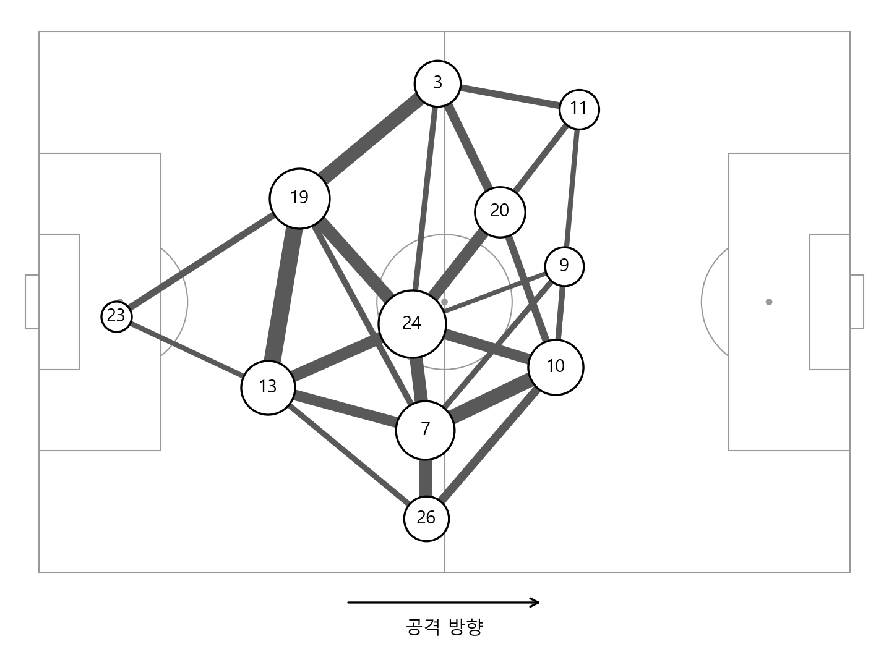
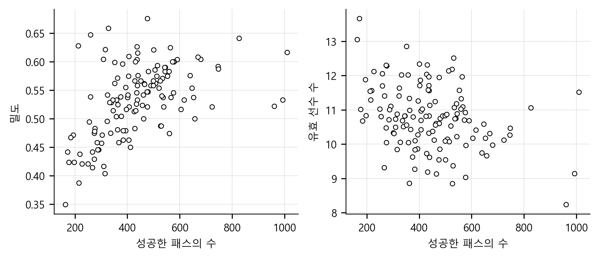

# 연쇄 2장. 패스 네트워크 — 공은 누구를 거쳐 가는가

- [I. 질문과 데이터](#i-질문과-데이터)
- [II. 그래프의 표현](#ii-그래프의-표현)
- [III. 중심성](#iii-중심성)
- [IV. 중심성의 불확실성](#iv-중심성의-불확실성)
- [V. 네트워크 전체의 요약](#v-네트워크-전체의-요약)
- [VI. 팀 사이의 비교](#vi-팀-사이의-비교)
- [VII. 해석](#vii-해석)
- [VIII. 이 방법을 쓴 연구](#viii-이-방법을-쓴-연구)
- [참고문헌](#참고문헌)

> 데이터: StatsBomb 공개 데이터(<https://github.com/statsbomb/open-data>). 이용 약관에 따라 데이터는 이 저장소에 싣지 않는다.

이 장은 대상들 사이의 관계를 그래프로 적고 그 구조를 요약하는 방법을 설명한다. 예는 패스다. 패스에는 준 선수와 받은 선수가 있다. 선수를 점으로, 패스를 점과 점을 잇는 선으로 적으면 한 팀의 한 경기는 그래프 하나가 된다. 이 장은 그 그래프에서 어느 선수가 중심에 있는지를 나타내는 값을 정의하고, 그 값이 얼마나 불안정한지를 보고, 그래프 전체를 요약한 값으로 팀과 팀을 비교할 때 무엇을 조심해야 하는지를 다룬다.

연쇄 1장은 공이 거쳐 간 구역을 상태로 두었다. 이 장은 공이 거쳐 간 선수를 본다. 두 장은 같은 데이터를 다르게 묶은 것이고 수학도 이어진다. 한 선수에게서 다음 선수로 공이 넘어가는 비율은 전이 확률이고, 이 장에서 다루는 중심성 가운데 하나는 그 전이 행렬의 정상 분포다. 다른 점은 질문이다. 앞 장은 위치의 가치를 물었고, 이 장은 관계의 구조를 묻는다.

장의 순서는 다음과 같다. I장은 데이터를 만든다. II장은 그래프를 행렬로 적는 법을 설명한다. III장은 중심성 세 가지를 정의하고 한 경기에 적용한다. IV장은 붓스트랩으로 중심성의 불확실성을 구한다. V장은 그래프 전체를 요약하는 값과 그 값이 패스의 수에 의존하는 문제를 다룬다. VI장은 팀을 비교한다. VII장은 해석을, VIII장은 이 방법을 쓴 연구를 적는다.

## I. 질문과 데이터

### 1. 패스를 선수의 쌍으로 적는다

성공한 패스에는 준 선수와 받은 선수가 적혀 있다. 실패한 패스에는 받은 선수가 없으므로 이 장은 성공한 패스만 쓴다. 승부차기는 뺀다. 한 팀의 한 경기를 단위로 삼아, 그 경기에서 그 팀의 선수들이 주고받은 패스를 모은 것을 패스 네트워크라 부른다. 64경기에 팀이 둘씩이므로 네트워크는 128개다. 표 1은 그 크기를 요약한 것이다. 선수의 수는 그 경기에서 패스를 한 번이라도 주거나 받은 선수의 수이고, 교체로 들어온 선수가 포함되므로 11보다 크다.

**표 1. 패스 네트워크: 데이터의 요약**

| 항목                                  | 값         |
|:--------------------------------------|:-----------|
| 네트워크(한 팀의 한 경기)             | 128        |
| 성공한 패스                           | 56,346     |
| 네트워크 하나의 패스 수의 평균        | 440        |
| 네트워크 하나의 패스 수의 최소와 최대 | 163, 1,009 |
| 네트워크 하나의 선수 수의 중위값      | 16         |
| 네트워크 하나의 선수 수의 최소와 최대 | 12, 17     |

표 1에서 성공한 패스는 56,346개이고 네트워크 하나에 평균 440개다. 네트워크의 크기는 고르지 않다. 패스가 가장 적은 네트워크는 163개, 가장 많은 네트워크는 1,009개로 6.2배 차이가 난다. 선수의 수도 12명에서 17명까지 다르다. 크기가 다른 그래프를 비교하는 것이 V장의 주제다.

### 2. 예로 쓰는 경기

II장부터 IV장까지는 네트워크 하나를 예로 쓴다. 결승전의 Argentina다. 연장전까지 간 경기여서 패스가 560개이고, 패스에 관여한 선수는 선발 11명과 교체로 들어온 6명을 합해 17명이다. 교체로 들어온 선수는 뛴 시간이 짧아 패스가 적다. 이 점은 선수의 값을 해석할 때마다 고려해야 한다. 네트워크의 값은 선수가 뛴 시간을 보정하지 않은 합계에서 나온다.

## II. 그래프의 표현

### 1. 노드, 변, 인접 행렬

그래프(graph)는 노드(node)의 집합과 노드의 쌍을 잇는 변(edge)의 집합이다. 여기서 노드는 선수이고 변은 패스다. 패스에는 방향이 있다. 선수 $i$가 선수 $j$에게 준 것과 $j$가 $i$에게 준 것은 다르다. 변에 방향이 있는 그래프를 방향 그래프라 한다. 또 같은 두 선수 사이에 패스가 여러 번 있으므로 변마다 횟수를 붙인다. 이 수를 가중치라 하고, 가중치가 있는 그래프를 가중 그래프라 한다. 패스 네트워크는 가중 방향 그래프다.

그래프는 행렬로 적는다. 노드가 $n$개일 때 $n$행 $n$열의 행렬 $A$를 두고, $(i, j)$ 원소 $a_{ij}$에 선수 $i$가 선수 $j$에게 성공시킨 패스의 수를 적는다. 이것이 인접 행렬(adjacency matrix)이다. 행은 준 선수이고 열은 받은 선수다. 방향이 있으므로 $A$는 대칭이 아니다. 자기 자신에게 주는 패스는 없으므로 대각선은 0이다. 그래프에 관한 계산은 모두 이 행렬에 대한 계산이 된다.

표 2는 예로 쓰는 네트워크의 인접 행렬 가운데 패스에 가장 많이 관여한 선수 6명의 부분이다. 행이 준 선수, 열이 받은 선수이고, 열의 이름은 등번호다.

**표 2. 인접 행렬의 일부: 결승전 Argentina의 선수 6명 사이의 성공한 패스 수**

| 준 선수(등번호)         |  24 |  19 |   7 |  10 |  13 |  20 |
|:------------------------|----:|----:|----:|----:|----:|----:|
| Enzo Fernandez (24)     |   0 |   9 |  14 |  11 |   7 |   9 |
| Nicolás Otamendi (19)   |  14 |   0 |   3 |   0 |  18 |   1 |
| Rodrigo De Paul (7)     |   9 |   8 |   0 |  14 |   8 |   3 |
| Lionel Messi (10)       |   8 |   1 |  12 |   0 |   2 |   6 |
| Cristian Romero (13)    |  14 |  12 |  11 |   2 |   0 |   1 |
| Alexis MacAllister (20) |  12 |   3 |   2 |   7 |   0 |   0 |

표 2에서 행렬이 대칭이 아니라는 것이 바로 보인다. 전체 행렬에서 가장 큰 원소는 Nicolás Otamendi가 Cristian Romero에게 준 18개이고, 반대 방향은 12개다. 방향의 차이가 가장 큰 쌍은 Nicolás Tagliafico와 Alexis MacAllister다. 앞의 선수가 뒤의 선수에게 13개를 주었고 돌려받은 것은 3개다. 방향을 무시하고 두 수를 더해 버리면 공이 어느 쪽으로 흐르는지가 사라진다.

### 2. 그림으로 그린다

그림 1은 같은 네트워크를 경기장 위에 그린 것이다. 선발 11명만 그렸다. 원의 위치는 그 선수가 패스를 준 위치의 평균이고, 원의 크기는 준 패스와 받은 패스의 합에 비례한다. 선은 두 선수 사이의 패스를 양방향으로 더한 수가 8개 이상인 쌍에만 그었고 굵기가 그 수에 비례한다. 원 안의 수는 등번호다. 공격 방향은 오른쪽이다.

그림 1에서 가장 굵은 선은 중앙 수비수 두 명(19번과 13번) 사이에 있고, 굵은 선의 대부분은 수비수와 미드필더를 잇는다. 가장 앞에 있는 9번과 11번은 원이 작고 선이 가늘다. 이런 그림은 팀의 모양을 한눈에 보여 주지만 버리는 것이 많다. 선발 11명의 쌍 55개 가운데 선이 그어진 것은 25개다. 기준을 8개가 아닌 다른 수로 잡으면 그림이 달라진다. 선수의 위치는 평균이어서 좌우를 오간 선수는 가운데에 찍힌다. 방향도, 패스가 일어난 순서도 그림에 없다. 그림은 인접 행렬을 이해하기 위한 보조 수단으로 쓰고, 진술은 행렬에서 계산한 값으로 한다.

## III. 중심성

중심성(centrality)은 그래프에서 노드가 얼마나 중요한 자리에 있는지를 수 하나로 나타낸 것이다. 중요하다는 말의 뜻이 여럿이어서 중심성도 여럿이다. 이 장은 세 가지를 다룬다. 패스를 얼마나 많이 주고받았는가, 다른 선수들 사이의 길목에 있는가, 공이 얼마나 자주 그 선수에게 가는가다.

### 1. 강도

가장 단순한 중심성은 세는 것이다. 노드에 붙은 변의 가중치를 더한 값을 강도(strength)라 한다. 방향 그래프에서는 나가는 것과 들어오는 것을 따로 센다.

$$s_i^{\text{out}} = \sum_{j} a_{ij}, \qquad s_i^{\text{in}} = \sum_{j} a_{ji}$$

나가는 강도는 그 선수가 성공시킨 패스의 수이고 들어오는 강도는 받은 패스의 수다. 인접 행렬의 행의 합과 열의 합이다. 가중치가 없는 그래프에서 변의 수를 센 것을 차수(degree)라 하는데, 강도는 그것을 가중 그래프로 넓힌 것이다. 강도는 그 선수와 직접 이어진 변만 본다. 그 패스를 받은 선수가 누구이고 그 선수가 다시 누구와 이어져 있는지는 고려하지 않는다.

### 2. 매개 중심성

매개 중심성(betweenness centrality)은 노드가 다른 노드들 사이의 길목에 있는 정도를 나타낸다(Freeman, 1977). 두 선수 $s$와 $t$ 사이의 최단 경로를 생각한다. 그 경로가 선수 $v$를 지나면 $v$는 $s$와 $t$를 잇는 자리에 있다. 이것을 모든 쌍에 대해 평균한다.

$$b_v = \frac{1}{(n-1)(n-2)} \sum_{s \ne v} \sum_{t \ne v,\, t \ne s} \frac{\sigma_{st}(v)}{\sigma_{st}}$$

$\sigma_{st}$는 $s$에서 $t$로 가는 최단 경로의 수이고 $\sigma_{st}(v)$는 그 가운데 $v$를 지나는 것의 수다. 앞의 분수는 $v$를 뺀 나머지 선수들의 순서쌍의 수로 나누는 것이어서 $b_v$는 0과 1 사이다. 모든 쌍의 최단 경로가 $v$를 지나면 1이고, 어떤 쌍의 최단 경로도 $v$를 지나지 않으면 0이다.

가중 그래프에서는 경로의 길이를 정해야 한다. 패스가 많이 오간 두 선수는 가깝다고 보는 것이 자연스러우므로 변의 길이를 패스 수의 역수 $1 / a_{ij}$로 두고, 경로의 길이는 지나는 변의 길이의 합으로 둔다(Opsahl et al., 2010). 패스가 10번 오간 변의 길이는 0.1이고 1번 오간 변의 길이는 1이다. 그러면 최단 경로는 패스가 자주 오가는 변을 따라 이어진 길이 된다. 이 선택은 임의적이다. 역수 대신 다른 변환을 쓰면 값이 달라진다. 계산은 `sportsdata/network.py`의 `betweenness` 함수가 한다.

### 3. 페이지랭크

셋째 중심성은 연쇄 1장의 생각에서 나온다. 인접 행렬의 각 행을 그 행의 합으로 나누면 전이 행렬이 된다.

$$p_{ij} = \frac{a_{ij}}{s_i^{\text{out}}}$$

$p_{ij}$는 선수 $i$가 패스를 성공시켰을 때 그 공이 선수 $j$에게 갔을 확률이다. 공이 이 확률에 따라 선수에서 선수로 끝없이 옮겨 간다고 하자. 오랜 시간이 지난 뒤 공이 선수 $j$에게 있을 확률 $\pi_j$는 다음을 만족한다.

$$\pi_j = \sum_{i} \pi_i\ p_{ij}, \qquad \sum_j \pi_j = 1$$

이것을 연쇄의 정상 분포(stationary distribution)라 한다. 식의 뜻은 재귀적이다. 공을 자주 가지는 선수는 공을 자주 가지는 선수에게서 공을 자주 받는 선수다. 강도가 직접 이어진 변만 세는 데 비해 이 값은 그래프 전체의 구조를 반영한다. 앞 장의 연쇄에는 끝이 있어서 어느 끝에 이르는지를 물었고, 여기서는 끝이 없는 연쇄가 어디에 머무는지를 묻는다.

실제 계산에는 수정이 하나 들어간다. 패스를 받기만 하고 준 적이 없는 선수가 있으면 공이 거기서 나오지 못한다. 그래서 매 단계에 확률 $d$로는 전이 행렬을 따르고 확률 $1 - d$로는 모든 선수 가운데 하나로 고르게 옮겨 간다고 둔다. 이렇게 고친 연쇄의 정상 분포가 페이지랭크(PageRank)다(Brin and Page, 1998). 웹 문서의 순위를 매기려고 만든 값이고 $d = 0.85$를 흔히 쓴다. 이 장도 그 값을 쓴다. 선수 17명의 값을 더하면 1이므로 모든 선수가 같다면 한 명의 값은 0.059다.

### 4. 결과

표 3은 예로 쓰는 네트워크에서 패스에 가장 많이 관여한 선수 8명의 중심성이다. 준 패스와 받은 패스가 III.1절의 두 강도이고, 매개 중심성과 페이지랭크가 III.2절과 III.3절의 값이다. 준 패스와 받은 패스의 합이 큰 순서로 놓았다.

**표 3. 중심성: 결승전 Argentina에서 패스에 가장 많이 관여한 선수 8명**

| 등번호 | 선수               | 준 패스 | 받은 패스 | 매개 중심성 | 페이지랭크 |
|-------:|:-------------------|--------:|----------:|------------:|-----------:|
|     24 | Enzo Fernandez     |      79 |        84 |       0.354 |      0.143 |
|     19 | Nicolás Otamendi   |      69 |        60 |       0.362 |      0.099 |
|      7 | Rodrigo De Paul    |      57 |        66 |       0.135 |      0.104 |
|     10 | Lionel Messi       |      49 |        60 |       0.077 |      0.106 |
|     13 | Cristian Romero    |      60 |        44 |       0.025 |      0.070 |
|     20 | Alexis MacAllister |      45 |        46 |       0.123 |      0.078 |
|      3 | Nicolás Tagliafico |      44 |        32 |       0.113 |      0.056 |
|     26 | Nahuel Molina      |      39 |        33 |       0.000 |      0.057 |

표 3에서 세 중심성은 같은 선수를 가리키기도 하고 다른 선수를 가리키기도 한다. 패스를 가장 많이 준 선수와 페이지랭크가 가장 높은 선수는 Enzo Fernandez로 같다. 준 패스가 79개, 받은 패스가 84개이고 페이지랭크는 0.143으로 모든 선수가 같을 때의 값의 2.4배다. 매개 중심성은 다르다. 가장 높은 선수는 Nicolás Otamendi(0.362)이고 둘째가 Enzo Fernandez(0.354)로 거의 같다. 이 두 선수를 지나는 최단 경로가 각각 전체 쌍의 3분의 1을 넘는다.

강도와 매개 중심성이 가장 크게 어긋나는 선수는 Cristian Romero다. 준 패스는 60개로 셋째인데 매개 중심성은 0.025로 여덟째다. 패스가 많아도 그 선수를 거치는 것보다 짧은 길이 따로 있으면 매개 중심성은 낮다. 예를 들어 Nicolás Otamendi에게서 이 선수를 거쳐 Enzo Fernandez에게 가는 길의 길이는 $1/18 + 1/14$ = 0.127인데, 두 선수 사이에는 패스가 14개 있어서 직접 가는 길의 길이가 0.071이다. 매개 중심성이 0인 선수는 17명 가운데 9명이다. 값이 소수의 선수에게 몰리는 것이 이 중심성의 성질이다. 페이지랭크는 받은 패스와 거의 같은 순서다. 17명에 대한 둘의 상관계수는 0.99다. 이 경기만 그런 것이 아니다. 네트워크 128개에서 같은 상관계수의 중위값은 0.99이고 가장 작은 값이 0.88이다. 페이지랭크는 그래프 전체의 구조를 반영하도록 정의되어 있지만, 한 팀의 패스 네트워크에서는 받은 패스를 센 것에 더하는 정보가 거의 없다.

세 값 가운데 어느 것이 옳은지는 물을 수 없다. 서로 다른 것을 측정한다. 강도는 관여의 양이고, 매개 중심성은 그 선수가 빠졌을 때 끊어지는 연결의 양이며, 페이지랭크는 공이 흘러드는 정도다. 분석의 질문이 먼저 있고 그에 맞는 중심성을 고른다. 여러 중심성을 계산한 뒤 결과가 마음에 드는 것을 고르는 것은 순서가 거꾸로다.

## IV. 중심성의 불확실성

### 1. 점유를 단위로 한 붓스트랩

표 3의 값은 한 경기의 패스 560개에서 나왔다. 같은 두 팀이 다시 경기를 했다면 패스는 다르게 오갔을 것이고 중심성도 달랐을 것이다. 그 변동의 크기는 붓스트랩으로 어림할 수 있다. 연쇄 1장 V.1절에서 설명한 대로 다시 뽑는 단위는 독립이라고 볼 수 있는 단위여야 한다. 패스 하나하나는 독립이 아니다. 같은 점유 안의 패스는 이어져 있다. 그래서 점유를 단위로 삼는다. 이 네트워크의 패스는 점유 112개에 속해 있다. 점유를 복원 추출로 같은 수만큼 뽑고, 뽑힌 점유의 패스로 인접 행렬을 다시 만들어 중심성을 계산한다. 1,000번 되풀이한다.

이 붓스트랩이 나타내는 것은 한 경기 안에서 점유가 다르게 뽑혔을 때의 변동이다. 상대가 달랐을 때나 다른 날의 경기였을 때의 변동은 들어 있지 않다. 그러므로 여기서 구한 구간은 불확실성의 하한으로 본다. 표 4는 페이지랭크가 높은 선수 6명에 대해 두 중심성의 추정치와 95% 구간, 그리고 붓스트랩 표본 가운데 그 선수가 팀에서 1위였던 비율을 적은 것이다.

**표 4. 중심성의 붓스트랩 구간: 결승전 Argentina, 점유를 단위로 1,000번**

| 선수 | 매개 중심성 | 95% 구간 | 1위인 비율(%) | 페이지랭크 | 95% 구간 | 1위인 비율(%) |
|:---|---:|:---|---:|---:|:---|---:|
| Enzo Fernandez | 0.354 | 0.165\~0.529 | 62.4 | 0.143 | 0.117\~0.164 | 95.5 |
| Lionel Messi | 0.077 | 0.010\~0.217 | 0.3 | 0.106 | 0.086\~0.131 | 3.5 |
| Rodrigo De Paul | 0.135 | 0.033\~0.246 | 0.2 | 0.104 | 0.084\~0.124 | 0.4 |
| Nicolás Otamendi | 0.362 | 0.104\~0.479 | 36.8 | 0.099 | 0.073\~0.119 | 0.6 |
| Alexis MacAllister | 0.123 | 0.004\~0.237 | 0.2 | 0.078 | 0.059\~0.101 | 0.0 |
| Cristian Romero | 0.025 | 0.000\~0.188 | 0.1 | 0.070 | 0.051\~0.088 | 0.0 |

### 2. 결과

표 4에서 두 중심성의 안정성이 크게 다르다. 페이지랭크의 구간은 좁다. 1위인 Enzo Fernandez의 구간은 0.117에서 0.164까지이고, 붓스트랩 표본의 95.5%에서 이 선수가 1위다. 표의 선수 6명에서 붓스트랩 표준편차를 평균으로 나눈 변동계수는 페이지랭크가 평균 0.12이고 매개 중심성이 평균 0.47이다. 매개 중심성의 구간은 넓다. 값이 가장 큰 두 선수 모두 구간의 하한이 추정치의 절반에 못 미친다. 표 3에서 매개 중심성이 가장 높았던 Nicolás Otamendi가 붓스트랩 표본에서 1위인 비율은 36.8%이고, 둘째였던 Enzo Fernandez가 1위인 비율이 62.4%다. 추정치로는 앞의 선수가 근소하게 앞서는데 다시 뽑은 표본에서는 뒤의 선수가 더 자주 1위다. 누가 1위인지는 이 데이터로 정할 수 없다.

매개 중심성이 불안정한 까닭은 정의에 있다. 이 값은 최단 경로만 센다. 어떤 쌍의 최단 경로가 선수 $v$를 지나는지는 지나거나 지나지 않거나 둘 중 하나다. 패스 한두 개가 더해지거나 빠져서 다른 길이 조금 더 짧아지면 그 쌍의 기여가 통째로 다른 선수에게 옮겨 간다. 페이지랭크는 모든 변을 가중치에 비례해 쓰므로 패스 몇 개의 변화가 값을 조금만 바꾼다. 연속으로 변하는 양의 합과 불연속인 선택의 합의 차이다. 중심성의 순위를 보고할 때는 값만이 아니라 그 순위가 얼마나 변동하는지를 함께 적어야 한다. 한 경기의 네트워크에서 매개 중심성이 가장 높은 선수를 찾는 일은 대개 그 데이터가 답할 수 있는 것보다 큰 질문이다.

## V. 네트워크 전체의 요약

### 1. 밀도와 유효 선수 수

선수 한 명이 아니라 네트워크 전체를 수 하나로 요약하는 값도 있다. 두 가지를 본다. 첫째는 밀도(density)다. 있을 수 있는 변 가운데 실제로 있는 변의 비율이다. 방향 그래프에서 노드 $n$개의 순서쌍은 $n(n-1)$개이므로 다음과 같다.

$$\text{밀도} = \frac{\lvert \lbrace (i, j) : i \ne j,\ a_{ij} > 0 \rbrace \rvert}{n(n-1)}$$

밀도가 1이면 모든 선수가 모든 선수에게 패스를 한 번 이상 성공시킨 것이다. 둘째는 패스가 선수들에게 얼마나 고르게 나뉘어 있는지다. 선수 $i$가 패스에 관여한 몫을 $q_i = (s_i^{\text{out}} + s_i^{\text{in}}) / \sum_k (s_k^{\text{out}} + s_k^{\text{in}})$이라 하고 다음 값을 유효 선수 수라 부른다.

$$n_{\text{eff}} = \frac{1}{\sum_i q_i^2}$$

모든 선수의 몫이 같으면 $n_{\text{eff}}$는 선수의 수 $n$과 같고, 한 선수가 모든 패스에 관여하면 작아진다. 패스가 몇 명에게 고르게 나뉜 것과 같은 정도인지를 나타내는 값이다. 생태학에서 종의 다양성을 나타내는 데 쓰는 유효 종 수와 동일한 식이다(Hill, 1973). 네트워크 분석에서 집중의 정도를 나타내는 표준적인 값은 가장 중심에 있는 노드와 나머지의 차이를 더한 집중도(centralization)다. 이 장이 유효 선수 수를 쓰는 것은 교체 때문이다. 교체로 들어와 패스를 몇 개만 한 선수는 몫이 작아서 $n_{\text{eff}}$를 거의 바꾸지 않는다. 노드의 수에 직접 의존하는 값은 교체가 몇 번 있었는지에 따라 달라진다.

### 2. 패스의 수에 의존한다

두 값을 네트워크 128개에 대해 계산한다. 그림 2는 가로에 네트워크의 패스 수를, 세로에 밀도(왼쪽)와 유효 선수 수(오른쪽)를 놓은 것이다. 점 하나가 네트워크 하나다.

그림 2의 왼쪽에서 밀도는 패스가 많은 네트워크일수록 높다. 상관계수는 0.50이다. 이 관계의 적어도 일부는 팀의 성질이 아니라 산술이다. 패스가 많으면 어떤 두 선수 사이에 패스가 한 번이라도 있었을 가능성이 올라간다. 패스가 200개인 팀과 800개인 팀의 밀도를 비교하면 그 차이에는 패스의 수의 차이가 섞여 있다. 오른쪽의 유효 선수 수는 패스의 수와 약한 음의 관계가 있다(상관계수 -0.34). 패스가 많은 팀에서 패스가 몇몇 선수에게 조금 더 몰린다. 이 관계가 산술인지 실제인지는 그림만으로는 알 수 없다.

### 3. 패스의 수를 맞춘다

크기가 다른 표본에서 계산한 값을 비교하는 방법 하나는 표본의 크기를 맞추는 것이다. 모든 네트워크에서 패스를 같은 수만큼만 무작위로 뽑고, 뽑힌 패스로 값을 다시 계산한다. 생태학에서 채집한 개체 수가 다른 지역들의 종 수를 비교할 때 쓰는 방법이고 희박화(rarefaction)라 부른다(Hurlbert, 1971). 여기서는 네트워크마다 패스 150개를 비복원 추출로 뽑아 값을 계산하고, 이것을 200번 되풀이해 평균한다. 150개는 패스가 가장 적은 네트워크(163개)보다 조금 작게 잡은 수다. 표 5는 원래의 값과 패스의 수를 맞춘 값이 패스의 수, 선수의 수와 가지는 상관계수다.

**표 5. 네트워크의 요약과 네트워크의 크기 사이의 상관: 네트워크 128개**

| 값                             |  평균 | 패스의 수와의 상관 | 선수의 수와의 상관 |
|:-------------------------------|------:|-------------------:|-------------------:|
| 밀도                           |  0.53 |               0.50 |              -0.36 |
| 밀도, 패스의 수를 맞춤         |  0.35 |              -0.48 |              -0.80 |
| 유효 선수 수                   | 10.78 |              -0.34 |               0.28 |
| 유효 선수 수, 패스의 수를 맞춤 | 10.61 |              -0.38 |               0.27 |

표 5에서 두 값의 성질이 다르다는 것이 나타난다. 밀도는 패스의 수를 맞추면 평균이 0.53에서 0.35로 내려가고, 패스의 수와의 상관이 0.50에서 -0.48로 부호가 바뀐다. 원래의 밀도와 맞춘 밀도의 상관계수는 0.40이다. 같은 이름의 값인데 네트워크의 순서가 크게 달라진다. 맞춘 밀도는 선수의 수와 강한 음의 상관(-0.80)이 있다. 패스의 수를 고정하면 선수가 많을수록 분모인 순서쌍의 수가 커지기 때문이다. 선수의 수는 대체로 교체를 몇 번 했는지로 정해진다. 패스의 수와의 음의 상관은 패스가 많은 팀일수록 패스가 일부 쌍에 몰려 있다는 뜻으로 해석할 수 있고, 아래의 유효 선수 수에서 나타나는 것과 같은 방향이다. 밀도는 패스의 수와 교체의 수에 좌우되고, 그 둘을 통제한 뒤 팀에 관해 남는 정보가 무엇인지 분명하지 않다.

유효 선수 수는 패스의 수를 맞추어도 거의 그대로다. 평균이 10.78에서 10.61로 조금 내려가고, 원래의 값과 맞춘 값의 상관계수가 0.998이다. 패스의 수와의 음의 상관도 -0.38로 남는다. 그림 2의 오른쪽에서 본 관계는 표본의 크기에서 온 산술이 아니다. 네트워크를 요약하는 값을 고를 때 확인할 것이 여기서 나온다. 그 값이 표본의 크기에 따라 기계적으로 변하는지를 먼저 확인하고, 변한다면 크기를 맞추거나 크기에 의존하지 않는 값으로 바꾼다.

## VI. 팀 사이의 비교

### 1. 팀의 평균

유효 선수 수를 팀마다 평균한다. 표 6은 평균이 가장 작은 5개 팀과 가장 큰 5개 팀이다. 값이 작을수록 패스가 적은 수의 선수에게 몰려 있다. 경기의 수는 팀마다 3에서 7까지 다르다.

**표 6. 팀별 유효 선수 수: 평균이 가장 작은 5개 팀과 가장 큰 5개 팀**

| 팀       | 경기 | 경기당 패스 | 유효 선수 수의 평균 | 경기별 최소 | 경기별 최대 |
|:---------|-----:|------------:|--------------------:|------------:|------------:|
| Ecuador  |    3 |         384 |                9.37 |        8.87 |       10.05 |
| Spain    |    4 |         885 |                9.72 |        8.24 |       11.51 |
| Croatia  |    7 |         542 |               10.03 |        9.04 |       11.03 |
| Ghana    |    3 |         329 |               10.04 |        9.32 |       10.69 |
| England  |    5 |         560 |               10.25 |        9.14 |       11.57 |
| Poland   |    4 |         298 |               11.40 |       10.42 |       12.06 |
| Cameroon |    3 |         323 |               11.41 |       10.81 |       12.28 |
| Canada   |    3 |         439 |               11.69 |       10.75 |       12.34 |
| Serbia   |    3 |         395 |               11.95 |       10.97 |       12.85 |
| Iran     |    3 |         264 |               12.29 |       11.71 |       13.05 |

표 6에서 팀의 평균은 9.4명(Ecuador)에서 12.3명(Iran)까지다. 경기당 패스가 885개로 가장 많은 Spain은 유효 선수 수가 9.7명으로 32개 팀 가운데 둘째로 작다. 패스를 많이 하는 팀이 패스를 고르게 나누는 팀은 아니다. 그런데 표의 오른쪽 두 열을 보면 한 팀 안에서 경기에 따른 차이도 크다. Spain은 값이 가장 작은 경기와 가장 큰 경기의 차이가 3.3명으로, 팀 평균의 전체 범위인 2.9명보다 크다.

### 2. 팀의 성질인가, 경기의 변동인가

팀의 평균이 다르다는 것만으로는 팀이 다르다고 말할 수 없다. 경기마다 값이 변동하면 팀이 모두 같아도 3\~7경기의 평균은 서로 다르게 나온다. 다층 모형 1장에서 선수의 패스 성공률에 대해 물은 것과 같은 질문이다. 관측의 분산 가운데 팀 사이의 분산이 차지하는 비율을 구한다. 이것을 급내상관계수(intraclass correlation)라 한다.

$$\text{ICC} = \frac{\sigma^2_{\text{팀}}}{\sigma^2_{\text{팀}} + \sigma^2_{\text{경기}}}$$

$\sigma^2_{\text{팀}}$은 팀의 참값이 팀 사이에서 가지는 분산이고 $\sigma^2_{\text{경기}}$는 한 팀 안에서 경기마다의 분산이다. 일원 분산분석의 평균제곱에서 두 분산을 추정한다. 팀 사이에 차이가 없다는 가설은 순열 검정으로 검정한다. 네트워크 128개의 팀 이름을 무작위로 섞으면 팀과 값 사이의 관계가 끊어진다. 섞은 데이터에서 분산분석의 $F$ 통계량을 2,000번 계산하고, 그 가운데 원래 데이터의 $F$ 이상인 것의 비율을 $p$값으로 삼는다.

유효 선수 수의 급내상관계수는 0.17이고 순열 검정의 $p$값은 0.016이다. 비교를 위해 패스의 수에 같은 계산을 하면 급내상관계수가 0.51이고 $p$값은 0.001보다 작다. 패스의 수는 분산의 절반이 팀 사이의 차이다. 패스를 많이 하는 팀은 경기가 바뀌어도 패스를 많이 한다. 유효 선수 수도 팀 사이에 차이가 없다는 가설은 기각되지만, 분산의 대부분은 같은 팀 안에서 경기마다 달라지는 부분이다.

차이가 있다는 것과 개별 팀의 값을 정할 수 있다는 것은 다른 일이다. 한 팀 안에서 경기 사이의 표준편차는 0.85명으로 추정되고, 여기에 급내상관계수를 적용하면 팀의 참값의 표준편차는 0.39명이다. 3경기를 치른 팀의 평균은 표준오차가 0.85$/\sqrt{3}$ = 0.49명이다. 평균 하나의 표준오차가 팀들의 참값이 흩어진 정도보다 크다. 32개 팀 가운데 16개가 3경기만 치렀다. 표 6의 순위는 다층 모형 1장에서 선수의 성공률을 그대로 순위로 매겼을 때와 같은 문제를 가진다. 양쪽 끝에 있는 팀의 값은 참값보다 평균에서 더 멀리 나와 있을 가능성이 높다.

### 3. 성적과의 관계

패스가 고르게 나뉜 팀이 더 잘하는가. 네트워크 128개에서 유효 선수 수와 그 경기의 골 득실의 상관계수는 -0.10이고, 경기를 단위로 한 붓스트랩의 95% 구간은 -0.26에서 0.07까지다. 패스의 수와 골 득실의 상관계수는 0.22(-0.09\~0.47)다. 두 구간 모두 0을 포함한다. 한 경기의 두 팀은 골 득실이 서로 부호만 반대여서 독립이 아니므로 경기를 통째로 다시 뽑았다.

이 상관을 인과로 해석할 수 없는 이유가 둘 있다. 하나는 방향이다. 네트워크는 경기의 결과이기도 하다. 앞서고 있는 팀은 뒤에서 공을 돌리고 뒤지고 있는 팀은 앞으로 길게 찬다. 생존 분석 1장에서 점수 차가 득점의 위험을 바꾸는지를 다룰 때와 같은 문제로, 패스의 구조는 점수에 따라 변하는 변수다. 다른 하나는 상대다. 한 팀의 네트워크는 상대가 어디서 압박하는지에 따라 달라진다. 네트워크의 값은 그 팀의 것이 아니라 그 경기에서 두 팀이 함께 만든 것이다. 앞 절의 급내상관계수가 낮은 것도 이와 맞는다.

## VII. 해석

패스 네트워크는 경기의 한 측면을 요약한다. 누가 누구에게 주었는지만 남기고 언제, 어디서, 어떤 순서로 주었는지는 버린다. 버린 것이 많으므로 얻는 것은 한정된다. 인접 행렬에서 계산한 값은 그 경기에서 패스가 어떻게 분포했는지를 기술하는 값이고, 선수의 능력이나 팀의 전술을 직접 측정한 값은 아니다. 중앙 수비수의 중심성이 높은 것은 그 선수가 뛰어나서라기보다 공이 뒤에서 도는 시간이 길어서일 수 있다. 연쇄 1장에서 뒤쪽 구역의 값이 낮았던 것을 함께 생각하면, 패스가 많이 오가는 자리와 득점에 가까운 자리는 다르다.

이 장에서 방법으로 남는 것은 셋이다. 첫째, 관계의 데이터는 행렬로 적으면 계산할 수 있게 되고, 같은 행렬에서 여러 가지 중심성이 나온다. 그것들은 서로 다른 것을 측정하므로 질문에 맞는 것을 미리 고른다. 둘째, 요약한 값에도 불확실성이 있다. 한 경기의 네트워크에서 페이지랭크는 변동계수가 0.12 안팎으로 안정적이었고 매개 중심성은 1위를 정하지 못할 만큼 불안정했다. 값의 정의가 불연속인 선택에 기대고 있을수록 불안정하다. 셋째, 크기가 다른 그래프를 비교할 때는 값이 크기에 따라 기계적으로 변하는지를 먼저 확인한다. 밀도는 패스의 수를 맞추자 패스의 수와의 상관의 부호가 바뀌었다.

팀을 비교한 결과는 소극적이다. 유효 선수 수의 분산 가운데 팀 사이의 차이는 17%로 추정되고 나머지는 경기마다의 변동이다. 팀 사이에 차이가 있다는 증거는 있지만, 한 대회의 3\~7경기로는 어느 팀이 얼마나 다른지를 정하기 어렵다. 이것은 데이터가 답할 수 있는 범위에 관한 결과다. 리그의 한 시즌처럼 팀마다 수십 경기가 있으면 같은 계산이 다른 답을 줄 수 있다.

## VIII. 이 방법을 쓴 연구

Duch et al. (2010)은 2008년 유럽 선수권 대회의 패스로 팀마다 네트워크를 만들고, 슛에 이른 패스의 경로 가운데 선수를 지나는 것의 비율로 선수의 기여를 평가했다. 매개 중심성의 생각을 슛으로 끝나는 경로에 한정한 것이다. 이 장의 매개 중심성이 모든 선수 쌍 사이의 최단 경로를 세는 것과 달리 실제로 공이 지나간 경로를 센다. López Peña and Touchette (2012)는 2010년 월드컵의 팀마다 가중 방향 네트워크를 만들고 여러 중심성을 계산해 선수의 상대적 중요성과 팀의 경기 방식을 기술했다. 이 장의 III장과 같은 종류의 분석이다.

Grund (2012)는 팀 수준의 값과 성적의 관계를 다루었다. 잉글랜드 프리미어리그 두 시즌의 760경기에서 팀의 패스 네트워크를 만들고, 패스의 양을 나타내는 값이 클수록, 패스가 소수의 선수에게 몰린 정도가 작을수록 팀의 득점이 많다는 결과를 보고했다. 팀마다 수십 경기가 있어 팀과 경기의 변동을 구분할 수 있는 데이터다. VI.2절에서 한 대회의 데이터로는 하기 어렵다고 한 일이다. Buldú et al. (2019)은 한 팀의 네트워크가 다른 팀들과 어떻게 다른지를 여러 요약 값으로 비교했다. 대상은 2009/10 시즌의 FC 바르셀로나이고, 같은 리그의 다른 팀들을 기준으로 삼았다.

## 참고문헌

Brin, S., and Page, L. (1998). “The anatomy of a large-scale hypertextual Web search engine.” *Computer Networks and ISDN Systems* 30(1–7), 107–117.

Buldú, J. M., Busquets, J., Echegoyen, I., and Seirul·lo, F. (2019). “Defining a historic football team: Using Network Science to analyze Guardiola’s F.C. Barcelona.” *Scientific Reports* 9, 13602.

Duch, J., Waitzman, J. S., and Amaral, L. A. N. (2010). “Quantifying the performance of individual players in a team activity.” *PLoS ONE* 5(6), e10937.

Freeman, L. C. (1977). “A set of measures of centrality based on betweenness.” *Sociometry* 40(1), 35–41.

Grund, T. U. (2012). “Network structure and team performance: The case of English Premier League soccer teams.” *Social Networks* 34(4), 682–690.

Hill, M. O. (1973). “Diversity and evenness: A unifying notation and its consequences.” *Ecology* 54(2), 427–432.

Hurlbert, S. H. (1971). “The nonconcept of species diversity: A critique and alternative parameters.” *Ecology* 52(4), 577–586.

López Peña, J., and Touchette, H. (2012). “A network theory analysis of football strategies.” arXiv:1206.6904.

Opsahl, T., Agneessens, F., and Skvoretz, J. (2010). “Node centrality in weighted networks: Generalizing degree and shortest paths.” *Social Networks* 32(3), 245–251.
