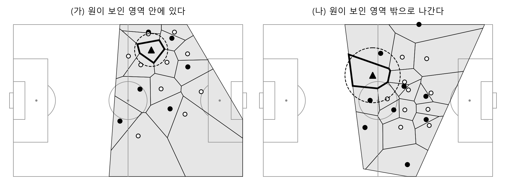
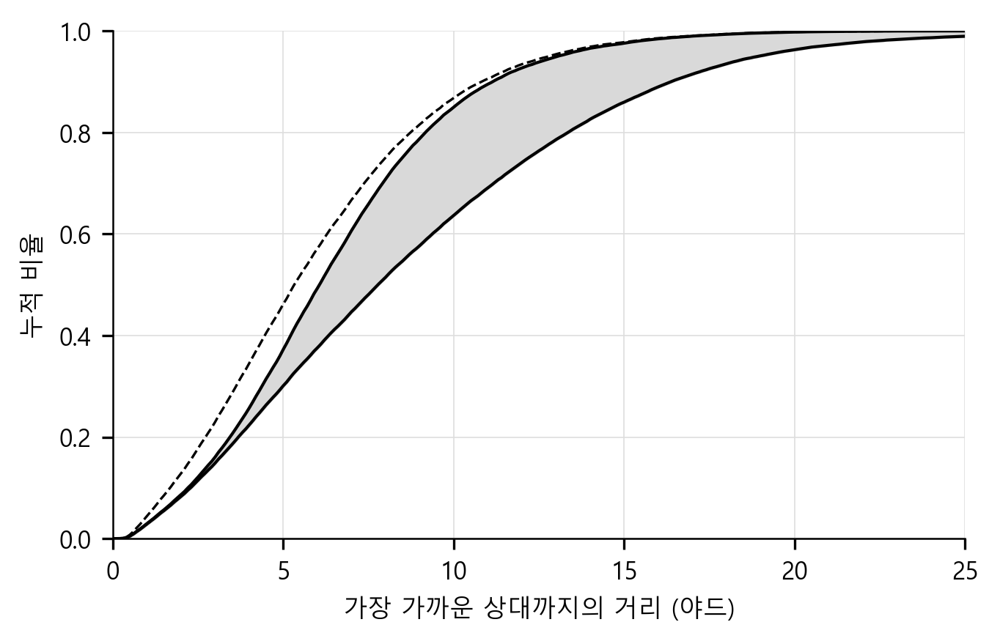

# 공간 2장. 보로노이 분할 — 패스를 받는 선수는 얼마나 비어 있는가

- [I. 질문과 데이터](#i-질문과-데이터)
- [II. 보로노이 분할](#ii-보로노이-분할)
- [III. 보이지 않는 선수](#iii-보이지-않는-선수)
- [IV. 값의 범위](#iv-값의-범위)
- [V. 질문을 관측에 맞춘다](#v-질문을-관측에-맞춘다)
- [VI. 슛과 골대 사이의 수비수](#vi-슛과-골대-사이의-수비수)
- [VII. 해석](#vii-해석)
- [VIII. 이 방법을 사용한 연구](#viii-이-방법을-사용한-연구)
- [참고문헌](#참고문헌)

> 데이터: StatsBomb 공개 데이터(<https://github.com/statsbomb/open-data>). 이용 약관에 따라 데이터는 이 저장소에 싣지 않는다.

이 장은 평면 위의 점들이 공간을 어떻게 나누어 가지는지를 계산하는 방법을 설명한다. 예는 선수의 배치다. 공간 1장은 사건이 일어난 위치만 보았다. 이 장은 그 순간 다른 선수들이 어디에 있었는지를 본다. 공을 받는 선수가 얼마나 비어 있었는지는 받은 위치만으로는 알 수 없고, 가장 가까운 상대가 어디에 있었는지를 알아야 한다. 데이터는 데이터 1장에서 구조를 살펴본 프리즈 프레임이다.

이 장에는 방법이 둘 있다. 하나는 보로노이 분할이다. 점마다 그 점이 가장 가까운 영역을 배정해 평면을 나눈다. 다른 하나는 일부만 관측된 데이터에서 무엇을 말할 수 있는지를 따지는 일이다. 프리즈 프레임에는 화면에 잡힌 선수만 있다. 보이지 않는 선수가 어디에 있느냐에 따라 답이 달라지는 질문이 있고, 달라지지 않는 질문이 있다. 이 장은 값이 확정되는 조건을 기하학으로 구하고, 확정되지 않을 때는 값이 놓일 수 있는 범위를 구한다.

장의 순서는 다음과 같다. I장은 데이터를 만든다. II장은 보로노이 분할을 설명한다. III장은 보이지 않는 선수가 만드는 문제를 다룬다. IV장은 가장 가까운 상대까지의 거리에 대해 값의 범위를 구한다. V장은 질문을 관측된 범위에 맞추어 바꾸고 결과를 본다. VI장은 같은 순서를 슛에 적용해, 회귀 1장에서 미루어 둔 슛과 골대 사이의 수비수를 모형에 넣는다. VII장은 해석을, VIII장은 이 방법을 사용한 연구를 적는다.

## I. 질문과 데이터

질문은 공을 받는 순간 받는 선수의 주변에 상대가 얼마나 가까이 있는가다. 사건 데이터에서 패스가 성공하면 받은 선수의 사건(`Ball Receipt*`)이 따로 기록되고, 그 사건에도 프리즈 프레임이 붙는다. 이 프레임에서 사건을 한 선수(`actor`)는 공을 받은 선수이고, 나머지 선수는 같은 팀인지 아닌지만 표시되어 있다. 이 장은 성공한 받음 가운데 프레임이 있는 것을 사용한다. 승부차기는 뺀다. 표 1은 그 데이터의 요약이다.

**표 1. 공을 받은 순간의 프리즈 프레임: 데이터의 요약**

| 항목                                           | 값     |
|:-----------------------------------------------|:-------|
| 공을 받은 순간(프리즈 프레임이 있는 것)        | 51,089 |
| 프레임에 보인 선수의 수의 평균                 | 15.1   |
| 보인 영역이 경기장에서 차지하는 비율의 평균(%) | 30     |
| 22명이 모두 보인 프레임                        | 0      |
| 상대 선수가 한 명도 보이지 않는 프레임         | 98     |

표 1에서 공을 받은 순간은 51,089개다. 프레임 하나에 보인 선수는 평균 15.1명이고, 보인 영역은 평균적으로 경기장의 30%다. 22명이 모두 보인 프레임은 하나도 없다. 프레임마다 평균 7명이 화면 밖에 있다. 데이터 1장 IV.3절에서 본 대로 이 결측은 무작위가 아니다. 카메라는 공을 따라가므로 공에서 먼 선수가 빠진다. 받는 선수는 공이 가는 곳에 있으므로 화면 안에 있지만, 그 주변의 선수가 모두 화면 안에 있다는 보장은 없다.

## II. 보로노이 분할

### 1. 정의

평면 위에 점 $p_1, \ldots, p_n$이 있다. 점 $p_i$의 보로노이 칸(Voronoi cell)은 평면의 점 가운데 다른 어느 점보다 $p_i$에 가까운 점의 집합이다.

$$V_i = \lbrace x : \lVert x - p_i \rVert \le \lVert x - p_j \rVert \text{ for all } j \ne i \rbrace$$

칸들을 모으면 평면이 겹치지 않게 나뉜다. 이것이 보로노이 분할(Voronoi tessellation)이다(Okabe et al., 2000). 점이 선수이면 칸은 그 선수가 다른 누구보다 가까운 땅이다. 모든 선수가 같은 속력으로 동시에 출발한다면 먼저 도착할 수 있는 영역이라는 뜻이 된다. 선수의 속도와 방향을 고려하지 않은 단순한 정의이고, 그래서 위치만 있는 데이터로 계산할 수 있다. 칸의 넓이가 크면 그 선수의 주변이 비어 있다.

### 2. 계산

칸의 정의에 있는 조건 하나를 풀어 쓰면 직선의 한쪽이다. $\lVert x - p_i \rVert \le \lVert x - p_j \rVert$의 양변을 제곱해 정리하면 다음이 된다.

$$2\ (p_j - p_i) \cdot x \le \lVert p_j \rVert^2 - \lVert p_i \rVert^2$$

$x$에 대한 1차 부등식이다. 등호가 성립하는 직선은 두 점을 잇는 선분의 수직이등분선이고, 부등식은 그 직선의 $p_i$ 쪽 반평면이다. 그러므로 칸 $V_i$는 반평면 $n - 1$개의 교집합이다. 반평면의 교집합은 볼록하므로 칸은 볼록 다각형이다. 계산은 이 성질을 그대로 따른다. 경기장 전체를 나타내는 다각형에서 출발해, 다른 선수마다 수직이등분선으로 다각형을 잘라 $p_i$ 쪽만 남긴다. 볼록 다각형을 직선으로 자르는 일은 꼭짓점을 차례로 돌며 직선의 어느 쪽인지를 보고 경계와 만나는 점을 더하는 것이다. `sportsdata/space.py`의 `voronoi_cell` 함수가 한다. 선수가 22명뿐이므로 이 단순한 방법으로 충분하다.

성질 하나가 뒤에서 쓰인다. 칸의 꼭짓점 $v$에서 $p_i$까지의 거리를 반지름으로 하는 원을 $v$를 중심으로 그리면, 그 원의 안쪽에는 어떤 선수도 없다. 꼭짓점은 $p_i$와 다른 두 선수에게서 같은 거리에 있는 점이고, 그보다 가까운 선수가 있었다면 그 꼭짓점은 그 선수의 칸에 속했을 것이기 때문이다.

### 3. 한 장면

그림 1은 결승전의 두 장면이다. 회색으로 칠한 부분이 보인 영역이고, 그 안을 프레임에 보인 선수들의 보로노이 칸으로 나누었다. 검은 점은 공을 받은 팀, 빈 원은 상대 팀이고, 세모가 공을 받은 선수다. 받은 선수의 칸은 굵은 선으로 둘렀다. 점선의 원은 받은 선수를 중심으로 가장 가까운 상대까지의 거리를 반지름으로 그린 것이다.

그림 1의 (가)에서 받은 선수의 칸은 넓이가 103제곱야드이고 가장 가까운 상대는 8.7야드 떨어져 있다. 칸의 변은 모두 다른 선수와의 수직이등분선이다. (나)에서는 사정이 다르다. 받은 선수의 칸이 보인 영역의 가장자리에 닿아 있다. 그 변은 다른 선수와의 경계가 아니라 카메라가 비춘 범위의 끝이다. 칸이 실제로 어디까지인지는 그 너머에 누가 있는지에 달려 있다. 점선의 원도 보인 영역 밖으로 나간다. 원 안의 보이지 않는 부분에 상대가 있었다면 가장 가까운 상대는 프레임에서 구한 14.5야드보다 가까이 있었다.

## III. 보이지 않는 선수

### 1. 값이 확정되는 조건

프레임에서 구한 값이 실제 값과 같다고 말하려면 보이지 않는 선수가 어디에 있든 그 값이 달라지지 않아야 한다. 이것은 기하학의 문제이고 조건을 정확히 적을 수 있다. 준비로 거리 하나를 정의한다. 점 $x$에서 보이지 않는 곳까지의 거리 $u(x)$는 $x$에서 보인 영역의 경계까지의 가장 짧은 거리다. 다만 경계 가운데 경기장의 터치라인이나 골라인과 겹치는 변은 세지 않는다. 그 너머는 경기장 밖이어서 선수가 없기 때문이다. 보이지 않는 선수는 누구든 $x$에서 $u(x)$ 이상 떨어져 있다.

가장 가까운 상대까지의 거리부터 본다. 받은 선수의 위치를 $p$, 프레임에 보인 가장 가까운 상대까지의 거리를 $d$라 하자. 보이지 않는 상대는 $p$에서 $u(p)$ 이상 떨어져 있으므로 다음이 성립한다.

$$d \le u(p) \quad \Longrightarrow \quad \text{실제의 가장 가까운 상대까지의 거리는 } d \text{다}$$

그림 1에서 점선의 원이 보인 영역 안에 있다는 것이 이 조건이다. 보로노이 칸에 대해서는 II.2절의 성질을 사용한다. 보이지 않는 선수 $q$가 칸의 일부를 가져가려면 칸의 어떤 점에 $p$보다 가까워야 한다. 칸은 볼록 다각형이고 $q$에 더 가까운 영역은 반평면이므로, $q$가 칸의 어떤 점에 더 가깝다면 칸의 어떤 꼭짓점에도 더 가깝다. 그러므로 조건은 꼭짓점에서만 확인하면 된다.

$$\lVert v - p \rVert \le u(v) \ \text{ for every vertex } v \text{ of the cell} \quad \Longrightarrow \quad \text{칸은 실제의 칸과 같다}$$

꼭짓점마다 II.2절의 빈 원을 그렸을 때 그 원이 모두 보인 영역 안에 있다는 뜻이다. 칸이 보인 영역의 가장자리에 닿으면 그 꼭짓점에서 $u(v) = 0$이므로 조건이 성립하지 않는다. 두 조건 모두 프레임에 있는 값만으로 확인할 수 있다. 보이지 않는 선수에 대한 가정은 그들이 보인 영역 밖에 있다는 것 하나뿐이다. `sportsdata/space.py`의 `unseen_distance`와 `cell_is_determined`가 계산한다.

### 2. 확정되는 것은 일부다

표 2는 두 값에 대해 조건이 성립하는 받음의 비율과, 성립하는 것만의 중위값과 전체의 중위값을 적은 것이다. 전체의 중위값은 보이지 않는 선수가 없다고 치고 프레임에 보인 선수만으로 계산한 값이다.

**표 2. 값이 확정되는 받음의 비율과 중위값**

| 값 | 확정되는 비율(%) | 확정된 것의 중위값 | 전체의 중위값(보인 선수만으로) |
|:---|---:|---:|---:|
| 보로노이 칸의 넓이(제곱야드) | 19.8 | 61.1 | 180.8 |
| 가장 가까운 상대까지의 거리(야드) | 64.7 | 5.3 | 7.8 |

표 2에서 칸의 넓이가 확정되는 받음은 20%뿐이다. 다섯 가운데 넷은 칸이 보인 영역의 가장자리에 닿거나, 보이지 않는 선수가 칸을 줄였을 수 있다. 가장 가까운 상대까지의 거리는 65%에서 확정된다. 칸은 여러 방향의 선수로 정해지므로 조건이 더 까다롭다.

더 중요한 것은 중위값의 차이다. 확정된 칸의 넓이의 중위값은 61제곱야드이고, 보인 선수만으로 구한 전체의 중위값은 그 3.0배다. 거리도 확정된 것의 중위값이 5.3야드로 전체의 7.8야드보다 작다. 둘 다 옳은 값이 아니다. 전체의 중위값은 보이지 않는 선수를 없는 것으로 쳤으므로 너무 크다. 확정된 것의 중위값은 너무 작다. 확정된다는 조건 자체가 값에 달려 있기 때문이다. 칸이 작을수록, 상대가 가까울수록 조건이 성립하기 쉽다. 확정된 것만 고르면 붐비는 장면만 고르게 된다. 생존 분석 1장에서 사건이 일어난 관측만 골라 평균을 내면 안 되었던 것과 같은 구조다.

### 3. 결측은 값에 의존한다

확정되는지를 정하는 것은 $u(p)$, 즉 받은 선수가 화면의 가장자리에서 얼마나 떨어져 있는지다. 이 거리가 선수 주변의 상황과 무관하다면 문제가 가벼워진다. 표 3은 받음을 $u(p)$의 크기에 따라 5등분하고, 등분마다 프레임에 보인 상대가 3야드 안에 있는 비율을 적은 것이다.

**표 3. 화면의 가장자리까지의 거리와 받는 선수의 상황**

| 보이지 않는 곳까지의 거리(야드) |   받음 | 상대가 3야드 안에 있는 비율(%) |
|:--------------------------------|-------:|-------------------------------:|
| 0.0\~7.0                         | 10,218 |                            4.5 |
| 7.0\~10.0                        | 10,218 |                            9.7 |
| 10.0\~13.4                       | 10,217 |                           17.2 |
| 13.4\~17.3                       | 10,218 |                           22.3 |
| 17.3\~61.6                       | 10,218 |                           20.7 |

표 3에서 두 값은 무관하지 않다. 화면의 가장자리에 가장 가까운 등분에서는 상대가 3야드 안에 있는 비율이 4.5%이고, 가장 먼 두 등분에서는 22.3%와 20.7%다. 화면의 가운데에서 공을 받는 선수는 상대와 가깝고, 가장자리에서 받는 선수는 비어 있다. 카메라가 선수가 몰린 곳을 가운데에 놓기 때문으로 보인다. 그러므로 가장자리에서 먼 받음만 골라 분석해도 치우침이 생긴다. 조건이 성립하는 것만 쓰는 방법은 조건이 값과 무관할 때만 치우침이 없고, 이 데이터는 그렇지 않다.

## IV. 값의 범위

### 1. 확정되지 않아도 범위는 안다

확정되지 않은 관측에 대해 아무것도 모르는 것은 아니다. 실제의 가장 가까운 상대까지의 거리 $D$는 프레임에 보인 상대까지의 거리 $d$와 보이지 않는 상대까지의 거리 가운데 작은 쪽이다. 보이지 않는 상대는 $u(p)$ 이상 떨어져 있다. 따라서 다음이 언제나 성립한다.

$$\min\lbrace d,\ u(p) \rbrace \le D \le d$$

$d \le u(p)$이면 양쪽이 같아서 $D = d$이고, III.1절의 조건이 이것이다. 그렇지 않으면 $D$는 $u(p)$와 $d$ 사이의 어딘가에 있다. 관측마다 값 하나가 아니라 구간 하나를 아는 것이다. 생존 분석 1장의 중도절단은 값이 어떤 수보다 크다는 것만 아는 경우였다. 여기서는 위와 아래가 모두 막혀 있다.

관측마다 구간을 알면 분포에 대해서도 범위를 말할 수 있다. 모든 관측에 아래 끝을 넣어 만든 분포와 위 끝을 넣어 만든 분포를 구한다. 실제 분포는 그 둘 사이에 있다. 이 범위는 보이지 않는 선수의 위치에 대해 아무 가정도 하지 않고 얻은 것이다. 가정 없이 데이터만으로 말할 수 있는 것의 범위를 구하는 이런 접근을 부분 식별(partial identification)이라 한다(Manski, 2003).

### 2. 분포의 범위

그림 2는 가장 가까운 상대까지의 거리의 누적 분포다. 실선 둘이 범위의 양쪽 끝이다. 위쪽 실선은 모든 관측에 구간의 아래 끝을, 아래쪽 실선은 위 끝을 넣은 것이다. 실제의 누적 분포는 두 실선 사이에 있다. 점선은 확정된 관측만으로 만든 분포다.

그림 2에서 범위의 너비는 거리에 따라 다르다. 3야드에서는 두 실선이 거의 붙어 있어서 너비가 1.2%포인트이고, 5야드에서는 7.2%포인트, 10야드에서는 21%포인트다. 가까운 거리에 관한 진술은 거의 확정되고 먼 거리에 관한 진술은 그렇지 않다. 가까운 곳은 대개 화면 안에 있기 때문이다. 중위값은 6.1야드와 7.8야드 사이에 있다. 이 범위는 표본의 크기를 늘려도 줄어들지 않는다. 표본 오차가 아니라 관측되지 않은 것에서 오는 불확실성이기 때문이다.

점선은 범위 밖에 있다. 확정된 관측만의 중위값은 5.3야드로 범위의 아래 끝 6.1야드보다도 작다. III.2절에서 말한 치우침이 그림에 나타난 것이다. 확정된 관측만 쓰는 분석은 있을 수 있는 값의 범위를 벗어난 답을 준다.

## V. 질문을 관측에 맞춘다

### 1. 문턱 안에 상대가 있는가

범위가 좁은 질문을 고르면 가정 없이도 거의 정확한 답을 얻는다. 그림 2가 그런 질문을 알려 준다. 받는 선수에게서 반지름 $r$ 안에 상대가 있는가를 묻는다. 이 질문은 다음의 두 경우에 답이 확정된다.

$$d \le r \ \Rightarrow \ \text{있다}, \qquad d > r \ \text{and}\ u(p) \ge r \ \Rightarrow \ \text{없다}$$

프레임에 보인 상대가 $r$ 안에 있으면 보이지 않는 선수와 상관없이 답은 있다이다. 보인 상대가 없고 반지름 $r$의 원이 모두 화면 안에 있으면 답은 없다이다. 남는 것은 보인 상대가 $r$ 안에 없는데 원의 일부가 화면 밖인 경우뿐이다. 그 경우를 모두 없다로 치면 비율의 아래 끝이, 모두 있다로 치면 위 끝이 나온다. $r$을 3야드로 둔다. 3야드는 한두 걸음에 닿는 거리다.

표 4는 공을 받은 위치의 구역별 결과다. 가로 좌표로 자기 진영(0\~40), 가운데(40\~80), 상대 진영(80\~120)을 나누고 상대 진영에서 페널티 구역을 따로 떼었다. 범위의 양쪽 끝과 함께, 범위 전체에 대한 95% 신뢰구간을 적었다. 신뢰구간은 경기를 단위로 한 붓스트랩 1,000번에서 아래 끝의 2.5% 분위수와 위 끝의 97.5% 분위수로 구했다.

**표 4. 공을 받는 순간 3야드 안에 상대가 있는 비율: 구역별 범위**

| 구역 | 받음 | 답이 확정되는 비율(%) | 아래 끝(%) | 위 끝(%) | 95% 신뢰구간 |
|:---|---:|---:|---:|---:|:---|
| 자기 진영 | 13,321 | 99.0 | 6.1 | 7.1 | 5.6\~7.8 |
| 가운데 | 25,860 | 98.7 | 13.6 | 14.9 | 12.8\~15.8 |
| 상대 진영(페널티 구역 밖) | 10,498 | 98.7 | 22.4 | 23.6 | 20.9\~25.2 |
| 페널티 구역 | 1,410 | 100.0 | 65.0 | 65.0 | 62.1\~67.8 |
| 전체 | 51,089 | 98.8 | 14.9 | 16.1 | 14.2\~16.8 |

표 4에서 답이 확정되는 받음은 전체의 98.8%다. 표 2에서 칸의 넓이가 20%에서만 확정되던 것과 동일한 데이터다. 질문을 바꾸자 거의 모든 관측이 쓸 수 있게 되었다. 전체에서 3야드 안에 상대가 있는 비율은 14.9%와 16.1% 사이다. 범위의 너비가 1.2%포인트이고, 이것이 보이지 않는 선수 때문에 남는 불확실성의 전부다.

구역 사이의 차이는 그 불확실성보다 훨씬 크다. 자기 진영에서 공을 받을 때 3야드 안에 상대가 있는 비율은 6\~7%이고, 가운데에서는 14\~15%, 상대 진영의 페널티 구역 밖에서는 22\~24%다. 페널티 구역 안에서는 65%로 셋 가운데 둘이 상대를 곁에 두고 공을 받는다. 구역마다의 범위가 서로 겹치지 않으므로 순서는 보이지 않는 선수가 어디에 있었든 달라지지 않는다. 상대 골대에 가까울수록 받는 선수는 덜 비어 있다. 연쇄 1장에서 구역의 값이 상대 골대 앞에서 급하게 올랐던 것과 함께 보면, 값이 높은 곳은 수비가 촘촘한 곳이다.

### 2. 다른 기록과의 대조

프레임에서 계산한 값이 타당한지는 다른 경로로 기록된 값과 대조해 볼 수 있다. 사건 데이터에는 기록원이 영상을 보고 적은 압박 여부(`under_pressure`)가 있다. 공을 받는 순간 상대의 압박을 받고 있었는지다. 프리즈 프레임의 좌표와는 따로 기록된 값이다. 답이 확정된 받음에서, 압박을 받았다고 적힌 것(전체의 6.1%) 가운데 3야드 안에 상대가 있는 것은 79%이고, 압박이 없었다고 적힌 것 가운데서는 11%다. 두 기록은 같은 방향을 가리킨다. 완전히 일치하지 않는 것은 정의가 다르기 때문이기도 하다. 기록원의 압박은 상대가 다가오고 있는지를 포함한 판단이고, 프레임의 거리는 한 순간의 위치다.

## VI. 슛과 골대 사이의 수비수

### 1. 관측의 범위를 먼저 확인한다

회귀 1장은 슛이 골이 될 확률을 거리와 각도, 머리로 한 슛인지로 설명했고, 슛과 골대 사이에 수비수가 있었는지는 이 장으로 미루었다. 같은 위치의 슛이라도 앞이 비어 있는 슛과 수비수 둘이 막아선 슛은 다르다. 이것을 변수로 만든다. 슛을 한 위치와 두 골대 기둥을 꼭짓점으로 하는 삼각형을 그린다. 공이 골대 안으로 가려면 이 삼각형 안을 지나야 한다. 삼각형 안에 있는 상대 선수의 수를 센다. 골키퍼는 따로 센다.

사건 데이터에는 슛마다 그 순간의 선수 위치가 따로 기록되어 있다(`shot_freeze_frame`). 프리즈 프레임 파일과는 다른 기록이고 선수가 누구인지와 포지션이 적혀 있다. 이 기록에도 모든 선수가 있는 것은 아니다. 그러므로 III장의 원칙을 먼저 적용한다. 세려는 범위가 관측되었는지를 확인한다.

슛 1,430개 모두에 이 기록이 있고, 슛 하나에 평균 14.2명의 위치가 있다. 상대 골키퍼의 위치는 모든 슛에 있다. 삼각형이 관측되었는지는 프리즈 프레임 파일의 보인 영역으로 확인한다. 슛 가운데 1,389개에 그 파일의 프레임이 있고, 그 가운데 삼각형의 세 꼭짓점이 모두 보인 영역 안에 있는 것이 84.4%다. 보인 영역은 볼록하므로 세 꼭짓점이 안에 있으면 삼각형 전체가 안에 있다. 받는 선수의 칸이 20%에서만 확정되던 것에 비하면 사정이 훨씬 낫다. 슛의 장면에서 카메라는 골대 쪽을 비춘다. 그래도 16%의 슛에서는 삼각형의 일부가 화면 밖이다. 슛에 딸린 기록이 프리즈 프레임 파일과 동일한 화면에서 만든 것인지는 명세서로 확인하지 못했다. 같은 화면이라면 그 슛들에서는 수비수를 덜 세었을 수 있다. 그래서 VI.3절에서 삼각형이 모두 관측된 슛만으로 모형을 다시 피팅해 결과가 달라지는지를 본다.

### 2. 수비수의 수와 득점

표 5는 삼각형 안의 수비수의 수에 따른 슛의 수와 득점 비율, 골대까지의 거리의 중위값이다. 골키퍼는 수에 넣지 않았다.

**표 5. 슛과 골대 사이의 수비수의 수와 득점**

| 삼각형 안의 수비수 |  슛 |  골 | 득점 비율(%) | 거리의 중위값(m) |
|:-------------------|----:|----:|-------------:|-----------------:|
| 0명                | 704 | 111 |         15.8 |             13.7 |
| 1명                | 465 |  33 |          7.1 |             18.1 |
| 2명                | 156 |   4 |          2.6 |             20.5 |
| 3명 이상           | 105 |   4 |          3.8 |             22.5 |

표 5에서 앞에 수비수가 없는 슛은 15.8%가 골이 되고, 한 명이 있으면 7.1%, 두 명이면 2.6%다. 그런데 이 차이를 그대로 수비수의 효과로 해석할 수 없다. 거리가 함께 변한다. 수비수가 없는 슛의 거리의 중위값은 13.7m이고 두 명이 있는 슛은 20.5m다. 먼 곳에서 찬 슛일수록 삼각형이 길어서 그 안에 선수가 많다. 회귀 1장 IV.2절에서 머리로 한 슛이 가까운 데서 나오기 때문에 겉보기 득점 비율이 높았던 것과 같은 교란이다. 거리와 각도가 같은 슛끼리 비교해야 한다.

### 3. 모형에 넣는다

회귀 1장의 모형 C(거리, 각도, 머리)에 두 변수를 더한다. 삼각형 안의 수비수의 수와, 골키퍼가 삼각형 안에 있는지다. 표 6은 이 모형의 승산비다.

**표 6. 수비수를 넣은 슛의 모형: 승산비**

| 변수                      | 승산비 | 95% 하한 | 95% 상한 | p값     |
|:--------------------------|-------:|---------:|---------:|:--------|
| 거리 (1m)                 |   0.91 |     0.87 |     0.96 | \<0.001 |
| 각도 (1도)                |   1.03 |     1.01 |     1.04 | \<0.001 |
| 머리                      |   0.29 |     0.17 |     0.47 | \<0.001 |
| 삼각형 안의 수비수 (1명)  |   0.59 |     0.45 |     0.79 | \<0.001 |
| 골키퍼가 삼각형 안에 있음 |   0.55 |     0.26 |     1.17 | 0.121   |

표 6에서 삼각형 안의 수비수 한 명은 득점의 승산을 0.59배로 만든다. 거리와 각도, 머리 여부가 같은 슛에서 앞에 수비수가 한 명 더 있으면 승산이 41% 줄어든다. 신뢰구간은 0.45에서 0.79까지로 1을 포함하지 않는다. 골키퍼가 삼각형 안에 있는 것의 승산비는 0.55이고 구간이 0.26에서 1.17까지로 넓다. 골키퍼가 삼각형 밖에 있는 슛이 43개뿐이기 때문이다. 방향은 예상과 같지만 이 데이터로는 크기를 정하지 못한다. 모형 C에 두 변수를 더한 것의 가능도비 검정은 통계량이 18.3이고 자유도 2에서 $p$값이 0.0001이다.

VI.1절에서 미룬 점검을 한다. 삼각형이 모두 관측된 슛 1,173개만으로 같은 모형을 피팅하면 수비수의 승산비는 0.62이고 신뢰구간은 0.46에서 0.83까지다. 전체 데이터의 0.59와 거의 같고 구간도 1을 포함하지 않는다. 결론은 달라지지 않는다. 이 점검에도 III.2절의 문제가 있다는 점은 적어 둔다. 삼각형이 모두 보이는 슛은 골대에 가까운 슛에 치우쳐 있을 수 있다. 다만 여기서는 거리와 각도가 모형에 들어 있으므로, 관측 여부가 그 변수들로 설명되는 만큼은 통제된다.

표 7은 교차검증에서의 예측이다. 회귀 1장과 동일한 경기 단위의 8겹이다. 마지막 행은 데이터에 들어 있는 StatsBomb의 기대 득점이다.

**표 7. 슛의 모형 비교: AIC와 교차검증의 로그 손실**

| 모형                            | 파라미터 |   AIC | 교차검증의 로그 손실 |
|:--------------------------------|:---------|------:|---------------------:|
| 모형 B: 거리, 각도              | 3        | 854.7 |               0.2981 |
| 모형 C: 거리, 각도, 머리        | 4        | 827.7 |               0.2885 |
| 모형 D: 모형 C와 수비수, 골키퍼 | 6        | 813.4 |               0.2838 |
| StatsBomb의 기대 득점           |          |       |               0.2665 |

표 7에서 수비수와 골키퍼를 넣은 모형 D는 AIC와 교차검증의 로그 손실이 모두 모형 C보다 작다. 손실의 차이는 -0.0047이고, 경기를 단위로 한 붓스트랩의 95% 구간은 -0.0116에서 0.0025까지다. 구간이 0을 포함한다. 두 가지 증거를 구분해서 본다. 수비수의 계수가 0이 아니라는 증거는 표 6의 신뢰구간과 가능도비 검정에서 분명하다. 그 변수를 넣은 모형이 새 경기의 슛을 더 잘 예측한다는 증거는 방향은 같지만 골 152개의 데이터로는 확정되지 않는다. 공간 1장에서 위치를 더 유연하게 사용한 모형은 손실이 오히려 늘었다. 여기서는 위치가 아닌 다른 정보를 변수 2개로 더했고 손실이 줄었다. 크기는 작아도 방향이 반대다.

StatsBomb의 기대 득점은 손실이 0.2665로 여전히 가장 작다. 모형 C와 그 값 사이의 차이 가운데 모형 D가 줄인 것은 22%다. 그 회사의 모형은 수비수의 위치를 더 자세히 쓰고, 슛의 종류와 공의 높이 같은 변수를 더 가지고 있으며, 훨씬 큰 데이터로 추정한 것이다. 그 내용은 공개되어 있지 않으므로 무엇이 차이를 만드는지는 이 데이터로 확인할 수 없다.

## VII. 해석

이 장에서 방법으로 남는 것은 관측의 범위를 따지는 순서다. 계산하려는 양이 데이터의 어느 범위에 의존하는지를 먼저 적는다. 가장 가까운 상대까지의 거리는 그 거리를 반지름으로 하는 원에, 보로노이 칸은 칸의 꼭짓점마다 그린 원들에, 슛을 막는 수비수의 수는 슛과 골대를 잇는 삼각형에 의존한다. 그 범위가 관측되었으면 값은 확정된다. 관측되지 않았으면 선택지는 셋이다. 그 관측을 버리는 것, 보이지 않는 부분에 가정을 두는 것, 값의 범위를 구하는 것이다.

버리는 것이 가장 쉽고 가장 위험하다. 확정되는지가 값 자체에 달려 있으면 남은 관측은 전체를 대표하지 않는다. 이 장에서 확정된 관측만의 중위값은 있을 수 있는 범위의 밖에 있었다. 범위를 구하는 것은 가정이 없다는 것이 장점이고, 범위가 넓으면 쓸모가 없다는 것이 약점이다. 보로노이 칸의 넓이는 범위가 너무 넓어서 이 장에서 결과를 내지 않았다. 대신 질문을 바꾸었다. 3야드 안에 상대가 있는가라는 질문은 범위가 1.2%포인트로 좁았다. 데이터가 답할 수 있는 질문을 찾는 것이 분석의 일부다.

보로노이 분할 자체는 이 데이터에서 주로 생각의 틀로 쓰였다. 칸이 확정되는 조건이 꼭짓점의 빈 원으로 적힌다는 것, 가까움으로 공간을 나눈다는 것이 그 내용이다. 선수 22명의 위치가 모두 있는 추적 데이터에서는 칸의 넓이를 그대로 쓸 수 있다. 그때에도 칸은 거리만으로 정한 것이라는 한계가 남는다. 전속력으로 달리는 선수와 서 있는 선수가 같은 거리에 있으면 칸은 둘을 같게 본다. 속도를 고려한 정의는 운동학 묶음에서 다루는 추적 데이터가 있어야 가능하다.

슛의 결과는 인과로 해석하지 않는다. 수비수 한 명이 승산을 41% 줄인다는 것은 거리와 각도, 머리 여부가 같은 슛들 사이의 비교다. 수비수가 앞에 있는 슛과 없는 슛은 그 밖의 점에서도 다르다. 수비수가 없는 슛은 역습에서 나왔을 가능성이 높고, 그런 슛은 골키퍼의 위치와 슛하는 선수의 여유도 다르다. 계수에는 그런 차이가 함께 포함되어 있다.

## VIII. 이 방법을 사용한 연구

선수의 위치로 경기장을 나누는 생각은 Taki and Hasegawa (2000)에서 볼 수 있다. 선수마다 다른 선수보다 먼저 도착할 수 있는 영역을 우세 영역(dominant region)이라 부르고, 거리 대신 선수의 속도와 가속을 고려한 도달 시간으로 영역을 나누었다. 보로노이 분할은 모든 선수가 같은 속력으로 서 있는 상태에서 출발한다고 둔 특수한 경우다. Kim (2004)은 축구 경기의 선수 위치에 보로노이 분할을 적용해 팀이 차지한 넓이의 변화를 기술했다. 이 장의 II장과 같은 계산이다.

Fernández and Bornn (2018)은 영역을 칸으로 나누지 않고 경기장의 각 지점에서 어느 팀이 공을 차지할 가능성이 높은지를 연속적인 값으로 추정했다. 선수의 위치와 속도, 공까지의 거리로 선수마다 영향의 면을 정의해 더한다. 공간 1장의 밀도와 같은 종류의 면이고, 추적 데이터를 전제로 한다. 슛의 모형에 선수의 배치를 넣은 연구로는 Lucey et al. (2015)이 있다. 추적 데이터에서 슛 직전의 수비수의 위치와 경기의 전개를 변수로 만들어 슛의 득점 확률을 추정했고, 위치만 사용한 모형보다 예측이 낫다고 보고했다. 회귀 1장에서 든 Anzer and Bauer (2021)도 같은 계열이다. 이 장의 VI장은 그 생각을 변수 2개로 줄인 것이다.

부분 식별은 Manski (2003)에 정리되어 있다. 결측이 있는 데이터에서 결측의 기제에 대한 가정 없이 말할 수 있는 범위를 먼저 구하고, 가정을 하나씩 더할 때마다 범위가 어떻게 줄어드는지를 본다. 이 장의 IV장은 그 가운데 가장 단순한 경우, 즉 관측마다 값이 놓인 구간을 아는 경우다.

## 참고문헌

Anzer, G., and Bauer, P. (2021). “A goal scoring probability model for shots based on synchronized positional and event data in football (soccer).” *Frontiers in Sports and Active Living* 3, 624475.

Fernández, J., and Bornn, L. (2018). “Wide open spaces: A statistical technique for measuring space creation in professional soccer.” *MIT Sloan Sports Analytics Conference*.

Kim, S. (2004). “Voronoi analysis of a soccer game.” *Nonlinear Analysis: Modelling and Control* 9(3), 233–240.

Lucey, P., Bialkowski, A., Monfort, M., Carr, P., and Matthews, I. (2015). “Quality vs quantity: Improved shot prediction in soccer using strategic features from spatiotemporal data.” *MIT Sloan Sports Analytics Conference*.

Manski, C. F. (2003). *Partial Identification of Probability Distributions*. Springer.

Okabe, A., Boots, B., Sugihara, K., and Chiu, S. N. (2000). *Spatial Tessellations: Concepts and Applications of Voronoi Diagrams* (2nd ed.). Wiley.

Taki, T., and Hasegawa, J. (2000). “Visualization of dominant region in team games and its application to teamwork analysis.” *Proceedings of Computer Graphics International 2000*, 227–235.
