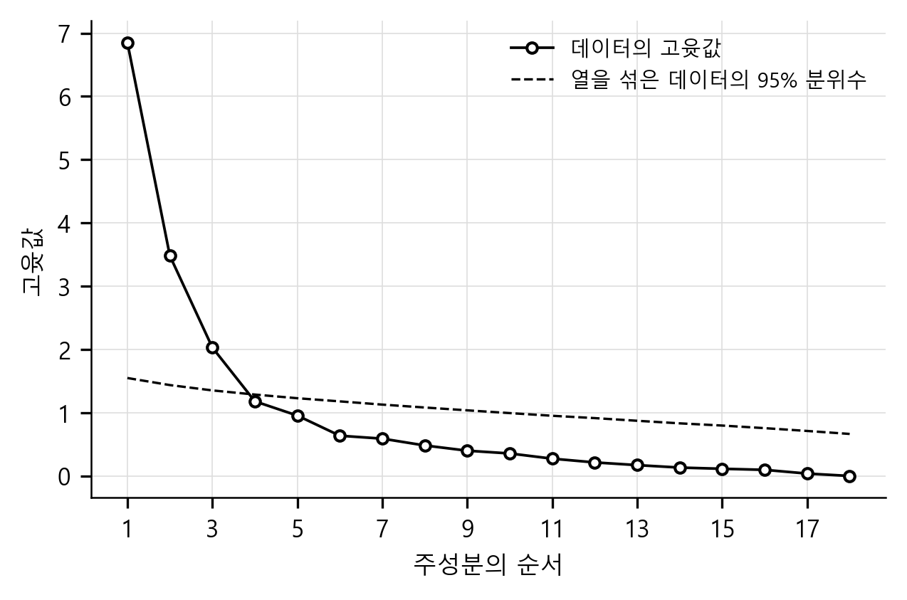
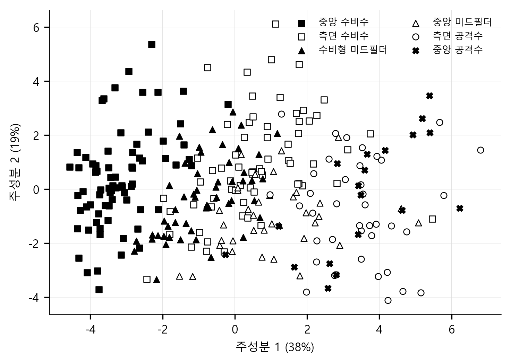
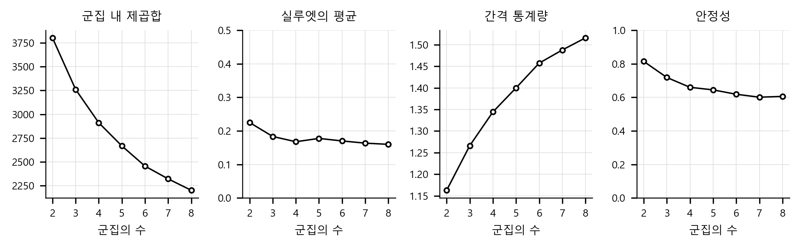
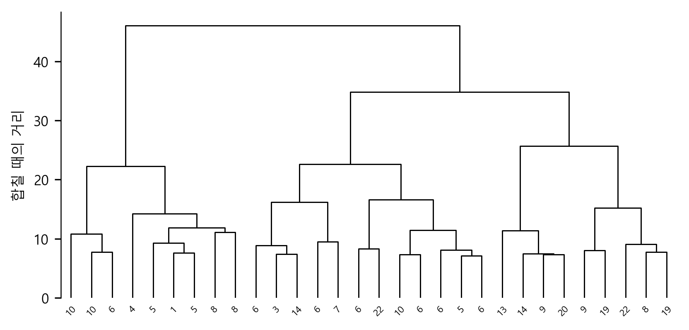

# 차원 축소 1장. 주성분 분석과 군집 — 선수의 역할은 몇 가지인가

- [I. 질문과 데이터](#i-질문과-데이터)
- [II. 주성분 분석](#ii-주성분-분석)
- [III. k-평균 군집](#iii-k-평균-군집)
- [IV. 군집의 수](#iv-군집의-수)
- [V. 계층 군집](#v-계층-군집)
- [VI. 군집과 자리](#vi-군집과-자리)
- [VII. 해석](#vii-해석)
- [VIII. 이 방법을 쓴 연구](#viii-이-방법을-쓴-연구)
- [참고문헌](#참고문헌)

> 데이터: StatsBomb 공개 데이터(<https://github.com/statsbomb/open-data>). 이용 약관에 따라 데이터는 이 저장소에 싣지 않는다.

이 장은 변수가 많은 데이터를 요약하는 두 방법을 설명한다. 주성분 분석은 변수를 줄인다. 서로 상관이 있는 변수 여러 개를 그 변동의 대부분을 나타내는 소수의 새 변수로 바꾼다. 군집 분석은 관측을 묶는다. 비슷한 관측끼리 모아 몇 개의 무리로 나눈다. 예는 선수다. 선수마다 경기에서 한 행동을 변수 18개로 요약하고, 그 변수들에서 선수의 유형을 찾는다.

앞의 장들과 다른 점이 하나 있다. 지금까지의 방법에는 맞추어야 할 값이 있었다. 슛이 골이 되었는지, 패스가 성공했는지, 골이 언제 났는지다. 모형이 좋은지는 그 값을 얼마나 잘 예측하는지로 판단했다. 이 장의 방법에는 그런 값이 없다. 선수의 유형이 몇 가지인지를 알려 주는 정답의 열이 데이터에 없다. 정답이 없을 때 결과를 어떻게 평가하는지가 이 장의 문제이고, 평가의 기준이 여럿이며 서로 다른 답을 줄 수 있다는 것이 이 장에서 보게 될 내용이다.

장의 순서는 다음과 같다. I장은 데이터를 만든다. II장은 주성분 분석을 설명하고 결과를 본다. III장은 k-평균 군집을, IV장은 군집의 수를 고르는 기준 넷을 다룬다. V장은 계층 군집을 설명하고 k-평균과 비교한다. VI장은 군집을 선수의 자리와 대조한다. VII장은 해석을, VIII장은 이 방법을 쓴 연구를 적는다.

## I. 질문과 데이터

### 1. 선수를 변수로 요약한다

선수 한 명을 한 행으로 하는 표를 만든다. 재료는 사건 데이터에서 선수가 한 행동이다. 패스, 공을 가지고 이동, 슛, 드리블, 압박, 공을 되찾음, 걷어내기, 가로채기, 경합의 9개 유형을 센다. 변수는 세 묶음이다. 첫째는 위치다. 행동을 한 곳의 가로 좌표의 평균과 표준편차, 그리고 세로 방향으로 경기장의 중앙선에서 떨어진 정도의 평균이다. 둘째는 행동의 구성이다. 그 선수의 행동 가운데 유형마다 차지하는 몫이다. 셋째는 패스의 방식이다. 패스 길이의 평균, 앞으로 준 패스와 높은 패스와 크로스의 비율, 성공률, 그리고 공을 받은 곳 가운데 상대 진영 3분의 1의 비율이다.

횟수가 아니라 몫과 비율을 쓴 것은 출전 시간 때문이다. 횟수는 오래 뛴 선수일수록 많다. 몫은 그 선수가 뛴 동안 무엇을 했는지의 구성만 나타낸다. 대상은 골키퍼가 아닌 선수 가운데 행동이 200개 이상인 선수다. 몫은 행동이 적으면 불안정하다. 다층 모형 1장에서 패스가 적은 선수의 성공률이 극단에 놓였던 것과 같은 이유다. 골키퍼는 다른 선수와 너무 달라서 넣으면 모든 결과가 골키퍼와 나머지의 구분이 된다. 표 1은 변수의 목록과 요약이다.

**표 1. 선수를 요약한 변수 18개: 선수 287명**

| 변수                                 |   평균 | 표준편차 |   최소 |   최대 |
|:-------------------------------------|-------:|---------:|-------:|-------:|
| 행동의 가로 위치의 평균              | 58.429 |   12.806 | 30.490 | 84.999 |
| 중앙선에서 떨어진 정도의 평균        | 21.425 |    5.461 | 10.056 | 31.700 |
| 가로 위치의 표준편차                 | 23.739 |    3.761 | 15.444 | 33.496 |
| 패스의 몫                            |  0.434 |    0.061 |  0.235 |  0.538 |
| 공을 가지고 이동의 몫                |  0.344 |    0.045 |  0.169 |  0.458 |
| 슛의 몫                              |  0.009 |    0.011 |  0.000 |  0.078 |
| 드리블의 몫                          |  0.012 |    0.014 |  0.000 |  0.084 |
| 압박의 몫                            |  0.109 |    0.058 |  0.005 |  0.360 |
| 공을 되찾음의 몫                     |  0.036 |    0.015 |  0.006 |  0.095 |
| 걷어내기의 몫                        |  0.019 |    0.018 |  0.000 |  0.091 |
| 가로채기의 몫                        |  0.009 |    0.006 |  0.000 |  0.037 |
| 경합의 몫                            |  0.029 |    0.016 |  0.003 |  0.096 |
| 패스 길이의 평균                     | 18.237 |    2.747 | 12.023 | 26.224 |
| 앞으로 준 패스의 비율                |  0.294 |    0.090 |  0.058 |  0.550 |
| 높은 패스의 비율                     |  0.163 |    0.074 |  0.008 |  0.425 |
| 크로스의 비율                        |  0.026 |    0.032 |  0.000 |  0.203 |
| 패스 성공률                          |  0.821 |    0.084 |  0.537 |  0.992 |
| 받음 가운데 상대 진영 3분의 1의 비율 |  0.247 |    0.185 |  0.000 |  0.691 |

표 1의 대상은 287명이다. 대회에서 사건이 기록된 선수 680명의 42%다. 이 선택은 고르지 않다. 행동의 수로 골랐으므로 공을 자주 만지는 자리의 선수가 많이 남는다. 중앙 수비수가 74명인데 중앙 공격수는 19명이다. 이 장의 결과는 이 287명에 대한 것이다.

변수의 단위와 크기는 제각각이다. 가로 위치의 표준편차는 12.8야드이고 슛의 몫의 표준편차는 0.011이다. 이대로 거리를 계산하면 숫자가 큰 변수가 결과를 지배한다. 그래서 모든 변수를 표준화한다. 변수마다 평균을 빼고 표준편차로 나누어, 모든 변수의 평균이 0이고 분산이 1이 되게 한다. 이 장의 모든 계산은 표준화한 데이터에서 한다. 표준화는 모든 변수를 같은 비중으로 다루겠다는 선택이다. 슛의 몫과 가로 위치가 선수를 구분하는 데 똑같이 중요하다고 본 것이고, 그렇게 볼 근거가 데이터에 있는 것은 아니다.

### 2. 변수는 서로 얽혀 있다

변수 18개는 18가지의 서로 다른 정보가 아니다. 앞쪽에서 뛰는 선수는 슛이 많고 걷어내기가 적으며 상대 진영에서 공을 받는다. 변수의 쌍 153개 가운데 상관계수의 절댓값이 0.5를 넘는 쌍이 39개다. 가장 큰 것은 행동의 가로 위치의 평균과 받음 가운데 상대 진영 3분의 1의 비율의 0.92다. 구조에서 오는 얽힘도 있다. 행동의 몫 9개는 더하면 1이므로 8개를 알면 나머지 하나가 정해진다. 변수가 이렇게 얽혀 있으면 그보다 적은 수의 변수로 같은 내용을 나타낼 수 있다. 주성분 분석이 하는 일이다.

## II. 주성분 분석

### 1. 분산이 가장 큰 방향

표준화한 데이터의 행을 $z_1, \ldots, z_n$이라 하자. 각각은 선수 한 명을 나타내는 $m$차원의 벡터다. 길이가 1인 벡터 $v$를 하나 정하면 선수마다 $v \cdot z_i$라는 수 하나가 생긴다. 변수들의 가중합이다. 주성분 분석(principal component analysis)은 이 수의 분산이 가장 커지는 $v$를 찾는다(Pearson, 1901; Hotelling, 1933).

$$v_1 = \arg\max_{\lVert v \rVert = 1} \ \text{Var}(v \cdot z) = \arg\max_{\lVert v \rVert = 1} \ v^\top S\ v$$

$S$는 표준화한 변수의 공분산 행렬, 즉 원래 변수의 상관 행렬이다. 선수들을 가장 넓게 흩어 놓는 방향을 찾는 것이다. 그 방향이 첫째 주성분이다. 둘째 주성분 $v_2$는 $v_1$과 직교하는 방향 가운데 분산이 가장 큰 방향이고, 셋째 이후도 같은 식으로 정한다. 이 문제의 해는 $S$의 고유벡터다. 고윳값이 큰 순서로 놓은 고유벡터가 차례로 주성분이고, 고윳값 $\lambda_k$가 그 방향의 분산이다.

$$S\ v_k = \lambda_k\ v_k, \qquad \lambda_1 \ge \lambda_2 \ge \cdots \ge \lambda_m \ge 0, \qquad \sum_{k} \lambda_k = m$$

고윳값의 합은 변수의 수와 같다. 표준화한 변수는 분산이 1이므로 전체 분산이 $m$이기 때문이다. $\lambda_k / m$은 $k$째 주성분이 전체 분산에서 차지하는 비율이다. 벡터 $v_k$의 원소를 적재(loading)라 하고, 선수마다의 값 $v_k \cdot z_i$를 주성분 점수(score)라 한다. 적재는 그 주성분이 어떤 변수들로 이루어져 있는지를 알려 준다. 주성분의 부호는 정해지지 않는다. $v_k$와 $-v_k$는 같은 방향이다.

### 2. 몇 개를 남기는가

주성분은 변수의 수만큼 있다. 그 가운데 앞의 몇 개만 남기는 것이 차원 축소다. 몇 개를 남길지를 정하는 방법으로 평행 분석(parallel analysis)을 쓴다(Horn, 1965). 생각은 이렇다. 변수들 사이에 아무 상관이 없어도 표본에서 구한 고윳값은 모두 1이 되지 않는다. 우연한 상관 때문에 큰 것은 1보다 크게, 작은 것은 1보다 작게 나온다. 그러므로 고윳값이 1보다 크다는 것만으로는 의미 있는 주성분이라고 할 수 없다. 상관이 없을 때 나올 수 있는 크기와 비교해야 한다. 데이터의 열마다 값을 따로 섞으면 변수마다의 분포는 그대로이고 변수 사이의 상관만 사라진다. 섞은 데이터에서 고윳값을 구하는 일을 500번 되풀이해, 순서마다 95% 분위수를 기준으로 삼는다. 연쇄 2장의 순열 검정과 같은 생각이다.

표 2는 앞의 6개 주성분의 고윳값과 분산의 비율, 평행 분석의 기준이다. 그림 1은 모든 주성분의 고윳값을 큰 순서로 그린 것이고, 점선이 평행 분석의 기준이다.

**표 2. 주성분의 고윳값과 분산의 비율**

| 주성분 | 고윳값 | 분산의 비율(%) | 누적(%) | 평행 분석의 기준 |
|:-------|-------:|---------------:|--------:|-----------------:|
| 1      |   6.85 |           38.1 |    38.1 |             1.55 |
| 2      |   3.48 |           19.3 |    57.4 |             1.44 |
| 3      |   2.03 |           11.3 |    68.7 |             1.35 |
| 4      |   1.18 |            6.6 |    75.2 |             1.29 |
| 5      |   0.95 |            5.3 |    80.5 |             1.23 |
| 6      |   0.64 |            3.5 |    84.1 |             1.18 |

표 2에서 첫째 주성분의 고윳값은 6.85다. 변수 18개의 분산 가운데 38%가 한 방향에 있다. 앞의 3개가 평행 분석의 기준을 넘고, 그 3개가 전체 분산의 69%를 차지한다. 넷째 주성분의 고윳값 1.18은 기준 1.29에 못 미친다. 변수들이 무관할 때 우연히 나올 수 있는 크기다. 그림 1의 오른쪽 끝에서 마지막 고윳값은 0.00이다. I.2절에서 말한 구조 때문이다. 몫 9개의 합이 1이어서 데이터는 실제로 17차원 안에 있다.

### 3. 주성분은 무엇을 나타내는가

표 3은 앞의 세 주성분의 적재다. 적재의 절댓값이 큰 변수가 그 주성분을 주로 이룬다. 부호가 같은 변수들은 함께 움직이고, 부호가 반대인 변수들은 반대로 움직인다.

**표 3. 앞의 세 주성분의 적재**

| 변수                                 | 주성분 1 | 주성분 2 | 주성분 3 |
|:-------------------------------------|---------:|---------:|---------:|
| 행동의 가로 위치의 평균              |     0.33 |    -0.20 |     0.08 |
| 중앙선에서 떨어진 정도의 평균        |     0.18 |     0.11 |     0.49 |
| 가로 위치의 표준편차                 |     0.26 |     0.18 |     0.28 |
| 패스의 몫                            |    -0.31 |    -0.01 |     0.32 |
| 공을 가지고 이동의 몫                |    -0.13 |    -0.40 |     0.25 |
| 슛의 몫                              |     0.24 |    -0.10 |    -0.21 |
| 드리블의 몫                          |     0.27 |    -0.12 |     0.02 |
| 압박의 몫                            |     0.27 |     0.14 |    -0.35 |
| 공을 되찾음의 몫                     |     0.21 |     0.14 |    -0.12 |
| 걷어내기의 몫                        |    -0.19 |     0.32 |    -0.10 |
| 가로채기의 몫                        |    -0.02 |     0.28 |    -0.06 |
| 경합의 몫                            |     0.18 |     0.28 |    -0.27 |
| 패스 길이의 평균                     |    -0.25 |     0.21 |     0.13 |
| 앞으로 준 패스의 비율                |    -0.16 |     0.37 |     0.11 |
| 높은 패스의 비율                     |     0.07 |     0.41 |     0.23 |
| 크로스의 비율                        |     0.26 |     0.02 |     0.37 |
| 패스 성공률                          |    -0.27 |    -0.26 |    -0.11 |
| 받음 가운데 상대 진영 3분의 1의 비율 |     0.35 |    -0.10 |     0.13 |

첫째 주성분에서 양의 적재가 큰 변수는 받음 가운데 상대 진영 3분의 1의 비율(+0.35), 행동의 가로 위치의 평균(+0.33), 드리블의 몫(+0.27)이고 음의 적재가 큰 변수는 패스의 몫(-0.31), 패스 성공률(-0.27), 패스 길이의 평균(-0.25)이다. 이 주성분은 경기장의 앞쪽에서 뛰는지 뒤쪽에서 뛰는지를 나타낸다. 자리별로 점수를 평균하면 중앙 공격수가 3.5로 가장 높고 중앙 수비수가 -3.2로 가장 낮다. 선수를 구분하는 가장 큰 차이는 앞뒤의 위치이고, 위치에 따라 행동의 구성과 패스의 방식이 함께 달라진다.

둘째 주성분은 양의 쪽이 높은 패스의 비율(+0.41), 앞으로 준 패스의 비율(+0.37), 걷어내기의 몫(+0.32), 음의 쪽이 공을 가지고 이동의 몫(-0.40), 패스 성공률(-0.26), 행동의 가로 위치의 평균(-0.20)이다. 셋째 주성분은 양의 쪽이 중앙선에서 떨어진 정도의 평균(+0.49), 크로스의 비율(+0.37), 패스의 몫(+0.32), 음의 쪽이 압박의 몫(-0.35), 경합의 몫(-0.27), 슛의 몫(-0.21)이다. 자리별 평균으로 보면 둘째 주성분은 측면 수비수(0.9)와 중앙 미드필더(-1.0)를 양쪽 끝에 두고, 셋째 주성분은 측면 수비수(1.5)와 중앙 공격수(-1.9)를 양쪽 끝에 둔다. 첫째 주성분이 앞뒤를 구분한 뒤에 남은 차이를 이 둘이 나눈다. 주성분에 이름을 붙이는 것은 해석이다. 적재는 계산의 결과이지만 그것을 한 낱말로 부르는 것은 분석하는 사람이 하는 일이고, 적재가 중간 크기인 변수가 여럿이면 이름이 맞지 않게 된다.

그림 2는 선수 287명을 첫째와 둘째 주성분의 점수로 찍은 것이다. 표식은 선수의 자리다. 자리는 주성분을 구하는 데 쓰지 않았다.

그림 2에서 같은 자리의 선수는 가까이 모여 있다. 행동의 기록만으로 구한 두 축이 자리를 상당히 구분한다. 그런데 무리 사이에 빈 곳이 없다. 중앙 수비수의 무리에서 수비형 미드필더를 지나 공격수의 무리까지 점이 끊기지 않고 이어진다. 자리가 다른 선수들이 섞여 있는 곳도 넓다. 이 그림은 다음 장들의 결과를 미리 알려 준다. 선수들이 몇 개의 떨어진 덩어리로 나뉘어 있다면 군집의 수는 눈으로 셀 수 있다. 연속으로 퍼져 있다면 어디서 자르든 그것은 자르는 사람의 선택이다.

## III. k-평균 군집

### 1. 알고리즘

군집 분석은 관측을 무리로 나눈다. 같은 무리의 관측은 서로 비슷하고 다른 무리의 관측과는 다르게 나누려 한다. k-평균(k-means)은 가장 널리 쓰이는 방법이다. 무리의 수 $k$를 먼저 정하고, 무리마다 중심 $c_1, \ldots, c_k$를 두어, 각 관측에서 자기 무리의 중심까지의 거리의 제곱합을 최소화한다.

$$W_k = \sum_{j=1}^{k} \sum_{i \in C_j} \lVert z_i - c_j \rVert^2$$

$C_j$는 $j$째 무리에 속한 관측의 집합이다. $W_k$를 군집 내 제곱합이라 한다. 이것을 최소화하는 나눔을 정확히 찾는 것은 관측이 많으면 계산이 불가능하다. 그래서 두 단계를 번갈아 되풀이하는 방법을 쓴다(Lloyd, 1982). 중심이 주어지면 각 관측을 가장 가까운 중심의 무리에 넣는다. 무리가 주어지면 각 무리의 평균을 새 중심으로 삼는다. 두 단계 모두 $W_k$를 늘리지 않으므로 되풀이하면 더 줄어들지 않는 곳에 이른다.

그곳이 가장 좋은 해라는 보장은 없다. 어디서 출발했는지에 따라 다른 곳에 이른다. 그래서 출발점을 여러 번 바꾸어 돌리고 $W_k$가 가장 작은 결과를 고른다. 이 장은 출발점을 30번 바꾼다. 출발점은 이미 고른 중심에서 먼 관측을 높은 확률로 뽑는 방식으로 정한다(Arthur and Vassilvitskii, 2007). 계산은 `sportsdata/cluster.py`의 `kmeans` 함수가 한다.

### 2. 방법이 전제하는 것

k-평균은 가정을 드러내 놓고 적지 않지만 전제하는 것이 있다. 거리는 유클리드 거리다. 그러므로 변수의 척도가 결과를 정하고, I.1절의 표준화가 여기서 중요해진다. 무리는 중심에서 가까운 점들의 모임이므로 둥근 모양의 무리를 찾는다. 길쭉하거나 굽은 무리는 찾지 못한다. 그리고 $k$를 주면 언제나 $k$개의 무리를 돌려준다. 데이터에 무리가 없어도 그렇다. 고르게 퍼진 점들에 k-평균을 돌리면 공간을 $k$개의 조각으로 나눈 결과가 나오고, 그 결과만 보아서는 무리가 실제로 있었는지 알 수 없다. 다음 장의 기준들은 그것을 판단하려는 것이다.

## IV. 군집의 수

### 1. 기준 넷

$k$를 고르는 데 $W_k$를 그대로 쓸 수는 없다. $k$가 커지면 $W_k$는 언제나 줄어든다. 무리를 늘리면 중심이 관측에 더 가까워지기 때문이고, 무리가 관측의 수만큼이면 0이 된다. 회귀 1장에서 피팅에 쓴 데이터의 이탈도가 변수를 더할수록 줄어들기만 했던 것과 같다. 필요한 것은 무리를 늘려서 얻는 것이 충분한지를 판단하는 기준이다. 넷을 본다.

첫째는 $W_k$가 줄어드는 속도다. $k$를 늘려 가다가 $W_k$가 더 크게 줄지 않는 곳을 고른다. 그래프가 팔꿈치처럼 꺾이는 곳이라는 뜻에서 팔꿈치 방법이라 부른다. 꺾이는 곳이 뚜렷하지 않으면 쓸 수 없다.

둘째는 실루엣(silhouette)이다(Rousseeuw, 1987). 관측 $i$에 대해 같은 무리의 다른 관측까지의 평균 거리를 $a_i$, 가장 가까운 다른 무리의 관측까지의 평균 거리를 $b_i$라 하고 다음 값을 구한다.

$$s_i = \frac{b_i - a_i}{\max\lbrace a_i, b_i \rbrace}$$

$s_i$는 $-1$과 1 사이다. 자기 무리에 꼭 맞고 다른 무리에서 멀면 1에 가깝고, 두 무리의 경계에 있으면 0에 가깝고, 다른 무리에 더 가까우면 음수다. 모든 관측의 평균이 큰 $k$를 고른다. 평균이 0.5를 넘으면 무리가 뚜렷하고 0.25에 못 미치면 구조가 약하다고 보는 것이 관행이다.

셋째는 간격 통계량(gap statistic)이다(Tibshirani et al., 2001). 무리가 없는 데이터에서도 $W_k$는 $k$와 함께 줄어든다. 그 줄어드는 정도를 기준으로 삼는다. 데이터의 변수마다의 범위 안에 점을 고르게 뿌려 기준 데이터를 만들고, 거기서 구한 $\log W_k$의 평균에서 데이터의 $\log W_k$를 뺀다.

$$\text{Gap}(k) = \text{E}^*\lbrace \log W_k \rbrace - \log W_k$$

값이 크면 데이터가 무리 없는 데이터보다 더 잘 뭉쳐 있다는 뜻이다. 간격이 더 늘지 않는 가장 작은 $k$를 고른다. 구체적으로는 $\text{Gap}(k) \ge \text{Gap}(k+1) - s_{k+1}$을 만족하는 가장 작은 $k$이고, $s_{k+1}$은 기준 데이터에서 구한 표준오차다. 평행 분석과 같은 생각이다. 구조가 없을 때의 값과 비교한다.

넷째는 안정성이다. 무리가 실제로 있다면 데이터가 조금 달라져도 같은 무리가 나와야 한다. 선수 287명에서 복원 추출로 287명을 뽑아 k-평균을 다시 돌리고, 그 중심으로 원래의 선수들을 가장 가까운 중심에 배정한다. 이렇게 얻은 나눔을 원래 데이터에서 얻은 나눔과 비교한다. 100번 되풀이해 평균한다. 두 나눔이 얼마나 같은지는 조정 랜드 지수(adjusted Rand index)로 나타낸다(Hubert and Arabie, 1985). 관측의 쌍마다 두 나눔에서 같은 무리에 있는지를 보고, 일치하는 쌍의 비율에서 우연히 일치할 만큼을 뺀 뒤 척도를 맞춘 값이다. 두 나눔이 같으면 1이고 우연한 수준이면 0이다. 무리의 번호가 어떻게 붙었는지와는 상관이 없다.

### 2. 결과

표 4와 그림 3은 $k$를 2에서 8까지 바꾸며 네 기준을 구한 것이다.

**표 4. 군집의 수를 고르는 네 기준: 선수 287명**

| 군집의 수 | 군집 내 제곱합 | 앞 단계보다 줄어든 비율(%) | 실루엣의 평균 | 간격 통계량 | 안정성(조정 랜드 지수의 평균) |
|---:|---:|---:|---:|---:|---:|
| 2 | 3,803 | 26.1 | 0.225 | 1.163 | 0.814 |
| 3 | 3,261 | 14.2 | 0.183 | 1.266 | 0.718 |
| 4 | 2,911 | 10.7 | 0.168 | 1.344 | 0.660 |
| 5 | 2,667 | 8.4 | 0.177 | 1.400 | 0.644 |
| 6 | 2,455 | 7.9 | 0.170 | 1.457 | 0.618 |
| 7 | 2,321 | 5.5 | 0.163 | 1.488 | 0.601 |
| 8 | 2,201 | 5.2 | 0.160 | 1.516 | 0.605 |

네 기준은 한 곳을 가리키지 않는다. 군집 내 제곱합은 꺾이는 곳 없이 줄어든다. 2개에서 3개로 갈 때 14.2%, 3개에서 4개로 갈 때 10.7%, 4개에서 5개로 갈 때 8.4% 줄어들어, 어디가 팔꿈치인지 정할 수 없다. 실루엣의 평균은 2개일 때 0.22로 가장 크고 그 뒤로 내려간다. 가장 큰 값도 구조가 약하다고 보는 0.25에 못 미친다. 간격 통계량은 무리를 늘릴수록 커지기만 하고, 조건을 만족하는 수가 8까지에는 없다. 안정성은 2개일 때 0.81로 가장 높고, 4개 이상에서는 0.60에서 0.66 사이다.

이 결과를 해석하는 방법은 하나다. 이 데이터에는 뚜렷이 떨어진 무리가 없다. 그림 2에서 본 대로 선수들은 연속으로 퍼져 있다. 실루엣이 낮은 것은 많은 선수가 두 무리의 경계 근처에 있다는 뜻이다. 안정성이 2개에서 가장 높은 것은 가장 큰 차이인 앞뒤의 구분만이 데이터가 조금 달라져도 같은 자리에 그어진다는 뜻이다. 무리를 더 잘게 나누면 경계가 표본에 따라 움직인다. 질문이 선수의 역할은 몇 가지인가였다면 정직한 답은 이 데이터에서 그 수가 정해지지 않는다는 것이다. $k$를 정해야 한다면 그것은 데이터에서 나오는 값이 아니라 쓰임에 맞추어 고르는 값이다.

## V. 계층 군집

### 1. 가까운 것부터 합친다

계층 군집(hierarchical clustering)은 $k$를 미리 정하지 않는다. 처음에는 관측 하나하나가 무리다. 가장 가까운 두 무리를 합치는 일을 무리가 하나가 될 때까지 되풀이한다. $n$개의 관측에서 $n - 1$번 합치면 끝나고, 합친 순서와 그때의 거리가 나무 모양의 그림으로 남는다. 이 그림을 덴드로그램(dendrogram)이라 한다. 나무를 어느 높이에서 자르는지에 따라 무리의 수가 정해진다.

두 무리 사이의 거리를 어떻게 정하는지에 따라 방법이 달라진다. 이 장은 워드의 방법을 쓴다(Ward, 1963). 두 무리를 합쳤을 때 군집 내 제곱합이 늘어나는 양을 두 무리 사이의 거리로 삼고, 그 양이 가장 작은 쌍을 합친다. k-평균과 동일한 기준을 다른 순서로 최소화하는 것이다. k-평균은 $k$를 정해 놓고 나눔 전체를 고쳐 가고, 워드의 방법은 한 번 합친 것을 다시 나누지 않는다. 그래서 $k$가 다른 나눔들이 서로 포함 관계에 있다. 4개의 무리는 5개의 무리 가운데 둘을 합친 것이다. k-평균에는 이런 성질이 없다.

그림 4는 선수 287명의 덴드로그램이다. 아래쪽의 잔가지는 줄여서 마지막 30개의 무리부터 그렸다. 세로축은 합칠 때의 거리이고, 가지 아래의 수는 그 가지에 속한 선수의 수다.

그림 4에서 가장 위의 가지는 높이 46에서 둘로 나뉘고, 그다음 나뉨은 35와 26에서 일어난다. 처음의 나뉨이 가장 크고 그 뒤로는 높이가 조금씩 줄어든다. 어느 높이에서 자르면 무리의 수가 오랫동안 변하지 않는 넓은 틈이 있으면 그곳이 자연스러운 수다. 두 무리로 나뉜 뒤에는 그런 틈이 뚜렷하지 않다. IV장의 결과와 같은 이야기다.

### 2. 두 방법은 같은 무리를 찾는가

같은 데이터에 두 방법을 써서 같은 수의 무리를 구했을 때 나눔이 얼마나 같은지를 조정 랜드 지수로 본다. 2개일 때 0.13, 3개일 때 0.44, 4개일 때 0.49, 5개일 때 0.41, 6개일 때 0.37이다. 같은 기준을 최소화하는 두 방법인데 일치는 어느 수에서도 절반에 못 미친다. 2개일 때가 가장 낮다. 워드의 방법이 처음에 나눈 둘은 k-평균이 나눈 둘과 다른 곳에서 구분된다. k-평균의 둘은 데이터를 다시 뽑아도 비슷하게 나왔지만(IV.2절), 방법을 바꾸면 달라진다. 무리가 뚜렷이 떨어져 있다면 어떤 방법을 쓰든 같은 무리를 찾는다. 방법에 따라 결과가 이만큼 달라진다는 것은 나눔의 경계가 데이터가 아니라 방법에서 온다는 또 하나의 증거다. 군집 분석의 결과를 보고할 때 한 가지 방법의 한 가지 결과만 적으면 이 사정이 가려진다.

## VI. 군집과 자리

### 1. 밖의 기준과 대조한다

지금까지의 기준은 모두 데이터 안에서 계산한 것이다. 이 데이터에는 밖의 기준이 하나 있다. 사건마다 적힌 선수의 자리다. 감독이 선수를 어디에 세웠는지를 기록한 것이고 군집을 구하는 데는 쓰지 않았다. 그림 2에서 쓴 6가지 자리와 군집을 대조한다. 표 5는 $k$마다 k-평균의 군집과 자리 사이의 조정 랜드 지수이고, 표 6은 그 값이 가장 큰 $k$에서 군집과 자리를 교차한 것이다.

**표 5. 군집과 선수의 자리 사이의 조정 랜드 지수**

| 군집의 수 | k-평균 | 워드의 방법 |
|----------:|-------:|------------:|
|         2 |  0.220 |       0.133 |
|         3 |  0.359 |       0.340 |
|         4 |  0.440 |       0.485 |
|         5 |  0.422 |       0.472 |
|         6 |  0.446 |       0.475 |
|         7 |  0.400 |       0.466 |
|         8 |  0.378 |       0.479 |

표 6은 k-평균의 군집 6개와 자리를 교차한 것이다. 행은 자리이고 열은 군집이며, 값은 선수의 수다. 군집의 번호에는 뜻이 없으므로 보기 쉽게 다시 매겼다. 첫째 주성분 점수의 평균이 가장 작은 군집, 즉 가장 뒤쪽에서 뛰는 선수들의 군집이 1이고 평균이 커지는 순서로 번호가 올라간다. 군집과 자리가 일대일로 대응한다면 행마다, 그리고 열마다 한 곳에만 큰 수가 있어야 한다. 한 행의 수가 여러 열에 흩어져 있으면 그 자리의 선수들이 여러 군집에 나뉜 것이고, 한 열에 여러 행의 수가 있으면 그 군집에 여러 자리의 선수가 섞인 것이다.

**표 6. 군집과 자리의 교차: k-평균, 군집 6개**

| 자리            | 군집 1 | 군집 2 | 군집 3 | 군집 4 | 군집 5 | 군집 6 |  계 |
|:----------------|-------:|-------:|-------:|-------:|-------:|-------:|----:|
| 중앙 수비수     |     56 |     17 |      0 |      1 |      0 |      0 |  74 |
| 측면 수비수     |      0 |     12 |      2 |     51 |      1 |      0 |  66 |
| 수비형 미드필더 |      4 |     20 |     28 |      0 |      0 |      0 |  52 |
| 중앙 미드필더   |      0 |      8 |     19 |      1 |      5 |      3 |  36 |
| 측면 공격수     |      0 |      0 |      4 |      7 |     24 |      5 |  40 |
| 중앙 공격수     |      0 |      1 |      2 |      1 |      4 |     11 |  19 |

표 5에서 군집과 자리의 일치는 어느 수에서도 0.5에 못 미친다. k-평균에서는 6개일 때 0.45로 가장 높지만 4개일 때의 0.44와 거의 같다. 워드의 방법도 4개 이상에서 0.47에서 0.49 사이다. 자리가 6가지라고 해서 6개의 군집이 그 6가지에 대응하는 것은 아니다.

표 6에서 군집은 번호가 클수록 앞쪽에서 뛰는 선수들이다. 군집 1에서는 60명 가운데 56명이 중앙 수비수, 군집 3에서는 55명 가운데 28명이 수비형 미드필더, 군집 4에서는 61명 가운데 51명이 측면 수비수, 군집 5에서는 34명 가운데 24명이 측면 공격수, 군집 6에서는 19명 가운데 11명이 중앙 공격수다. 중앙 수비수는 76%가, 측면 수비수는 77%가 한 군집에 들어 있다. 이 두 자리는 행동의 기록만으로 상당히 가려진다. 가장 섞인 군집은 군집 2다. 58명 가운데 가장 많은 자리인 수비형 미드필더가 20명이고, 나머지는 여러 자리에 나뉘어 있다. 자리의 이름으로는 수비수와 미드필더로 나뉘는 선수들이 이 변수들로는 한 무리다. 가장 흩어진 자리는 중앙 미드필더다. 가장 많이 들어간 군집에도 53%만 있다. 군집마다 가장 많은 자리로 선수를 분류했다고 치면 287명 가운데 66%가 맞는다.

### 2. 일치하지 않는 것은 오류인가

조정 랜드 지수 0.45는 높은 값이 아니다. 이것을 군집 분석의 실패로 볼 수도 있고 그렇지 않게 볼 수도 있다. 자리의 이름은 선수가 서는 곳을 적은 것이고, 군집은 선수가 한 행동을 요약한 것이다. 같은 자리의 두 선수가 다르게 뛰면 다른 군집에 들어가는 것이 맞다. 다만 이 데이터로는 두 설명을 구분할 수 없다. 한 선수가 자기 자리의 다른 선수들과 다른 군집에 들어갔을 때, 그것이 그 선수의 방식인지 몫을 추정하는 데 쓴 행동 수백 개의 표본 변동인지를 가릴 방법이 없다. IV장의 안정성이 그 한계를 말한다. 6개의 군집에서 붓스트랩 사이의 조정 랜드 지수는 평균 0.62다. 데이터를 다시 뽑았을 때 군집끼리 일치하는 정도가 이만큼이므로, 군집과 자리의 일치가 그보다 높기를 기대하기는 어렵다.

## VII. 해석

주성분 분석은 이 데이터에서 분명한 결과를 주었다. 변수 18개의 분산의 69%가 3개의 방향에 있고, 첫째 방향은 앞뒤의 위치다. 이 결과는 방법의 가정에 크게 기대지 않는다. 주성분은 상관 행렬의 성질이고, 평행 분석은 몇 개가 우연을 넘는지를 알려 준다. 주의할 것은 둘이다. 표준화를 했으므로 모든 변수를 같은 비중으로 다루었다는 것, 그리고 어떤 변수를 표에 넣었는지가 결과를 정한다는 것이다. 위치에 관한 변수를 더 넣으면 첫째 주성분의 비율이 올라간다. 주성분은 데이터의 요약이지 선수에 관한 발견이 아니다.

군집 분석의 결과는 소극적이다. 뚜렷이 떨어진 무리는 없었다. 네 기준이 서로 다른 수를 가리켰고, 두 방법의 나눔은 절반도 일치하지 않았으며, 데이터를 다시 뽑으면 경계가 움직였다. 이것은 분석이 잘못된 것이 아니라 데이터의 모양에 관한 결과다. 선수의 방식은 종류로 나뉘어 있지 않고 연속으로 퍼져 있다. 그런 데이터에서도 k-평균은 요청한 수만큼의 군집을 돌려준다. 군집 분석을 쓸 때 가장 흔한 잘못은 그 출력을 발견으로 받아들이는 것이다. 군집에 이름을 붙이고 나면 그것이 실제로 있는 종류처럼 보인다.

그렇다고 군집이 쓸모없는 것은 아니다. 연속인 것을 구간으로 나누는 일은 흔하고 유용하다. 나이를 연령대로 나누는 것이 그렇다. 선수를 4개의 무리로 나누어 비슷한 선수끼리 비교하는 것은 타당한 쓰임이다. 다만 그때의 4는 편의로 고른 수이고, 경계 근처의 선수는 어느 쪽에 넣어도 된다는 것을 알고 써야 한다. 정답이 없는 방법에서 할 수 있는 점검은 이 장에서 한 것들이다. 구조가 없는 데이터와 비교하고, 데이터를 다시 뽑아 보고, 다른 방법으로 해 보고, 밖의 기준이 있으면 대조한다.

## VIII. 이 방법을 쓴 연구

선수의 행동 기록에서 유형을 찾는 연구는 여럿이다. Decroos and Davis (2020)는 선수마다 행동의 종류별로 경기장의 어디에서 그 행동을 하는지를 면으로 요약하고, 그 면들을 소수의 기본 모양의 결합으로 분해해 선수를 벡터 하나로 나타냈다. 공간 1장에서 든 농구의 연구와 같은 분해다. 이 장의 주성분 분석과 목적이 같다. 다른 점은 위치를 평균 하나가 아니라 면 전체로 쓴다는 것과, 성분이 음수가 되지 않게 제약해 해석을 쉽게 했다는 것이다. 그렇게 만든 벡터가 타당한지는 한 시즌의 벡터로 다음 시즌의 같은 선수를 찾아낼 수 있는지로 평가했다. 정답이 없는 방법을 밖의 기준으로 평가한 예이고 VI장과 같은 생각이다.

방법 쪽에서는 Jolliffe (2002)가 주성분 분석의 표준적인 교과서다. 몇 개를 남길지, 적재를 어떻게 해석하는지, 표준화를 할지가 자세히 다루어져 있다. 군집의 안정성을 붓스트랩으로 평가하는 방법은 Hennig (2007)에 정리되어 있다. 그 논문은 나눔 전체가 아니라 군집 하나하나가 다시 뽑은 데이터에서도 나타나는지를 본다. 어떤 군집은 안정적이고 어떤 군집은 그렇지 않을 수 있으므로 이 장의 평균 하나보다 자세한 진단이다.

## 참고문헌

Arthur, D., and Vassilvitskii, S. (2007). “k-means++: The advantages of careful seeding.” *Proceedings of the Eighteenth Annual ACM-SIAM Symposium on Discrete Algorithms*, 1027–1035.

Decroos, T., and Davis, J. (2020). “Player vectors: Characterizing soccer players’ playing style from match event streams.” *Machine Learning and Knowledge Discovery in Databases (ECML PKDD 2019)*, Lecture Notes in Computer Science, 569–584. Springer.

Hennig, C. (2007). “Cluster-wise assessment of cluster stability.” *Computational Statistics & Data Analysis* 52(1), 258–271.

Horn, J. L. (1965). “A rationale and test for the number of factors in factor analysis.” *Psychometrika* 30(2), 179–185.

Hotelling, H. (1933). “Analysis of a complex of statistical variables into principal components.” *Journal of Educational Psychology* 24(6), 417–441; 24(7), 498–520.

Hubert, L., and Arabie, P. (1985). “Comparing partitions.” *Journal of Classification* 2(1), 193–218.

Jolliffe, I. T. (2002). *Principal Component Analysis* (2nd ed.). Springer.

Lloyd, S. P. (1982). “Least squares quantization in PCM.” *IEEE Transactions on Information Theory* 28(2), 129–137.

Pearson, K. (1901). “On lines and planes of closest fit to systems of points in space.” *The London, Edinburgh, and Dublin Philosophical Magazine and Journal of Science* 2(11), 559–572.

Rousseeuw, P. J. (1987). “Silhouettes: A graphical aid to the interpretation and validation of cluster analysis.” *Journal of Computational and Applied Mathematics* 20, 53–65.

Tibshirani, R., Walther, G., and Hastie, T. (2001). “Estimating the number of clusters in a data set via the gap statistic.” *Journal of the Royal Statistical Society: Series B* 63(2), 411–423.

Ward, J. H. (1963). “Hierarchical grouping to optimize an objective function.” *Journal of the American Statistical Association* 58(301), 236–244.
