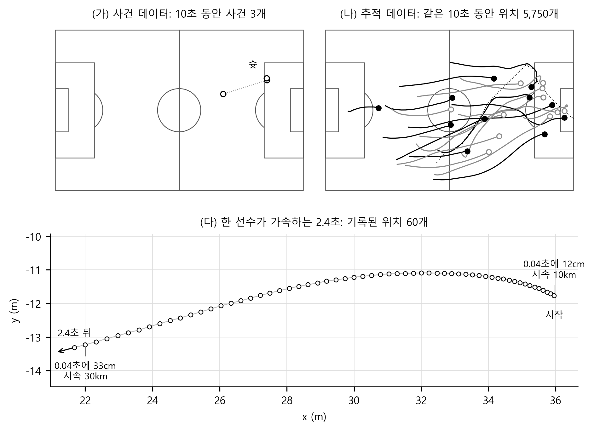
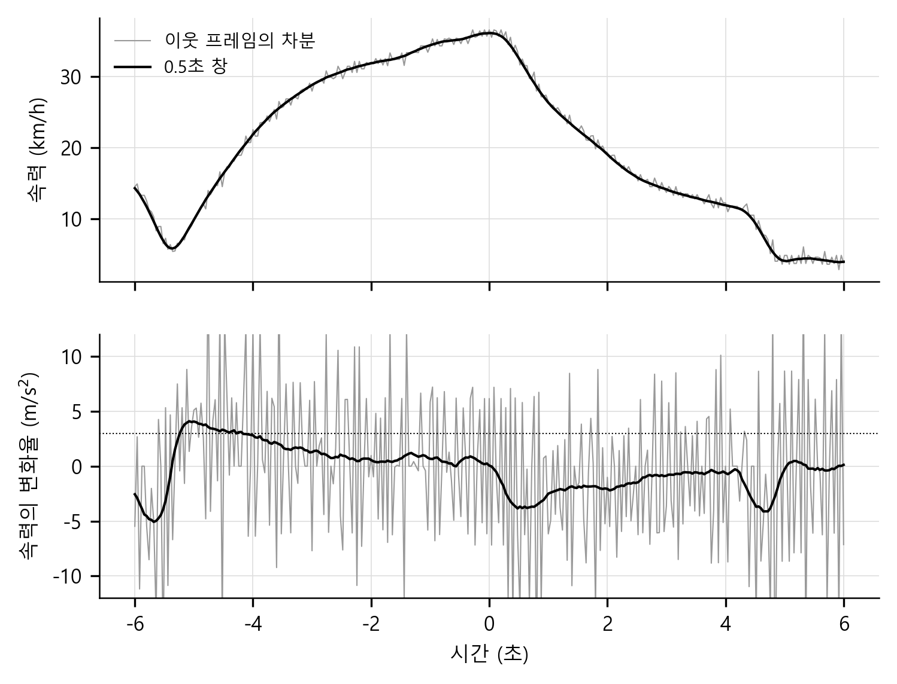
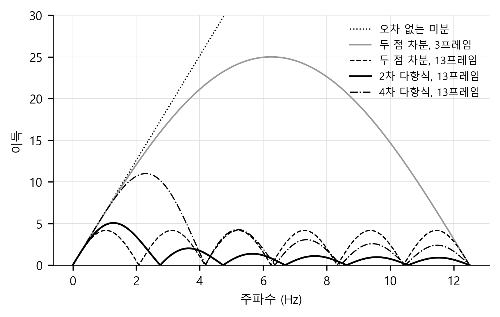
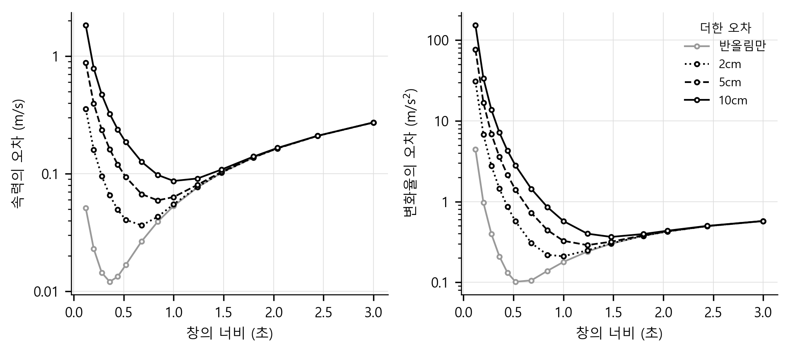

# 운동학 1장. 위치의 미분과 평활 — 위치 기록에서 속도를 어떻게 얻는가

- [I. 질문과 데이터](#i-질문과-데이터)
- [II. 차분으로 미분한다](#ii-차분으로-미분한다)
- [III. 평활](#iii-평활)
- [IV. 창의 너비를 고른다](#iv-창의-너비를-고른다)
- [V. 제공자의 값](#v-제공자의-값)
- [VI. 지표는 처리에 따라 달라진다](#vi-지표는-처리에-따라-달라진다)
- [VII. 해석](#vii-해석)
- [VIII. 관련 연구](#viii-관련-연구)
- [참고문헌](#참고문헌)

> 데이터: Bassek et al. (2025)의 독일 분데스리가 추적 데이터(<https://doi.org/10.6084/m9.figshare.28196177>, CC BY 4.0). 파일이 커서 이 저장소에 싣지 않는다. `python scripts/fetch_idsse.py`로 받는다.

이 장부터 두 장은 선수의 위치를 초당 25번 기록한 추적 데이터를 쓴다. 앞의 장들이 쓴 사건 데이터는 공에 일어난 일을 기록한 것이고, 공과 떨어진 선수가 무엇을 했는지는 기록하지 않는다. 추적 데이터는 모든 선수의 위치를 경기 내내 기록한다. 선수가 얼마나 뛰었는지, 얼마나 빨랐는지, 몇 번 가속했는지는 이 기록에서 나온다. 그런데 기록된 것은 위치뿐이다. 속도와 가속도는 위치를 시간으로 미분해 얻는 값이고, 이 장은 그 계산을 설명한다.

미분은 단순한 계산처럼 보인다. 이웃한 두 위치의 차를 시간 간격으로 나누면 된다. 문제는 위치에 오차가 있다는 점이다. 미분은 오차를 키우고, 두 번 미분하면 더 키운다. 그래서 미분하기 전이나 미분하면서 평활을 하는데, 평활을 얼마나 하는지에 따라 결과가 달라진다. 이동 거리, 고속 주행 거리, 스프린트 횟수, 가속 횟수처럼 선수의 활동량으로 보고되는 지표는 모두 이 선택의 영향을 받는다. 지표마다 그 영향이 얼마나 다른지가 이 장에서 확인하는 내용이다.

장의 순서는 다음과 같다. I장은 데이터를 설명하고, 미분하기 전에 확인해야 하는 것을 본다. II장은 차분으로 미분하는 방법과 오차가 커지는 정도를 설명한다. III장은 평활의 방법 셋을 가중치와 주파수의 두 관점에서 설명한다. IV장은 참값을 아는 시뮬레이션 궤적에서 창의 너비를 고른다. V장은 직접 계산한 값을 제공자가 계산해 둔 값과 비교한다. VI장은 처리 방식에 따라 선수의 지표가 얼마나 달라지는지를 본다. VII장은 해석을, VIII장은 관련 연구를 적는다.

## I. 질문과 데이터

### 1. 이 묶음의 데이터는 월드컵이 아니다

이 책의 다른 장은 2022년 카타르 월드컵의 사건 데이터를 쓴다. 운동학 묶음의 두 장만 다른 데이터를 쓴다. Bassek et al. (2025)이 공개한 독일 분데스리가 2022/23 시즌의 7경기다. 1부 리그 2경기와 2부 리그 5경기이고, 독일축구리그의 공식 추적 데이터다. 경기장에 고정한 여러 대의 카메라로 선수와 공의 위치를 초당 25번 기록했다.

데이터를 바꾼 이유는 관측의 범위다. 2022년 월드컵에도 공개된 추적 데이터가 있지만 중계 영상에서 뽑은 것이다. 중계 화면은 공 주변만 비추므로 화면 밖의 선수는 관측되지 않고, 그 위치는 추정으로 채워져 있다. 위치를 미분하려면 끊기지 않은 궤적이 필요하다. 다음 장에서 선수의 전반과 후반을 비교하려면 선수가 경기 내내 관측되어야 한다. 관측되는지가 공과의 거리에 따라 정해지는 데이터에서는 관측된 구간만 모아도 선수의 활동을 대표하지 않는다. 공간 2장에서 화면 밖의 선수 때문에 생긴 문제와 같은 종류다. 경기장 전체를 찍는 고정 카메라의 데이터에는 이 문제가 없다.

데이터는 경기마다 파일 세 개다. 경기 정보(팀, 명단, 경기장의 크기), 사건, 위치다. 이 장은 위치 파일을 쓴다. 위치 파일은 사람마다, 그리고 전반과 후반마다 프레임의 열로 되어 있다. 프레임 하나에는 프레임 번호와 시각, 위치의 가로와 세로 좌표가 있고, 제공자가 계산한 속도와 가속도가 함께 있다. 좌표는 경기장의 중앙이 원점이고 단위는 미터다. 경기장은 모두 가로 105m, 세로 68m다. 심판 세 명의 궤적도 있으나 쓰지 않는다. 표 1은 경기의 목록이다. 프레임 수는 전반과 후반을 더한 것이고, 선수의 수는 교체로 들어온 선수를 포함해 궤적이 있는 선수의 수다.

**표 1. 경기 7개**

| 대회 | 날짜       | 홈                 | 원정                  | 결과 |  프레임 | 선수 |
|:-----|:-----------|:-------------------|:----------------------|:-----|--------:|-----:|
| 2부  | 2022-08-26 | Fortuna Düsseldorf | SSV Jahn Regensburg   | 4:0  | 137,214 |   32 |
| 2부  | 2022-09-10 | Fortuna Düsseldorf | F.C. Hansa Rostock    | 3:1  | 142,536 |   32 |
| 2부  | 2022-10-15 | Fortuna Düsseldorf | 1\. FC Nürnberg       | 0:1  | 146,211 |   31 |
| 2부  | 2022-11-05 | Fortuna Düsseldorf | FC St. Pauli          | 1:0  | 142,345 |   31 |
| 2부  | 2022-11-11 | Fortuna Düsseldorf | 1\. FC Kaiserslautern | 1:2  | 146,810 |   31 |
| 1부  | 2023-05-27 | 1\. FC Köln        | FC Bayern München     | 1:2  | 145,967 |   32 |
| 1부  | 2023-05-27 | VfL Bochum 1848    | Bayer 04 Leverkusen   | 3:0  | 141,561 |   29 |

표 1의 프레임은 모두 1,002,644개다. 한 구간이 평균 47.7분이다. 전반과 후반은 추가 시간을 포함하고, 공이 밖으로 나가 경기가 멈춘 시간도 포함한다. 선수의 궤적 안에는 빠진 프레임이 없다. 선발로 나와 교체되지 않은 선수는 구간의 첫 프레임부터 마지막 프레임까지 위치가 있고, 교체된 선수는 경기장에 있던 동안의 위치가 있다. 선수 한 명의 한 프레임을 관측 하나로 세면 관측은 21,874,234개다.

그림 1은 두 데이터가 같은 순간을 어떻게 기록하는지를 보여 준다. 예로 쓰는 경기는 1부 리그의 1. FC Köln 대 FC Bayern München(2023-05-27)이고, 장면은 전반 8분에 나온 첫 골 직전의 10초다. 왼쪽 위의 (가)는 그 10초 동안의 사건이다. 사건 데이터의 기록을 위치 파일과 같은 좌표로 옮겨 찍었다. 오른쪽 위의 (나)는 같은 10초 동안의 추적 데이터다. 선마다 한 선수의 궤적이고 점은 마지막 위치다. 검은 선과 채운 점이 골을 넣은 FC Bayern München, 회색 선과 빈 점이 상대 팀이며, 점선은 공의 궤적이다. 아래의 (다)는 이 경기의 다른 순간에 한 선수가 가속하는 2.4초를 확대한 것으로, 기록된 위치를 하나하나 점으로 찍었다.

그림 1의 (가)에서 10초 동안 기록된 사건은 3개이고, 모두 공이 있던 곳이다. 공을 가진 선수가 무엇을 했는지만 기록되므로 그사이 다른 선수들의 움직임은 이 데이터에 없다. (나)에는 같은 10초 동안 선수 22명과 공의 위치가 5,750개 기록되어 있다. 공과 멀리 떨어진 선수들이 골대 쪽으로 함께 움직이는 것은 (나)에서만 보인다. (다)의 선수는 Leroy Sané이다. 처음에는 이웃한 두 점 사이가 12cm이고 마지막에는 33cm다. 0.04초 동안의 이동이므로 시속 10km에서 30km로 빨라진 것이다. 기록된 것은 점의 위치뿐이고, 속도는 점 사이의 간격에서 계산한 값이다. 이 장은 그 계산을 다룬다.

경기가 7개뿐이고 그 가운데 5개는 같은 팀의 홈 경기다. 이 데이터로 리그나 팀에 대해 말할 수 있는 것은 적다. 이 장의 목적은 그것이 아니다. 위치의 시계열에서 속도와 가속도를 얻는 계산을 설명하는 데에는 한 경기로도 충분하고, 처리 방식에 따른 차이를 선수 사이에서 비교하는 데에는 7경기의 선수가 쓰인다.

### 2. 위치가 한 프레임에 옮겨지는 곳

미분하기 전에 위치를 먼저 확인한다. 가장 간단한 확인은 이웃한 두 프레임 사이에 선수가 이동한 거리다. 한 프레임은 0.04초다. 이 데이터에서 제공자가 계산한 속도의 최댓값은 시속 36.3km이고, 이 속도로 한 프레임에 가는 거리는 0.40m다. 그런데 한 프레임에 0.5m 넘게 옮겨진 곳이 있다. 0.5m는 시속 45km에 해당하고, 사람이 낼 수 있는 속도가 아니다. 표 2는 그런 곳을 옮겨진 거리로 나누어 센 것이다. 마지막 열은 그때 경기가 멈춰 있던 비율이다.

**표 2. 한 프레임에 0.5m 넘게 옮겨진 곳**

| 옮겨진 거리 |    곳 | 경기가 멈춰 있던 비율(%) |
|:------------|------:|-------------------------:|
| 0.5\~1m      |   347 |                       65 |
| 1\~2m        |   278 |                       74 |
| 2\~5m        |   218 |                       70 |
| 5\~20m       |   157 |                       79 |
| 20m 이상    |    60 |                       78 |
| 전체        | 1,060 |                       71 |

표 2에서 그런 곳은 1,060곳이다. 관측 21,874,234개 가운데 20,636개에 하나이므로 드물다. 그러나 크기가 작지 않다. 중위값이 1.9m이고 가장 큰 것은 64m다. 이것들은 한 프레임만 튀었다가 돌아오는 값이 아니다. 옮겨진 뒤의 궤적은 새 위치에서 이어진다. 경기별로는 13곳에서 223곳까지 차이가 크고, 71%는 경기가 멈춰 있을 때 일어났다. 원인은 데이터에 적혀 있지 않다. 추적이 선수를 놓쳤다가 위치를 바로잡은 것으로 보이지만 확인하지 못했다. 제공자의 속도에는 이 이동이 반영되어 있지 않다. 그 프레임의 제공자 속도는 앞뒤와 다르지 않다.

이것을 그대로 두고 미분하면 결과가 크게 틀린다. 이웃 프레임의 차로 속도를 계산하면 64m를 0.04초에 간 것이 되어 시속 5,768km가 나온다. 평활은 이것을 고치지 못한다. 평활은 한 점의 큰 값을 주변으로 퍼뜨릴 뿐이어서, 1초 너비의 창을 쓰면 64m의 이동이 1초 동안의 고속 주행이 된다. 그래서 이 장의 모든 계산은 이런 곳에서 궤적을 끊는다. 계산에 쓰는 창이 끊긴 곳을 걸치면 그 시점의 속도와 가속도는 계산하지 않고, 지표를 셀 때 그 시점의 이동은 0으로 둔다. 끊지 않았을 때 지표가 얼마나 달라지는지는 VI장에서 본다. 문턱 0.5m는 사람의 속도로 불가능한 값에서 골랐고, 그 아래에도 의심스러운 이동이 조금 남아 있을 수 있다.

### 3. 위치의 해상도와 잡음

좌표는 소수 둘째 자리, 즉 1cm 단위로 기록되어 있다. 1cm로 반올림하면 참값과의 차이는 −0.5cm와 0.5cm 사이에 고르게 분포하고, 그 표준편차는 $1/\sqrt{12}$cm, 즉 0.29cm다. 위치의 오차로는 무시할 만한 크기다. 선수의 몸이 차지하는 너비가 수십 cm이므로 선수의 위치를 1cm까지 정하는 것 자체가 의미가 없다. 그런데 미분에서는 이 크기가 문제가 된다. II장에서 그 이유를 식으로 본다.

제공자가 공개한 위치는 추적 시스템의 원래 출력이 아니다. 영상에서 프레임마다 따로 추정한 위치라면 이웃한 프레임 사이에 불규칙한 어긋남이 있을 것인데, 이 데이터의 궤적은 매끄럽다. 프레임 사이의 불규칙한 변동의 크기는 위치의 2차 차분, 즉 $x_{k+1} - 2x_k + x_{k-1}$로 가늠할 수 있다. 궤적이 매끄러우면 이 값은 0에 가깝고, 남는 것은 주로 프레임마다 독립인 오차다. 독립인 오차의 표준편차가 $\sigma$이면 2차 차분의 표준편차는 $\sqrt{6}\,\sigma$다. 이 데이터에서 2차 차분의 표준편차는 1.06cm이고, 이것을 $\sqrt{6}$으로 나누면 0.43cm다. 반올림만으로 생기는 0.29cm보다 조금 크다. 이 값에는 선수의 실제 가속도 포함되어 있으므로 오차의 상한으로 본다. 남은 불규칙한 오차는 반올림과 비슷한 크기다. 궤적이 이 정도로 매끄러운 것은 공개하기 전에 평활을 거쳤기 때문으로 보인다. 어떤 평활을 했는지는 데이터에 적혀 있지 않다. 여기서 말하는 오차는 프레임 사이의 불규칙한 부분뿐이다. 선수의 위치가 여러 프레임에 걸쳐 한쪽으로 어긋나 있는 오차는 2차 차분에 나타나지 않고, 이 데이터만으로는 그 크기를 알 수 없다.

## II. 차분으로 미분한다

### 1. 차분의 식

시점 $k$의 위치를 $x_k$, 프레임 사이의 간격을 $\Delta t$라 한다. 이 데이터에서 $\Delta t = 0.04$초다. 속도는 위치의 시간 미분이고, 가장 단순한 추정은 이웃한 두 프레임의 차를 간격으로 나누는 것이다.

$$\hat v_k = \frac{x_k - x_{k-1}}{\Delta t} \qquad (1)$$

식 (1)은 엄밀히는 시점 $k$가 아니라 $k - 1/2$에서의 속도다. 시점 $k$에서의 속도는 앞뒤로 같은 거리만큼 떨어진 두 점으로 구한다. 앞뒤로 $h$프레임 떨어진 두 점을 쓰는 중심 차분은 다음과 같다.

$$\hat v_k = \frac{x_{k+h} - x_{k-h}}{2h\,\Delta t} \qquad (2)$$

가속도는 속도의 미분이므로 위치를 두 번 미분한다. 이웃한 세 점으로 구하는 2차 차분이 가장 단순한 추정이다.

$$\hat a_k = \frac{x_{k+1} - 2x_k + x_{k-1}}{\Delta t^2} \qquad (3)$$

위치는 2차원이므로 가로와 세로 좌표에 같은 계산을 따로 한다. 속도는 벡터 $(v_x, v_y)$이고, 그 크기 $\sqrt{v_x^2 + v_y^2}$가 속력이다. 이 장에서 속도라고만 적은 것은 대개 속력을 가리킨다. 가속도에는 뜻이 둘 있어서 V장에서 따로 구분한다. 단위는 계산에서는 초속 미터(m/s)를 쓰고, 선수의 지표를 적을 때는 관행대로 시속 킬로미터(km/h)를 쓴다. 초속 1m는 시속 3.6km다.

### 2. 미분은 오차를 키운다

기록된 위치가 참값에 오차가 더해진 것이라 하자. $x_k = x_k^* + e_k$이고, 오차 $e_k$는 프레임마다 독립이며 표준편차가 $\sigma$다. 식 (1)의 추정값에는 참 속도 외에 $(e_k - e_{k-1})/\Delta t$가 더해진다. 독립인 두 오차의 차의 분산은 $2\sigma^2$이므로 속도 오차의 표준편차는 다음과 같다.

$$\mathrm{sd}(\hat v_k) = \frac{\sqrt{2}\,\sigma}{\Delta t} \qquad (4)$$

같은 계산을 식 (3)에 하면 $e_{k+1} - 2e_k + e_{k-1}$의 분산이 $(1 + 4 + 1)\sigma^2 = 6\sigma^2$이므로 가속도 오차의 표준편차는 다음과 같다.

$$\mathrm{sd}(\hat a_k) = \frac{\sqrt{6}\,\sigma}{\Delta t^2} \qquad (5)$$

두 식의 분모에 $\Delta t$와 $\Delta t^2$이 있다는 것이 요점이다. $\Delta t$가 0.04이면 속도에서는 오차가 $\sqrt{2}/0.04$, 즉 35배가 되고 가속도에서는 $\sqrt{6}/0.0016$, 즉 1,531배가 된다. 위치를 자주 기록할수록 미분의 오차는 커진다. 기록의 간격이 짧으면 그사이에 선수가 실제로 이동한 거리는 줄어드는데 위치의 오차는 그대로이기 때문이다.

반올림의 오차 0.29cm를 두 식에 넣으면 속도 오차의 표준편차는 초속 0.10m, 가속도 오차의 표준편차는 4.4m/s²이다. 속도의 오차는 시속 0.4km이므로 견딜 만하다. 가속도는 그렇지 않다. 축구에서 높은 가속으로 세는 문턱이 흔히 3m/s²인데, 위치를 1cm로 반올림한 것만으로 생기는 오차가 그보다 크다. 위치의 오차가 0.3cm라는 것은 측정으로는 더 바랄 것이 없는 정확도다. 그래도 식 (3)으로는 가속도를 얻지 못한다.

### 3. 한 선수의 12초

그림 2는 이 계산을 실제 궤적에 적용한 것이다. 예로 쓴 경기의 전반에 제공자의 속도가 가장 높았던 선수를 골라, 그 순간의 앞뒤 6초를 그렸다. 위의 그림은 속력이고 아래의 그림은 속력의 변화율이다. 회색 선은 이웃한 프레임만 쓴 값으로, 위에서는 식 (1)의 속력이고 아래에서는 그 속력의 이웃 프레임 사이의 변화율이다. 검은 선은 III장에서 설명할 방법으로 0.5초 너비의 창을 써서 계산한 값이다.

그림 2의 선수는 Leroy Sané이다. 12초 동안 속력이 시속 4km와 36km 사이에서 변했다. 속력에서는 두 선이 거의 겹친다. 회색 선에 작은 요철이 있지만 전체 모양을 가리지 않는다. 변화율에서는 사정이 다르다. 회색 선은 검은 선의 위아래로 표준편차 6.5m/s²만큼 퍼져 있고, 세로축의 범위를 넘는 값도 있다. 아래 그림의 점선은 문턱 3m/s²이다. 검은 선은 이 12초 동안 문턱을 2번 넘었고 회색 선은 86번 넘었다. 이웃 프레임의 차분으로는 선수가 몇 번 가속했는지를 셀 수 없다.

## III. 평활

### 1. 창과 가중치

오차를 줄이는 방법은 여러 프레임을 함께 쓰는 것이다. 시점 $k$의 앞뒤로 $h$프레임씩, 모두 $2h + 1$개의 위치를 창이라 부른다. 창 안의 위치에 가중치 $w_{-h}, \dots, w_h$를 곱해 더한 값이 추정값이다.

$$\hat v_k = \sum_{i=-h}^{h} w_i\, x_{k+i} \qquad (6)$$

이 장에서 다루는 방법은 모두 식 (6)의 형태이고 가중치만 다르다. 오차가 프레임마다 독립이면 추정값의 오차의 분산은 $\sigma^2 \sum_i w_i^2$이다. 방법을 비교하는 일은 가중치를 비교하는 일이다. 세 가지를 본다.

첫째는 두 점 차분이다. 식 (2)가 이것이고, 가중치는 창의 양 끝에만 있다. $w_h = 1/(2h\Delta t)$, $w_{-h} = -1/(2h\Delta t)$이고 나머지는 0이다. 오차의 표준편차는 $\sqrt{2}\sigma/(2h\Delta t)$로, 간격을 $h$배로 늘리면 $1/h$이 된다.

둘째는 이동 평균이다. 위치를 먼저 창 안의 평균으로 바꾸고, 평활한 위치를 식 (1)로 미분한다. 널리 쓰이는 방법인데, 식을 풀어 보면 두 점 차분과 동일한 것이다. 이웃한 두 시점의 이동 평균을 빼면 가운데의 위치가 모두 상쇄되고 양 끝의 두 값만 남기 때문이다.

$$\frac{1}{\Delta t}\left(\frac{1}{2h+1}\sum_{i=-h}^{h} x_{k+i} - \frac{1}{2h+1}\sum_{i=-h}^{h} x_{k-1+i}\right) = \frac{x_{k+h} - x_{k-h-1}}{(2h+1)\,\Delta t} \qquad (7)$$

창 안의 위치를 모두 쓴 것처럼 보이지만 속도의 추정에 쓰인 것은 두 점뿐이다. 식 (7)의 오른쪽은 $2h + 1$프레임 떨어진 두 점의 차분이고, 오차의 표준편차도 그 차분과 같다. 위치를 이동 평균으로 평활한 뒤 미분하는 것과 넓은 간격의 두 점으로 미분하는 것은 같은 계산이다. 평활의 단계를 따로 두었다고 해서 정보를 더 쓰는 것이 아니다. 그래서 이 장은 이동 평균을 따로 다루지 않고 두 점 차분으로 대신한다.

셋째는 Savitzky and Golay (1964)의 방법이다. 창 안의 위치에 시간의 다항식을 최소제곱으로 맞추고, 그 다항식을 창의 가운데에서 미분한 값을 추정값으로 쓴다. 다항식의 1차 계수가 속도이고 2차 계수의 두 배가 가속도다. 창을 한 프레임씩 옮기며 같은 일을 되풀이한다. 최소제곱 추정값은 데이터의 선형 결합이므로 이 방법도 식 (6)의 형태이고, 가중치는 창의 너비와 다항식의 차수만으로 정해진다. 데이터와 무관하므로 한 번 구해 두면 된다. 창 안의 시점을 열로 세운 행렬 $\mathbf{A}$의 $(i, j)$ 원소를 $(i\Delta t)^j$라 하면 계수의 추정값은 $(\mathbf{A}^\top \mathbf{A})^{-1}\mathbf{A}^\top \mathbf{x}$이고, 이 행렬의 둘째 행이 속도의 가중치, 셋째 행의 두 배가 가속도의 가중치다.

다항식이 1차나 2차일 때 속도의 가중치는 $w_i = i / (\Delta t \sum_j j^2)$이다. 가운데에서 멀수록 크고, 앞쪽은 음수이고 뒤쪽은 양수다. 창 안의 점에 직선을 맞춘 기울기와 같다. 오차의 표준편차는 $\sigma / (\Delta t \sqrt{\sum_j j^2})$이다. 표 3은 위치의 오차가 1cm일 때 창의 너비에 따른 추정값의 오차다. 둘째 열과 셋째 열은 속도의 오차로, 두 점 차분과 2차 다항식을 맞춘 것이다. 넷째 열은 2차 다항식으로 구한 가속도의 오차다. 위치의 오차가 다른 크기이면 표의 값에 그 크기를 곱한다.

**표 3. 위치의 오차가 1cm일 때 추정값의 오차의 표준편차**

| 창(프레임) | 창(초) | 두 점 차분의 속도(m/s) | 다항식의 속도(m/s) | 다항식의 가속도(m/s²) |
|---:|---:|---:|---:|---:|
| 3 | 0.12 | 0.177 | 0.177 | 15.31 |
| 5 | 0.20 | 0.088 | 0.079 | 3.34 |
| 7 | 0.28 | 0.059 | 0.047 | 1.36 |
| 13 | 0.52 | 0.029 | 0.019 | 0.28 |
| 25 | 1.00 | 0.015 | 0.007 | 0.05 |
| 51 | 2.04 | 0.007 | 0.002 | 0.01 |

표 3에서 창이 넓을수록 오차가 줄어든다. 줄어드는 속도는 가속도에서 더 빠르다. 창이 3프레임일 때 가속도의 오차는 15m/s²이고, 13프레임(0.52초)이면 0.28m/s²이다. 속도에서는 같은 너비의 창에서 다항식이 두 점 차분보다 오차가 작다. 13프레임에서 두 점 차분의 오차는 다항식의 1.6배다. 두 점 차분은 창의 양 끝만 쓰고 다항식은 창 안의 점을 모두 쓰기 때문이다.

### 2. 평활은 참값도 깎는다

표 3만 보면 창은 넓을수록 좋다. 그렇지 않은 이유는 창이 넓어지면 추정값이 참값에서 벗어나기 때문이다. 식 (2)의 두 점 차분은 창 안에서 속도가 일정하다고 본 것이다. 실제로는 창 안에서 선수의 속도가 변한다. 참 궤적을 테일러 급수로 펼치면 식 (2)의 기댓값은 참 속도에 $(h\Delta t)^2 x'''_k / 6$이 더해진 값이다. $x'''$은 가속도의 변화율이다. 속도가 최고점에 이르렀다가 내려오는 순간에는 이 항이 음수여서 최고 속도가 실제보다 낮게 추정된다. 가속도에서도 같은 일이 일어난다. 짧고 강한 가속일수록 넓은 창에서 많이 깎인다.

오차는 두 부분으로 나뉜다. 위치의 오차에서 오는 부분은 창이 넓을수록 작아지고, 평활이 참값을 깎아서 생기는 치우침은 창이 넓을수록 커진다. 둘의 제곱을 더한 것이 평균제곱오차이고, 이것이 가장 작은 창이 있다. 공간 1장에서 커널 밀도의 띠너비를 고를 때와 같은 구조다. 차이는 그때는 교차검증으로 띠너비를 골랐는데 여기서는 그렇게 하기 어렵다는 점이다. 참 속도가 관측되지 않기 때문이다. IV장에서 참값을 아는 궤적을 만들어 이 문제를 다룬다.

다항식의 차수는 치우침을 줄이는 수단이다. 2차 다항식은 창 안에서 가속도가 일정하다고 보고, 4차 다항식은 가속도가 2차 곡선으로 변하는 것까지 허용한다. 차수가 높으면 같은 창에서 치우침이 작고 오차의 분산은 크다. 창의 가운데에서 구하는 미분에서는 차수가 둘씩 묶인다. 속도의 가중치는 1차와 2차가 같고 3차와 4차가 같으며, 가속도의 가중치는 2차와 3차가 같다. 이 장은 2차를 기본으로 쓰고 IV장에서 4차와 비교한다.

### 3. 주파수로 본 평활

같은 내용을 주파수로 볼 수 있다. 시계열은 주파수가 다른 사인파의 합으로 나타낼 수 있다. 주파수 $f$의 사인파 $\sin(2\pi f t)$를 미분하면 $2\pi f \cos(2\pi f t)$가 되므로, 미분은 주파수 $f$의 성분의 진폭을 $2\pi f$배로 만든다. 두 번 미분하면 $(2\pi f)^2$배다. 높은 주파수일수록 크게 키운다. 이 데이터에서 나타낼 수 있는 가장 높은 주파수는 기록 빈도의 절반인 12.5Hz이고, 이 주파수에서 $2\pi f$는 79, $(2\pi f)^2$은 6,169다. II.2절의 식 (4)와 (5)가 말한 것을 주파수별로 나누어 본 것이다.

선수의 움직임은 낮은 주파수에 있고 프레임마다 독립인 오차는 모든 주파수에 고르게 있다. 이 차이가 평활의 근거다. 예로 쓴 경기의 전반에서 선수 22명의 속도를 식 (1)로 구해 주파수별 분산을 보면 그렇다.

분산의 99.2%가 1Hz 아래에 있다. 1Hz와 4Hz 사이에 0.1%, 4Hz 위에 0.7%가 있다. 움직임의 성분은 주파수가 높아질수록 줄어들 것인데 4Hz 위의 몫이 그 아래 대역보다 크다. 4Hz 위에 있는 것은 주로 움직임이 아니라 오차로 보인다. 높은 주파수의 성분은 속도에서는 작지만 한 번 더 미분하면 $2\pi f$배가 되므로 가속도에서는 커진다. 평활은 높은 주파수의 성분을 줄이는 일이다. 방법마다 어느 주파수를 얼마나 줄이는지가 다르다. 식 (6)의 가중치에 주파수 $f$의 사인파를 넣으면 진폭이 몇 배가 되는지를 계산할 수 있고, 이것을 이득이라 부른다. 그림 3은 속도를 추정하는 가중치 넷의 이득이다. 점선은 오차 없는 미분의 이득 $2\pi f$다. 이 선을 따라가는 주파수에서는 미분이 정확하고, 이 선보다 아래로 내려가는 주파수에서는 그 성분이 줄어든다.

그림 3에서 3프레임의 두 점 차분은 높은 주파수의 성분을 거의 줄이지 않는다. 6Hz 근처까지 이득이 계속 오른다. 13프레임의 창은 셋 모두 2Hz 위의 성분을 크게 줄이지만 줄이는 방식이 다르다. 두 점 차분의 이득은 2Hz 근처에서 0이 되었다가 다시 올라와 높은 주파수의 성분이 여러 번 통과한다. 2차 다항식은 다시 올라오는 정도가 훨씬 작다. 4차 다항식은 낮은 주파수에서 점선을 가장 오래 따라가고, 그 대신 더 높은 주파수까지 통과시킨다. 1Hz에서의 이득을 점선의 값으로 나누면 두 점 차분이 0.66, 2차 다항식이 0.76, 4차 다항식이 0.99다. 1에서 모자란 만큼이 III.2절에서 말한 치우침이다.

## IV. 창의 너비를 고른다

### 1. 참값을 아는 궤적

창의 너비를 고르려면 추정값을 참값과 비교해야 하는데 참 속도는 관측되지 않는다. 그래서 참값을 아는 궤적을 만든다. 예로 쓴 경기의 전반에서 선수 22명의 궤적을 가져와, 높은 주파수의 성분을 줄인 것을 참 궤적으로 정한다. 주파수 $f$의 성분에 $\exp(-f^2/2)$를 곱한다. 1Hz의 성분은 0.61배, 2Hz는 0.14배, 3Hz는 0.01배가 된다. 이렇게 만든 궤적은 실제 선수의 궤적과 닮았고 완전히 매끄러우며, 속도와 가속도를 주파수 영역에서 차분 없이 정확히 계산할 수 있다. 이 궤적에 표준편차가 정해진 정규 오차를 프레임마다 독립으로 더하고 1cm로 반올림한 것이 시뮬레이션 데이터다. 오차의 표준편차는 0, 2, 5, 10cm의 네 가지다. 0은 반올림만 한 것이다.

이 설계에는 가정이 둘 있다. 하나는 참 궤적의 매끄러움이다. 3Hz 위의 움직임이 거의 없다고 정한 것이고, 이 기준을 바꾸면 가장 좋은 창도 달라진다. 다른 하나는 오차가 프레임마다 독립이라는 것이다. 실제 추적의 오차는 그렇지 않을 가능성이 높다. 카메라가 선수의 위치를 한쪽으로 잘못 잡으면 그 어긋남은 여러 프레임 동안 이어진다. 그런 오차는 낮은 주파수에 있어서 평활로 줄어들지 않는다. 그러므로 이 절의 결과는 가장 좋은 창이 몇 초인지를 정하는 근거가 아니다. 창의 너비에 따라 오차가 어떤 모양으로 변하는지, 그리고 속도와 가속도에 필요한 창이 얼마나 다른지를 보이는 것이 목적이다.

참 궤적에서 속력의 표준편차는 초속 1.39m이고, 속력의 변화율의 표준편차는 1.00m/s²이다. 추정의 오차는 이 크기에 비추어 판단한다. 오차는 추정값과 참값의 차의 제곱을 평균해 제곱근을 구한 값(RMSE)이다. 양 끝의 4초는 뺐다.

### 2. 오차는 창의 너비에 따라 내려갔다가 올라간다

그림 4는 2차 다항식으로 추정한 속력과 속력의 변화율의 오차를 창의 너비에 따라 그린 것이다. 왼쪽이 속력이고 오른쪽이 변화율이다. 선 넷은 더한 오차의 크기다. 세로축은 로그 눈금이다.

그림 4의 선은 모두 내려갔다가 올라간다. 창이 좁을 때의 오차는 위치의 오차가 미분으로 커진 것이고 더한 오차가 클수록 높다. 창이 넓을 때의 오차는 치우침이고 더한 오차의 크기와 무관해서 네 선이 한 곡선으로 모인다. 가장 낮은 곳은 더한 오차가 클수록 오른쪽에 있다. 표 4는 가장 낮은 곳을 정리한 것이다. 더한 오차마다 이웃 프레임의 차분으로 구한 속력의 오차를 먼저 적고, 이어서 방법별로 오차가 가장 작은 창의 너비와 그때의 오차를 적었다. 속력은 두 점 차분과 2차 다항식과 4차 다항식의 세 방법, 변화율은 2차와 4차 다항식의 두 방법이다.

<!-- Word 변환 지침 (표 4):
- 헤더 2행 구조.
  · 1행: [더한 오차 (rowspan=2)] [이웃 차분 (rowspan=2)] [속력: 두 점 차분 (colspan=2)] [속력: 2차 (colspan=2)] [속력: 4차 (colspan=2)] [변화율: 2차 (colspan=2)] [변화율: 4차 (colspan=2)]
  · 2행: 묶음마다 [창(초)][오차]
- 병합 셀은 가운데 정렬, 숫자 열은 우측 정렬.
-->

**표 4. 오차가 가장 작은 창의 너비와 그때의 오차: 속력은 m/s, 변화율은 m/s²**

| 더한 오차 | 이웃 차분 속력 | 속력, 두 점 차분 창(초) | 속력, 두 점 차분 오차 | 속력, 2차 창(초) | 속력, 2차 오차 | 속력, 4차 창(초) | 속력, 4차 오차 | 변화율, 2차 창(초) | 변화율, 2차 오차 | 변화율, 4차 창(초) | 변화율, 4차 오차 |
|:---|---:|---:|---:|---:|---:|---:|---:|---:|---:|---:|---:|
| 반올림만 | 0.104 | 0.36 | 0.016 | 0.36 | 0.012 | 0.84 | 0.007 | 0.52 | 0.10 | 1.00 | 0.07 |
| 2cm | 0.712 | 0.68 | 0.059 | 0.68 | 0.036 | 1.48 | 0.027 | 1.00 | 0.21 | 1.80 | 0.17 |
| 5cm | 1.835 | 0.84 | 0.105 | 0.84 | 0.059 | 1.80 | 0.047 | 1.24 | 0.29 | 2.04 | 0.25 |
| 10cm | 3.980 | 1.24 | 0.162 | 1.00 | 0.087 | 2.04 | 0.072 | 1.48 | 0.36 | 2.44 | 0.33 |

표 4에서 알 수 있는 것은 넷이다. 첫째, 가장 좋은 창은 위치의 오차가 클수록 넓다. 2차 다항식으로 속력을 추정할 때 반올림만 있으면 0.36초이고 오차가 5cm이면 0.84초다. 창의 너비는 방법의 성질이 아니라 데이터의 성질에 맞추어 정하는 값이다. 어떤 추적 시스템에 맞는 창이 다른 시스템에도 맞는다는 보장이 없다.

둘째, 변화율에는 속력보다 넓은 창이 필요하다. 네 가지 오차 모두에서 그렇다. 오차가 5cm일 때 2차 다항식의 가장 좋은 창은 속력에서 0.84초, 변화율에서 1.24초다. 그리고 가장 좋은 창에서도 변화율의 오차는 상대적으로 크다. 속력의 오차 0.059m/s는 참 속력의 표준편차의 4%이고, 변화율의 오차 0.29m/s²은 참 변화율의 표준편차의 29%다. 가속도는 속도보다 훨씬 부정확하게 추정된다.

셋째, 4차 다항식은 2차보다 넓은 창에서 가장 좋고 그때의 오차가 더 작다. 치우침이 작아서 창을 더 넓힐 수 있기 때문이다. 같은 창에서 비교하면 좁은 창에서는 2차가, 넓은 창에서는 4차가 낫다. 차수와 창의 너비는 따로 고르는 값이 아니다. 두 점 차분은 가장 좋은 창에서도 2차 다항식보다 오차가 크다.

넷째, 이웃 프레임의 차분은 위치의 오차가 작을 때만 쓸 수 있다. 반올림만 있을 때 속력의 오차는 0.104m/s이지만 5cm이면 1.83m/s다. 이 오차는 평균이 0이 아니다. 속력은 속도 벡터의 크기이므로 오차가 어느 방향으로 더해져도 크기는 대체로 늘어난다. 그래서 속력을 시간에 대해 더한 이동 거리가 늘어난다. 오차가 5cm일 때 이웃 프레임의 차분으로 구한 이동 거리는 참값의 1.57배다. 반올림만 있을 때는 1.003배다. 서 있는 선수도 위치가 프레임마다 다르게 기록되면 이동한 것으로 계산된다. 반대쪽의 한계도 있다. 오차가 없어도 창이 넓으면 최고 속력이 깎인다. 참 궤적의 최고 속력은 시속 36.0km인데 반올림만 한 데이터에서 2초 창의 추정값은 35.1km다.

## V. 제공자의 값

### 1. 속도

위치 파일에는 제공자가 계산한 속도가 프레임마다 있다. 어떻게 계산했는지는 적혀 있지 않다. 직접 계산한 값과 비교하면 그 계산을 짐작할 수 있고, 제공자의 값을 그대로 써도 되는지를 판단할 수 있다. 표 5는 2차 다항식으로 창의 너비를 바꾸어 가며 구한 속력과 제공자의 속력의 차이다. 차이는 7경기의 모든 선수와 모든 프레임에서 구한 RMSE이고 단위는 시속 km다. 궤적이 끊긴 곳의 주변은 뺐다.

**표 5. 직접 계산한 속력과 제공자의 속력의 차이**

| 창    | 창(프레임) | 제공자와의 차이(km/h) |
|:------|-----------:|----------------------:|
| 0.2초 |          5 |                 0.152 |
| 0.5초 |         13 |                 0.100 |
| 1초   |         25 |                 0.237 |
| 2초   |         51 |                 0.656 |

표 5에서 차이가 가장 작은 창은 0.5초이고, 그 차이는 시속 0.10km다. 속도가 소수 둘째 자리까지 적혀 있는 것을 생각하면 거의 같은 값이다. 두 점 차분으로도 비교했다. 앞뒤 1, 3, 5, 8프레임의 차이는 차례로 0.30, 0.14, 0.12, 0.19km이고, 가장 작은 것은 앞뒤 5프레임이다. 제공자의 속도는 0.4초에서 0.5초 너비의 창으로 위치를 미분한 것과 같은 정도로 평활되어 있다. 이 장에서 직접 계산한 값은 이것을 다시 만든 것이 아니라 그 선택의 결과를 볼 수 있게 한 것이다.

제공자의 속도가 직접 계산한 것과 다른 곳은 I.2절의 끊긴 곳이다. 위치가 수십 미터 옮겨진 프레임에서 제공자의 속도는 앞뒤와 이어진다. 제공자가 속도를 계산한 위치와 공개한 위치가 그 프레임에서 다르거나, 제공자가 그런 프레임을 따로 처리했다는 뜻이다. 속도만 쓰는 분석이라면 제공자의 값을 쓰는 편이 안전하다. 위치 자체를 쓰는 분석, 예를 들어 선수 사이의 거리나 공간 2장의 보로노이 칸을 계산하는 분석은 끊긴 곳의 앞과 뒤 가운데 어느 쪽 위치가 맞는지를 따로 판단해야 한다.

### 2. 가속도의 두 가지 뜻

가속도에는 뜻이 둘 있다. 하나는 속도 벡터의 변화율 $(a_x, a_y)$의 크기 $\sqrt{a_x^2 + a_y^2}$이다. 물리학에서 가속도라 부르는 것이고, 선수가 지면에서 얻어야 하는 수평 방향의 힘에 비례한다. 다른 하나는 속력의 변화율이다. 가속도 벡터를 진행 방향으로 사영한 값과 같다.

$$a_{\parallel} = \frac{v_x a_x + v_y a_y}{\sqrt{v_x^2 + v_y^2}} \qquad (8)$$

둘은 선수가 직선으로 뛸 때만 같다. 일정한 속력으로 방향을 바꾸는 선수는 속력의 변화율이 0이지만 가속도 벡터는 0이 아니다. 진행 방향에 수직인 성분이 있기 때문이다. 속력의 변화율에는 부호가 있어서 양이면 가속, 음이면 감속이다. 이 장의 그림 2와 IV장에서 변화율이라 부른 것이 식 (8)이다.

제공자의 가속도가 어느 쪽인지는 값을 보면 알 수 있다. 음의 값이 있으므로 크기는 아니다. 0.5초 창으로 구한 식 (8)의 값과 제공자의 가속도의 상관계수는 0.96이고, 가속도 벡터의 크기와의 상관계수는 -0.04다. 제공자의 가속도는 속력의 변화율이다. 축구의 활동량 지표에서 가속과 감속의 횟수라 부르는 것도 대개 이 뜻이다. 두 정의의 차이는 작지 않다. 0.5초 창에서 속력의 변화율이 3m/s² 이상인 프레임은 전체의 1.09%이고, 가속도 벡터의 크기가 3m/s² 이상인 프레임은 6.43%다. 방향 전환에 드는 힘은 속력의 변화율로 센 지표에 들어가지 않는다.

## VI. 지표는 처리에 따라 달라진다

### 1. 지표의 정의

추적 데이터에서 선수의 활동량으로 보고하는 지표는 대개 다섯 가지다. 이동 거리는 속력을 시간에 대해 더한 값이다. 고속 주행 거리는 속력이 문턱을 넘은 프레임에서만 더한 이동 거리다. 스프린트 횟수는 속력이 더 높은 문턱을 넘은 채로 이어진 구간의 수다. 최고 속력은 속력의 최댓값이다. 가속 횟수는 속력의 변화율이 문턱을 넘은 채로 이어진 구간의 수다.

문턱에는 정해진 값이 없다. 이 장은 널리 쓰이는 값을 쓴다. 고속 주행은 시속 19.8km(초속 5.5m) 이상, 스프린트는 시속 25.2km(초속 7m) 이상이다. Bradley et al. (2009)이 쓴 구분과 거의 같다. 가속은 3m/s² 이상이다. 횟수를 세는 지표에는 문턱 외에 정할 것이 하나 더 있다. 문턱을 넘은 상태가 얼마나 이어져야 한 번으로 세는지다. 이것을 최소 지속 시간이라 한다. 이 장은 스프린트에 1초, 가속에 0.5초를 쓰고, 최소 지속 시간을 두지 않은 횟수와 함께 제시한다.

대상은 골키퍼가 아닌 선수 가운데 한 경기에 60분 이상 뛴 선수다. 한 선수의 한 경기가 관측 하나이고 132개다. 같은 선수가 여러 경기에 나온 경우가 있으므로 이 관측은 서로 독립이 아니다. 이 절은 처리 방식 사이의 차이를 같은 관측 안에서 비교하므로 이 점은 문제가 되지 않는다. 표 6은 처리 방식별 지표의 평균이다. 행은 처리 방식이다. 이웃 차분은 식 (1)이고 가속도를 계산하지 않는다. 그 아래 네 행은 2차 다항식으로 창의 너비를 바꾼 것이다. 마지막 행은 제공자의 속도와 가속도를 그대로 쓴 것이다. 스프린트와 가속의 횟수는 최소 지속 시간이 없는 것과 있는 것을 따로 적었다.

**표 6. 처리 방식별 지표의 평균: 60분 이상 뛴 선수의 한 경기 132개**

| 처리 | 이동 거리(m) | 고속 주행(m) | 스프린트 거리(m) | 스프린트, 지속 없음 | 스프린트, 1초 이상 | 최고 속력(km/h) | 가속, 지속 없음 | 가속, 0.5초 이상 |
|:---|---:|---:|---:|---:|---:|---:|---:|---:|
| 이웃 차분 | 9,975 | 816 | 182 | 89.2 | 7.1 | 35.0 |  |  |
| 0.2초 | 9,931 | 799 | 173 | 18.2 | 8.5 | 31.1 | 3,575.9 | 7.8 |
| 0.5초 | 9,895 | 786 | 169 | 13.6 | 8.5 | 30.7 | 169.8 | 40.0 |
| 1초 | 9,811 | 756 | 159 | 12.0 | 8.1 | 30.5 | 111.7 | 36.6 |
| 2초 | 9,561 | 658 | 131 | 9.0 | 6.7 | 29.9 | 43.4 | 20.1 |
| 제공자 | 9,938 | 803 | 174 | 14.5 | 8.7 | 30.8 | 152.4 | 38.8 |

표 6에서 지표마다 처리의 영향이 다르다. 이동 거리는 거의 달라지지 않는다. 0.2초 창과 2초 창의 차이가 3.7%다. 고속 주행 거리는 18%, 스프린트 거리는 24% 줄어든다. 문턱이 높을수록 영향이 크다. 높은 속력은 짧게 지속되고, 넓은 창은 짧은 정점을 깎기 때문이다. 문턱 근처의 속력으로 뛴 시간이 문턱의 위에서 아래로 넘어간다. 최고 속력의 평균은 0.2초 창의 시속 31.1km에서 2초 창의 29.9km로 내려간다.

횟수는 최소 지속 시간에 따라 사정이 다르다. 최소 지속 시간이 없으면 스프린트 횟수는 이웃 차분에서 89번이고 1초 창에서 12번이다. 속력이 문턱 근처에 있을 때 작은 요철마다 문턱을 넘나들기 때문이다. 1초 이상 이어진 것만 세면 6.7번에서 8.7번 사이로 모인다. 최소 지속 시간은 평활이 부족한 것을 보완한다. 다만 이웃 차분에서는 횟수가 0.2초 창보다 적다. 1초 넘게 이어진 스프린트가 요철 때문에 중간에 끊겨 어느 쪽도 1초에 못 미치게 되는 경우가 있기 때문으로 보인다. 2초 창에서 적은 것은 이유가 다르다. 속력의 정점이 깎여 문턱 위에 머무는 시간이 줄어든다.

가속 횟수는 처리에 가장 크게 좌우된다. 0.5초 이상 이어진 가속은 0.2초 창에서 8번, 0.5초 창에서 40번, 2초 창에서 20번이다. 창이 좁으면 변화율이 요철 때문에 0.5초 동안 문턱 위에 머물지 못하고, 창이 넓으면 가속이 깎여 문턱에 닿지 못한다. 그 사이에 횟수가 가장 많은 창이 있다. 최소 지속 시간이 없으면 0.2초 창에서 3,576번이 나온다. 한 경기에 선수가 높은 가속을 몇 번 했는지에 대한 답이 처리에 따라 20번도 되고 40번도 되고 3,576번도 된다. 제공자의 값으로 센 결과는 모든 지표에서 0.5초 창과 가깝다. V.1절의 결과와 맞는다.

### 2. 선수의 순서는 유지되는가

평균이 달라져도 선수 사이의 순서가 같다면 문제는 작다. 한 가지 처리로 통일하기만 하면 선수를 비교할 수 있기 때문이다. 표 7은 0.5초 창으로 구한 지표와 다른 처리로 구한 지표 사이의 스피어만 순위 상관계수다. 행은 지표이고 열은 비교한 처리다. 값이 1이면 선수의 순서가 같다.

**표 7. 0.5초 창의 지표와 다른 처리의 지표 사이의 순위 상관: 관측 132개**

| 지표                    | 이웃 차분 | 0.2초 |  1초 |  2초 | 제공자 |
|:------------------------|----------:|------:|-----:|-----:|-------:|
| 이동 거리               |      1.00 |  1.00 | 1.00 | 1.00 |   1.00 |
| 고속 주행 거리          |      1.00 |  1.00 | 1.00 | 0.99 |   1.00 |
| 스프린트 거리           |      1.00 |  1.00 | 1.00 | 0.99 |   1.00 |
| 스프린트 횟수(1초 이상) |      0.96 |  0.99 | 0.99 | 0.96 |   1.00 |
| 최고 속력               |      0.43 |  0.94 | 1.00 | 0.97 |   1.00 |
| 가속 횟수(0.5초 이상)   |           |  0.68 | 0.94 | 0.77 |   0.90 |

표 7에서 이동 거리와 고속 주행 거리, 스프린트 거리의 순서는 처리와 거의 무관하다. 세 지표의 상관 가운데 가장 낮은 값이 0.99다. 스프린트 횟수도 최소 지속 시간이 있으면 0.96 이상이다. 가속 횟수는 다르다. 0.5초 창과 0.2초 창의 상관이 0.68, 2초 창과의 상관이 0.77이다. 처리를 바꾸면 가속을 많이 한 선수의 명단이 달라진다. 최고 속력은 이웃 차분과의 상관이 0.43으로 낮다. 최댓값은 시계열 전체에서 한 프레임의 값이므로 그 한 프레임의 오차가 그대로 들어간다. 이웃 차분에서 최고 속력의 최댓값은 시속 45.0km이고 0.5초 창에서는 36.1km다.

### 3. 궤적을 끊지 않으면

I.2절에서 위치가 한 프레임에 옮겨지는 곳에서 궤적을 끊기로 했다. 표 8은 끊지 않았을 때의 지표다. 이웃 차분과 0.5초 창의 두 처리에서 끊은 것과 끊지 않은 것을 함께 제시한다. 열은 표 6과 같되 가속 횟수는 0.5초 이상 이어진 것만 적었다. 최고 속력은 평균이 아니라 관측 132개 가운데 가장 큰 값이다.

**표 8. 궤적을 끊은 것과 끊지 않은 것**

| 처리 | 이동 거리(m) | 고속 주행(m) | 스프린트 거리(m) | 가속, 0.5초 이상 | 최고 속력의 최댓값(km/h) |
|:---|---:|---:|---:|---:|---:|
| 이웃 차분 | 9,975 | 816 | 182 |  | 45 |
| 이웃 차분, 끊지 않음 | 10,003 | 844 | 209 |  | 5,768 |
| 0.5초 | 9,895 | 786 | 169 | 40.0 | 36 |
| 0.5초, 끊지 않음 | 9,924 | 810 | 191 | 40.0 | 666 |

표 8에서 끊지 않으면 0.5초 창의 최고 속력의 최댓값이 시속 666km가 된다. 이런 값은 눈에 띄므로 걸러진다. 문제는 눈에 띄지 않는 쪽이다. 이동 거리의 평균은 29m밖에 늘지 않지만 고속 주행 거리는 3.0%, 스프린트 거리는 13% 늘어난다. 위치가 옮겨진 곳은 선수 한 명에 한 경기 평균 4.9곳이다. 이만큼의 이동이 스프린트 거리를 이 정도로 바꾼다. 스프린트는 드문 사건이고, 드문 사건을 세는 지표는 드문 오류에 민감하다. 합계나 평균만 확인해서는 이런 오류가 드러나지 않는다. 프레임 사이의 이동 거리처럼 물리적으로 불가능한 값을 걸러내는 확인을 미분보다 먼저 해야 한다.

## VII. 해석

이 장의 결과는 세 가지로 요약할 수 있다. 첫째, 속도와 가속도는 관측한 값이 아니라 계산한 값이다. 계산에는 창의 너비라는 선택이 들어가고, 이 선택은 오차의 분산과 치우침 사이의 교환이다. 가장 좋은 창은 위치의 오차가 얼마나 큰지와 선수의 움직임이 얼마나 빨리 변하는지에 따라 정해지는데, 둘 다 데이터만으로는 정확히 알 수 없다. 창을 정하는 표준이 없는 이유가 여기에 있다.

둘째, 선택의 영향은 지표마다 다르다. 이동 거리는 어떻게 계산해도 거의 같다. 고속 주행 거리와 스프린트 거리는 창에 따라 달라지지만 선수의 순서는 유지된다. 가속 횟수는 평균도 순서도 달라진다. 이 순서는 미분의 횟수와 사건의 드문 정도를 따른다. 한 번 미분한 값보다 두 번 미분한 값이, 합계보다 문턱을 넘는 횟수가, 낮은 문턱보다 높은 문턱이 처리에 민감하다. 다른 팀이나 다른 리그, 다른 추적 시스템의 가속 횟수를 비교할 때는 같은 처리를 거쳤는지를 먼저 확인해야 한다. 확인할 수 없으면 비교하지 않는 편이 낫다.

셋째, 이 장에서 직접 계산한 값이 제공자의 값보다 낫다는 근거는 없다. 위치가 옮겨진 곳에서 제공자의 속도가 앞뒤와 이어지는 것을 보면, 제공자는 공개한 위치에 없는 정보를 가지고 속도를 계산한 것으로 보인다. 직접 계산한 목적은 제공자의 값이 0.5초쯤의 창에 해당하는 평활을 거친 것임을 확인하고, 다른 선택을 했다면 지표가 어떻게 되었을지를 보는 것이었다. 다음 장은 제공자의 속도를 쓴다.

이 장이 하지 않은 것이 있다. 위치의 오차 자체는 평가하지 못했다. 그러려면 더 정확한 측정과의 비교가 필요하고, 이 데이터에는 그런 측정이 없다. 시뮬레이션 궤적의 오차는 프레임마다 독립이라고 가정했는데 실제 추적의 오차는 그렇지 않을 것이다. 문턱의 값도 그대로 받아들였다. 시속 25.2km가 모든 선수에게 스프린트인지, 선수마다 자기 최고 속력에 대한 비율로 정해야 하는지는 이 장이 다루지 않은 문제다.

## VIII. 관련 연구

창 안의 데이터에 다항식을 맞추어 평활과 미분을 한 번에 하는 방법은 Savitzky and Golay (1964)가 분광 데이터를 위해 제안했다. 가중치가 데이터와 무관하게 정해진다는 것을 보이고 가중치의 표를 실었다. Schafer (2011)는 이 방법을 주파수의 관점에서 설명했다. 그림 3과 같은 이득의 곡선으로 창의 너비와 다항식의 차수가 통과시키는 주파수를 어떻게 정하는지를 보였다. 사람의 움직임을 기록한 데이터에서 미분이 오차를 키우는 문제와 저역 통과 필터로 그것을 다루는 방법은 Winter (2009)의 생체역학 교과서에 정리되어 있다.

추적 시스템의 정확도는 더 정확한 기준 측정과 비교해 평가한다. Linke et al. (2020)은 이 장의 데이터를 만든 것과 같은 계열의 광학 추적 시스템을 실험실의 동작 분석 시스템과 비교했다. Buchheit et al. (2014)은 같은 선수의 같은 움직임을 광학 추적, 지역 위치 측정, GPS의 세 시스템으로 기록해 지표를 비교했고, 시스템 사이의 차이가 가속과 감속의 횟수에서 크다고 보고했다. 두 연구의 수치는 여기에 옮기지 않는다.

처리 방식이 지표를 바꾼다는 것은 GPS 데이터에서 여러 번 보고되었다. Varley et al. (2017)은 같은 데이터에서 평활의 방법과 최소 지속 시간을 바꾸면 가속과 감속, 스프린트의 횟수가 크게 달라진다는 것을 보였다. 이 장의 VI장은 같은 질문을 광학 추적 데이터에 한 것이다. Malone et al. (2017)은 GPS 기기의 제조사가 데이터를 어떻게 처리하는지 공개하지 않는 문제와 그것이 연구 사이의 비교에 미치는 영향을 논했다. Sweeting et al. (2017)은 팀 종목의 연구들이 쓴 속력의 문턱을 모아 연구마다 다르다는 것을 정리했다. 이 장이 쓴 문턱은 Bradley et al. (2009)의 구분을 따랐고, 가속의 문턱 3m/s²은 Akenhead et al. (2013)을 비롯한 여러 연구가 쓴 값이다.

## 참고문헌

Akenhead, R., Hayes, P. R., Thompson, K. G., and French, D. (2013). “Diminutions of acceleration and deceleration output during professional football match play.” *Journal of Science and Medicine in Sport* 16(6), 556–561.

Bassek, M., Rein, R., Weber, H., and Memmert, D. (2025). “An integrated dataset of spatiotemporal and event data in elite soccer.” *Scientific Data* 12, 195.

Bradley, P. S., Sheldon, W., Wooster, B., Olsen, P., Boanas, P., and Krustrup, P. (2009). “High-intensity running in English FA Premier League soccer matches.” *Journal of Sports Sciences* 27(2), 159–168.

Buchheit, M., Allen, A., Poon, T. K., Modonutti, M., Gregson, W., and Di Salvo, V. (2014). “Integrating different tracking systems in football: Multiple camera semi-automatic system, local position measurement and GPS technologies.” *Journal of Sports Sciences* 32(20), 1844–1857.

Linke, D., Link, D., and Lames, M. (2020). “Football-specific validity of TRACAB’s optical video tracking systems.” *PLOS ONE* 15(3), e0230179.

Malone, J. J., Lovell, R., Varley, M. C., and Coutts, A. J. (2017). “Unpacking the black box: Applications and considerations for using GPS devices in sport.” *International Journal of Sports Physiology and Performance* 12(S2), S2-18–S2-26.

Savitzky, A., and Golay, M. J. E. (1964). “Smoothing and differentiation of data by simplified least squares procedures.” *Analytical Chemistry* 36(8), 1627–1639.

Schafer, R. W. (2011). “What is a Savitzky-Golay filter?” *IEEE Signal Processing Magazine* 28(4), 111–117.

Sweeting, A. J., Cormack, S. J., Morgan, S., and Aughey, R. J. (2017). “When is a sprint a sprint? A review of the analysis of team-sport athlete activity profile.” *Frontiers in Physiology* 8, 432.

Varley, M. C., Jaspers, A., Helsen, W. F., and Malone, J. J. (2017). “Methodological considerations when quantifying high-intensity efforts in team sport using global positioning system technology.” *International Journal of Sports Physiology and Performance* 12(8), 1059–1068.

Winter, D. A. (2009). *Biomechanics and Motor Control of Human Movement* (4th ed.). Wiley.
